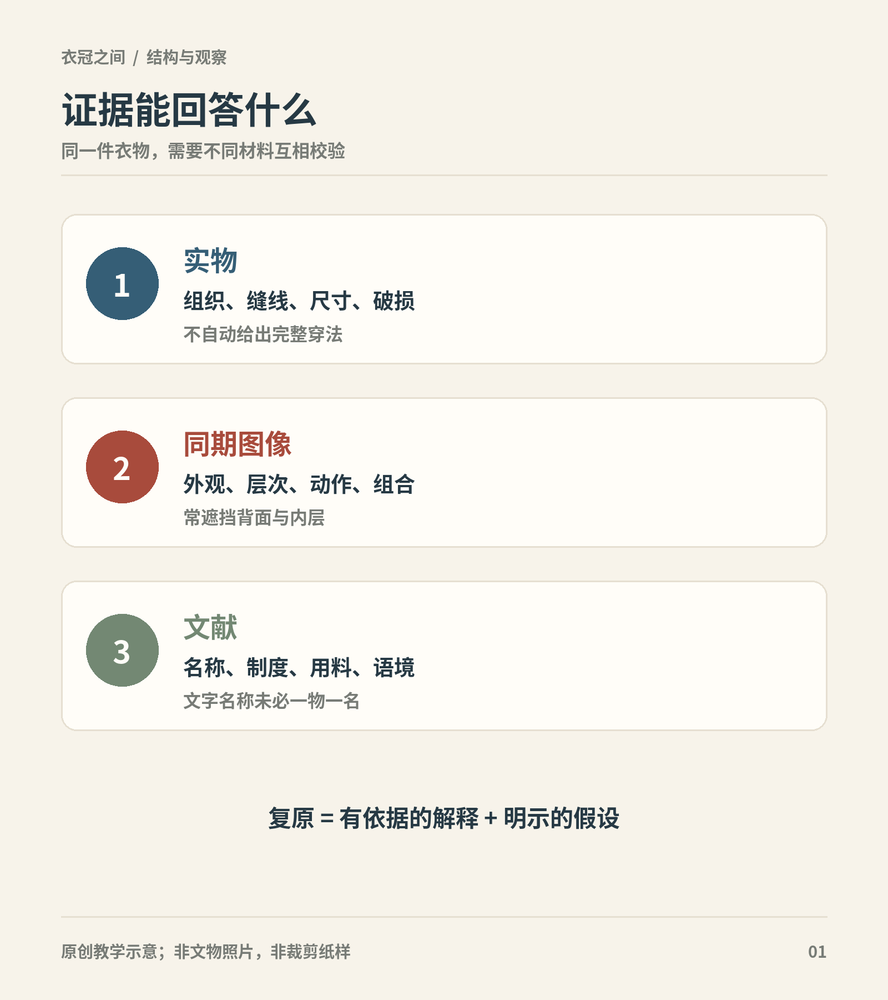

# 第1章　看衣冠，也看证据

同样是一件交领长衣，放在战国墓中、唐代壁画里和今天的汉服活动现场，会得到三种不同的解释。领口相似，不代表名称、裁剪、用途和穿着者身份完全相同。读汉服，第一步是学会描述眼前的衣物，第二步才是把描述放回时代。

本书以今天常用的“汉服”作为进入中国历史衣冠的入口，重点讨论与当代汉服实践关系密切的服饰传统，同时交代周边人群、政治制度和跨地域交流。古人并不一直用同一个总称管理数千年的衣着。遇到具体对象，我们优先写“西汉马王堆一号墓出土衣物”“北朝女服”“明代男子便服”，避免用一个现代大类抹去历史差异。

图｜实物、同期图像和文献分别支持不同判断；互证不等于消除全部未知。 不构成证据等级排序；具体材料可靠性仍需个案评估。 原创教学示意。

## 一件衣服，至少有四种身份

先分开四个问题：它是什么构造，什么时候出现，在什么场合使用，今天怎样被重新制作。这些问题可以同时成立。例如，“交领”描述领襟关系，“丝绵袍”涉及填充与材料，“贵族墓出土”说明考古语境，“现代复原”说明现在看到的对象性质。它们不能作为四个互斥衣类排列。

本书的历史主线也不是一幅从简陋走向华美的进步图。窄袖与宽袖、短衣与长袍、裙与裤会在同一时期并存；服装的改变可能来自骑行、气候、礼仪、供应、流行和政治要求。中国国家博物馆的古代服饰展将衣物与配饰、图像、工艺和穿着场景一同讨论，提供的正是这种综合观察方法。[资料：国博《中国古代服饰文化》](https://www.chnmuseum.cn/zl/ztcl/202102/t20210205_248954.shtml)

## 证据回答的问题各不相同

| 材料 | 比较擅长回答 | 需要保留的问题 |
| --- | --- | --- |
| 出土或传世衣物 | 裁片、缝线、面料、尺寸、修补痕迹 | 原穿法、衣物之间的关系、是否专为随葬制作 |
| 同时代陶俑、壁画、雕刻 | 穿着轮廓、组合、姿势、可见配饰 | 细节可能简化；衣内通常不可见，背面能否观察取决于媒介、保存和展示角度 |
| 服制与礼仪文献 | 某种身份在某种场合的规定 | 规定是否普遍执行、地方差异和实际变通 |
| 诗文、笔记、账册 | 用词、消费、时尚和日常细节 | 修辞、特殊事例和作者立场 |
| 后世摹本与复原 | 图像流传、研究解释、可能的穿着效果 | 与原作或原物之间隔着哪些选择 |

没有一种材料能够单独解决全部问题。保存完整的袍服可以显示缝线，却未必告诉我们腰带系在什么高度；俑上看得见腰带，却未必能判断内部有几层。把两种材料放在一起，仍须先确认它们的年代、地区和使用群体是否相近。

## 名字不一定就是古人的叫法

博物馆的文物名称常是研究与编目的结果。“颜色＋织物＋纹样＋器形”可以帮助识别，却不一定是历史上的商品名。故宫藏品页面也提示，展示名称可能根据研究进展或观众理解需要调整。因而，“某馆目前定名为……”通常比“古人一律叫……”更准确。[资料：故宫《陶彩绘持腰鼓女俑》及编目说明](https://www.dpm.org.cn/collection/sculpture/233415.html)

古籍中的同名也未必同物。一个词可能延续很久，指代的衣长、领式或用途却发生变化；不同词有时又指向相近对象。阅读时要保留词出现的语境。遇到“深衣”，应区分《礼记》讨论的规范、历代经学家的解释、出土长衣和现代商品名称，而不把它们自动叠成一张确定纸样。[原典：《礼记·深衣》](https://ctext.org/liji/shen-yi/zh)

## 古画不是现场照片

故宫所藏《洛神赋图》卷标明为宋摹本。它与较早的故事和绘画传统有关，但现存物的制作年代、摹写过程和图像题材都不能省略。画中飘带能说明一种人物表现方式，却不能独自证明魏晋普通人的日常衣橱。[资料：故宫《顾恺之洛神赋图卷（宋摹）》](https://www.dpm.org.cn/collection/paint/234597.html)

看任何图像，可以先给它写四行记录：作品年代；画中表现的年代；人物身份或题材；作者能够看到和可能想象的内容。四行不清楚时，衣着判断就应降低确定程度。图像很漂亮与材料很可靠，是两种需要分别评价的品质。

## 复原可以有不同程度的确定性

复原通常不是一次性“找回原样”。它可能包含整理残片、补足缺失尺寸、选择现代替代面料、推测系结点和调整人体模型。每个选择都影响成衣外观。比较两件复原品时，应先看依据是否相同，再讨论哪一件更好看。

本书采用三种表述：“实物可见”用于能够直接确认的构造；“据相关材料推测”用于有证据但尚不足以唯一确定的解释；“教学示意”用于为了理解而简化的图。示意图会省略装饰或夸大层次，不能拿来证明某一朝代的具体裁法。

这也解释了为什么某些背面保持空白。正面俑像没有呈现的后背系带、衣内结构或裙片接缝，不应靠想象补成“标准答案”。不知道不是阅读失败；明确不知道什么，恰好能把下一次检索变得具体。

## 从“像不像”走向“依据是什么”

以后读到一套标为“唐制”的衣服，可以依次记录：说明了哪一件材料；对应什么时期；哪些部分有依据；哪些是适应现代穿着的调整。判断不必从接受或否定整套服装开始。一件当代设计可以有可靠的历史参考，也可以同时加入新口袋、拉链或不同材料，只要说明真实。

本书希望读者最后能够独立完成一句克制而有内容的描述：“这套衣着参考某时期的某类材料，领襟和外层关系可比较，裙腰固定和背面细节仍有推测。”这样的句子，比一个未经解释的“正统”标签更能传递知识。

## 观察练习

选一件博物馆衣物、一尊同类人物俑和一件当代复原品，分别记下能直接看到的五个细节。把不能观察的细节另列，不急着补齐。最后比较：三件对象之间，哪一条关系由材料支持，哪一条只是观看时产生的联想？

## 本章资料

- 中国国家博物馆：《中国古代服饰文化》，展览说明，见正文链接。
- 故宫博物院：《陶彩绘持腰鼓女俑》《顾恺之洛神赋图卷（宋摹）》，藏品条目，见正文链接。
- 《礼记·深衣》，中国哲学书电子化计划整理本，见正文链接；原文及历代注释应分开阅读。
