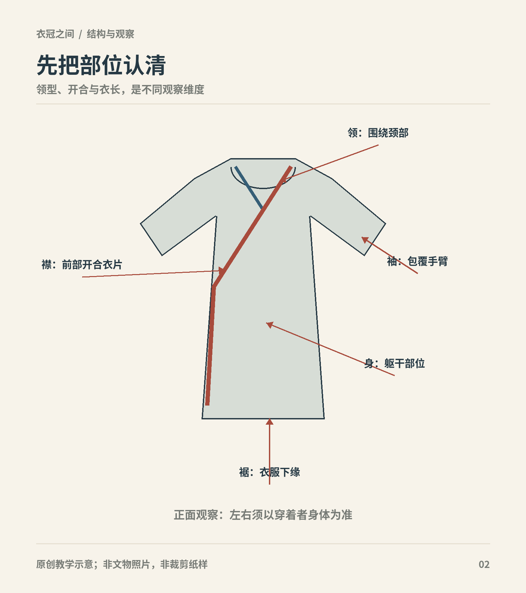

# 第2章　衣服怎样构成：领、襟、袖、身与裳

一套衣着最显眼的常是颜色和纹样，最能解释它怎样穿的却往往是开口、接缝与固定位置。认识衣物结构，可以从一个简单动作开始：想象把它从身体上取下来，平放在桌面上。哪些部分仍然连着，哪些部分依靠系带或围合才形成穿着轮廓？

本章建立一套观察用语。它适合比较历史材料，也适合阅读现代商品说明，但不能替代具体文物报告。古代名称常随时期变化，本章尽量用清楚的构造描述，把命名争议留在相应历史章节。

图｜示意衣物的领、襟、袖、衣身与下缘；交叠的方向从穿着者视角判断。 通用部位图，非某时代具体服装；线条不是裁剪纸样或真实缝线。 原创教学示意。

## 领与襟，相关而不同

领是颈部开口及其边缘构造；襟涉及衣身前部的开启、覆盖和搭接关系。交领最容易识别：两侧领缘在胸前斜向相交。对襟的前开口通常沿中线相向，不以一侧大幅覆盖另一侧为主要特征。圆领则先说明颈口形状，不能仅凭正面的圆圈认定衣身没有搭接。

右衽描述衣襟向穿着者右侧交掩的关系。观察时始终以穿衣者自己的左右为准：常见的交领右衽穿法是先将右前襟收在内，再把左前襟覆在外，外襟收向身体右侧。面对观众时，身体右侧恰在观众左边；镜像自拍还会再次颠倒。因此，照片中斜线的视觉方向只是一条线索，最好同时寻找外襟边缘和固定点。

“右衽”并不等于所有衣物必须采用同一种领形。唐代圆领袍是一例：它属于袍服系统，其颈口和开合方式需要一起理解，不能用一条交叉领缘概括。[资料：国博《陶男俑》](https://www.chnmuseum.cn/zp/zpml/kgfjp/202111/t20211116_252268.shtml)

| 观察词 | 问的是什么 | 不能直接推出什么 |
| --- | --- | --- |
| 交领、圆领、直领 | 颈口和领缘怎样形成 | 具体年代、身份及全部衣身裁法 |
| 对襟、交掩 | 前开口与覆盖关系 | 是否有衬里、是否为外衣 |
| 右衽 | 交掩趋向穿着者哪一侧 | 不能据此独断人物族属 |
| 系带、扣、带袢 | 开口如何固定 | 固定件是否原配、是否另有隐蔽系结 |

<!-- visual-study:model-tang-round-collar -->

**上身观察｜唐代圆领、束带与靴的整体轮廓。** 把领口形状与前片闭合分开描述。这里只看圆领、束带和衣长，不据正面猜背面。

**图像性质与边界：** AI 生成的复原展示，非史料。 原参照为旧黑白照片，不能确认原色；图中褐色不代表品级。 帽内构造、闭合方式、靴材质与背面未获该图证明。

**依据与支持特征：** [The Metropolitan Museum of Art, Male attendant, 7th century, 52.190.3](https://www.metmuseum.org/art/collection/search/54075)：已查看馆藏史料图：圆领、较窄袖、腰带、膝下袍身和足部的组合。该页确认年代与藏号。 [中国国家博物馆《陶男俑》](https://www.chnmuseum.cn/zp/zpml/kgfjp/202111/t20211116_252268.shtml)：馆方对唐代圆领窄袖袍、幞头与靴组合的解释。

<!-- /visual-study:model-tang-round-collar -->

## 袖宽，不等于袖长

袖长是从身体向手部延伸的长度；袖宽是袖管的展开宽度；袖口大小又是另一项。宽袖可以在末端收窄，窄袖也可能较长。只写“大袖”会漏掉手怎样伸出、面料怎样下垂这些影响穿着的重要信息。

通袖长通常指衣物展开后两袖端之间的总距离，不等于单只袖长，更不等于穿着者臂展。衣身宽、袖根位置、测量状态都会影响读数。衣长也应注明从何处量到何处。古衣尺寸与现代尺码表比较时，先统一测量方法，再比较数字。

中国丝绸博物馆藏北朝绞缬绢衣的袖管呈外展轮廓，馆方同时公布展开尺寸与组织信息。这个实例提醒我们，袖形、衣身长度和织物不是同一条分类轴；一件衣服完全可以同时被描述为短身、大袖、平纹绢和绞缬装饰。[资料：国丝《绞缬绢衣》](https://www.chinasilkmuseum.com/zggd/info_21.aspx?itemid=1815)

<!-- visual-study:model-ming-qian-sleeve-layers -->

**上身观察｜钱氏三件套近看：两层袖子怎样相接。** 这不是一件袖子变色的上衣：较短外袖下面还有长袖。先数衣层，再谈袖宽。

**图像性质与边界：** AI生成的现代成年模特复原展示，非史料。沿用整身图的同一虚拟试制设计，近景用于看短袖外层和长袖内层，不用于复制具体绮纹、刺绣针法、缝线或染色。色差为增强层次阅读的展示选择。

**依据与支持特征：** [中国丝绸博物馆《绢短袖衫&绮长袖衫&绢裙》](https://www.chinasilkmuseum.com/zggd/info_21.aspx?itemid=1870)：钱姓女子三件套，直领对襟、短袖外层和长袖内层、外衫系带、裙褶与较宽中央褶。

<!-- /visual-study:model-ming-qian-sleeve-layers -->

## 衣身与下部：分开穿，还是相连接

上衣下裙的组合把上身和下身分别覆盖。裙可以压住上衣下摆，也可以被长上衣部分遮住，两种穿法给人的比例很不同。袍服则以较长的衣身覆盖上下，但外观看似一体，不代表裁片必然从肩到摆一整块连裁。腰部有无横向接缝，应看实物或结构记录，不能只凭“袍”字判断。

“裳”在古代语境中涉及下体衣着，本书读先秦礼制时保留原词，不把它无条件等同于今天全部女裙；讨论具体裙实物时则直接使用裙。衣物名称与现代性别分类并不总是一一对应。

《礼记·深衣》把衣长、边缘和身体动作放在一起讨论，这说明结构在礼仪叙述中也有意义。但文本提供的规范，仍须经过解释才能转成裁剪方案。[原典：《礼记·深衣》](https://ctext.org/liji/shen-yi/zh)

## 接缝、衩与褶，各做什么

接缝把裁片连成衣服；衩保留部分不缝合的边缘，以改变活动量、露出内层或形成特定轮廓；褶裥则把较大的布量暂时收在较小的空间里。三者可能同时出现，不能把侧面的一条垂直线全叫开衩，也不能把所有阴影都叫裙褶。

判断一处线条，可以问：它是否从一个固定点连续延伸？两侧面料能否分离？走动时是展开，还是始终相连？平放实物、穿着照片和步行动图分别能回答其中一部分。只看一张正面静态图，最难确认的往往恰是侧面。

裙腰同样不只是装饰。它负责把裙身布量连接并固定在身体上，具体可借系带、纽扣或其他方式围合。裙片数、褶向与腰部固定共同决定穿着时的重叠。看见前方一块平整面，不能立即认定它就是某一种裙的完整结构。

## 单、夹、绵：看不见的层数

单层而无里的衣物可称襌衣；夹衣涉及面与里；绵衣还涉及填充。这里的“绵”在丝织衣物语境中常与丝绵有关，不能一见“绵袍”就想成现代棉花填充。湖北省博物馆公布的马山战国锦面绵袍说明，面料、里衬和缘饰使用不同织物；外表的一种花纹并不能概括整件衣物的材料。[资料：湖北省博物馆《马山战国楚墓锦袍完成加固保护并对外展出》](https://www.hbww.org.cn/xwdt/p/11338.html)

贴身、居中和最外层，也属于穿着位置，并非每个衣名固定对应某一层。薄而透明不一定只能贴身；装饰明显也不保证一定是最外层。确定层次需要服装组合、图像和文献支持。

## 把观察写成一句话

可以按“长度与组合—领襟—袖—开合—侧面—材料”的顺序描述。例如：“一件膝下长衣，前部交掩，袖口收窄，以带固定，侧面结构尚未确认，面料据馆方记录为绢。”这个句子不急着给朝代结论，却保留了可供比较的信息。

用词最重要的作用，是让另一个人知道你看到了什么。遇到未知结构，写“未见背面”“无法确认衬里”比填入一个熟悉衣名更有价值。以后每章的年代差异，都要建立在这些可以重复观察的细节上。

## 观察练习

找一件现代交领衣，平放后标出领、内外襟、袖根、袖口和系带。穿上后再拍正面、侧面与背面，比较平放时的直线怎样变成身体上的曲线。练习对象可以是当代衣服，不必把实验结果倒推为古代定制。

## 本章资料

- 中国国家博物馆：《陶男俑》；中国丝绸博物馆：《绞缬绢衣》，见正文链接。
- 《礼记·深衣》，原典，见正文链接。
- 湖北省博物馆：马山战国锦面绵袍保护展示说明，见正文链接。
