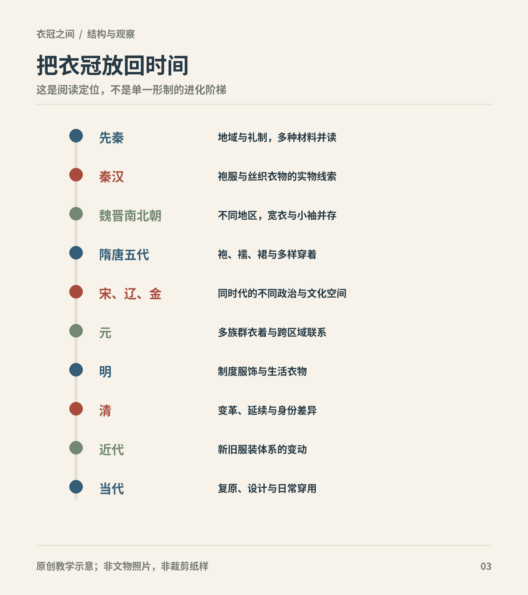

# 第3章　先秦：衣裳、礼制与楚地衣物

从先秦开始，容易产生一种期待：先找到一套最早、最完整的“汉服”，以后所有款式便有了共同起点。然而，先秦包含很长的时间和广阔的区域，实物保存又极不平均。最适合入门的方法，是把礼仪文本与具体出土衣物并置，看看它们各自回答什么，而不追求一套覆盖所有人的祖型。

图｜各时期衣冠变化由制度、材料、交流及生活共同塑造；同一时段也存在差异。 按阅读顺序概括，非按时长比例绘制；未穷尽全部政权和地区。 原创教学示意。

## 更早的商周：冠饰与人物形象

在完整衣物罕见的阶段，玉雕和其他人物形象能够保留冠、发、带与姿态的线索。国博藏商代玉人的介绍，将细部发式、冠饰和服饰作为研究材料；这类小型形象使我们知道，头部处理和身体姿态早已参与人物身份的表现。[资料：国博《玉人》](https://www.chnmuseum.cn/zp/zpml/kgfjp/202104/t20210416_249761.shtml)

然而，玉器是经过选择和概括的形象，不是缩小的裁剪图。雕刻线可能表现衣缘，也可能表现纹饰，必须结合器物说明与同类材料判断。阅读商周衣冠，不宜把礼书中后经整理的整套规范直接投射到每件更早玉人身上。冠帽的存在、轮廓和位置，与具体冠名、材料和系法，是确定程度不同的几件事。

## 衣与裳，是组合也是秩序

在礼仪叙述中，上身的衣、下身的裳、冠、带和足衣共同形成衣冠。它们的意义不仅在保暖或遮蔽，也关系到何人何时以何种身份出现。《礼记·玉藻》按人物身份和活动讨论衣着，说明穿衣是一整套随场合变化的行为，而不是只有一件外袍。[原典：《礼记·玉藻》](https://ctext.org/liji/yu-zao/zh)

读这些材料，要先分开规定与现实。文本告诉我们某种秩序被怎样表达，不意味着每个地区、每个家庭每天都照章执行。礼制叙述对上层男性与正式活动的关注尤其明显；没有详细记下的劳动者、儿童和地方日常生活，不能据此判为没有差异。

“衣裳”也不是现代女装的专用说法。下体衣物如何围合，是否另穿裤或其他内层，需要具体材料。若只因古文写了“裳”，便画成今天常见的现代长裙，就把文字中尚未解决的问题提前填满了。

## 深衣：规范怎样进入身体

《礼记·深衣》讨论衣长、衣缘、袖与身体动作的关系，并将结构赋予礼仪意义。这里的“深衣”首先是一个需要通过文本、注释和实物共同研究的概念，而不是拿到名字便能立即裁剪的单一版型。[原典：《礼记·深衣》](https://ctext.org/liji/shen-yi/zh)

把上部与下部相连接，是理解深衣讨论的重要线索；然而，古籍中的衽、裾和接缝位置经历了不同解释。历代注家身处不同年代，能够见到的衣物也不同。今天复原深衣时，若分别依据经注或考古衣物，得出不完全相同的方案，并不奇怪。

因此，博物馆里一件战国长衣，可以先按实物描述它的领襟、腰缝、裁片和缘饰，再讨论它与礼书规范的对应程度。把它直接叫作“礼记标准深衣”，会略过最需要解释的一步。

## 马山楚墓：从一件衣看见多种织物

湖北江陵马山一号楚墓的衣物为观察战国楚地上层衣着提供了重要材料。湖北省博物馆公布的小菱形纹锦面绵袍，衣面、里衬、领缘与其他缘饰并不全用同一种织物。这说明一件衣物可以是多种织造技术的组合，领缘和袖缘也不是随意画上的装饰线。[资料：湖北省博物馆《馆藏马山战国楚墓锦袍完成加固保护并对外展出》](https://www.hbww.org.cn/xwdt/p/11338.html)

这里的“绵”应放在古代丝织服装语境中理解，不宜自动替换成现代棉花填充。研究衣物时，面、里、填充与缘饰需要分别记录。看似相近的两件袍服，可能因里层或填充不同而承担不同的季节用途，也可能处于不同的穿着次序。

缘饰的技术意义同样值得注意。衣服最常受拉扯的开口和边缘，需要适当加固；与正身不同的缘料还能形成视觉分区。但一件文物的处理方式不是一条全国统一裁法。它首先证明这个具体对象怎样制作，然后才可能与更多材料共同支持更广泛的解释。

## 墓中有整套衣物，仍不能照搬成日常衣橱

考古衣物的摆放位置、叠压关系和随葬记录很重要，因为它们能帮助判断衣物之间的关系。不过，葬礼也可能重新组织衣着。死者身上穿着、棺内覆盖和箱中存放的衣物，承担的功能不必相同。

研究者对马山与其他楚墓的穿衣次序，仍需结合发掘记录与礼仪文本讨论。北京服装学院公布的相关研究介绍，正是把衣物放在丧葬语境中考察；这也提醒我们，不应把墓中出现的全部层数当作生前每日固定穿法。[研究线索：北京服装学院《艺术设计研究》2025年第2期相关论文介绍](https://kjc.bift.edu.cn/xzqk/yzsjyj/yssjyj2025n02qzd118q/17614f7573754619aab44e115c82e53a.htm)

日常与礼仪的差异，还影响我们想象身体的方式。一次正式仪式中的衣长、下摆和层叠，不必适合赶路或劳作。看到长裾与宽袖，可以分析它们怎样形成轮廓，却不能直接推出“先秦所有人都不便活动”。

## 地域不是背景标签

楚地丝织衣物保存丰富，为细读结构提供了条件，但保存优势不等于楚地衣物就是全部先秦服饰的平均面貌。北方与南方、王朝中心与地方、不同身份之间，都应通过各自材料讨论。没有完整衣物留下来的地区，也并不因此没有复杂服饰。

在比较中，地名至少有两层含义：出土地点，以及推测的制作或使用范围。衣料可以流通，技术可以传播，墓主也可能迁移。因此，“出土于楚地”并不自动回答所有织物在哪里制造。读文物说明时，把出土、收藏、制作与使用四个地点分开，会少很多误判。

## 今天可以学到什么

先秦篇最有用的收获，是建立“组合”的眼光。冠带与衣裳形成礼仪整体，正身与缘饰形成材料整体，衣物与葬仪形成考古整体。漂亮的成衣图像只能呈现其中一层，细读缝线和记录，才会发现其余层次。

若购买或观看一件标为“战国袍”的现代衣服，可以询问它参考的是马山哪件出土物，使用了怎样的裁片资料，面里材料作了哪些替换。没有明确参考的设计也可以欣赏，但适合称为受战国衣物启发的当代创作，而不是无条件的原样复原。

## 观察练习

在马山锦袍资料中，分别寻找正身、领缘、袖缘、里衬。画四个小方框记录它们的材料，不必画整套人物。再写一句证据限度：“这件文物能够说明……，尚不能说明……。”

## 本章资料

- 《礼记·玉藻》《礼记·深衣》，原典，见正文链接。
- 湖北省博物馆：马山战国锦面绵袍保护展示说明，见正文链接。
- 北京服装学院：《艺术设计研究》2025年第2期相关研究介绍，见正文链接。结构和葬俗研究的最终依据应进一步核对发掘报告与论文全文。
