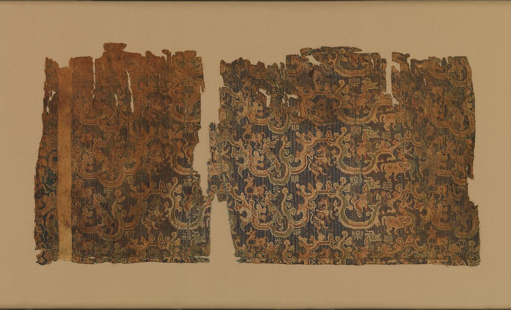

# 第4章　秦汉：袍服、曲裾与丝织衣物

秦汉常被画成一个整齐的衣冠世界：交领长袍、宽袖、腰带，人人轮廓相近。实际材料更丰富。秦陵俑群中有襦与裤的组合，西汉墓中有轻薄单衣和较厚袍服，人物俑又显示不同的着装姿态。先把它们分开看，才能理解“汉代衣服”不是只有一件曲裾长裙。

图｜动物纹铭文锦（Textile with animals and woven inscription），1—3世纪；馆藏时期字段列东汉。可观察残片上的动物、云气与织入铭文；属于经面复合平纹丝织物。 残片不等于完整衣服，不能据此推断具体袍式；年代按馆方日期保留1—3世纪。 资料与图片：[The Metropolitan Museum of Art（大都会艺术博物馆），2003.385a–e](https://www.metmuseum.org/art/collection/search/65598)。图片权利：Public Domain；Met Open Access（CC0）。

## 从秦陵文官俑看一套衣着

秦始皇帝陵K0006陪葬坑的陶俑，提供了长冠、交领长襦、带、裤和履相配的具体形象。馆方说明还指出，衣物有单层和双层的表现，长度至膝附近。这是一套具有明确出土环境的衣着资料，不宜简单当作全部秦人的通用装束。[资料：秦始皇帝陵博物院《文官俑坑》](https://www.bmy.com.cn/pitofficial.html)

观察这些俑时，可以沿头、颈、腰、膝和足的顺序往下看。上衣到膝，不表示膝以下裸露；裤与足衣共同完成覆盖。腰带既影响衣身布量的收束，也属于身份表现的一部分。即使陶俑没有把所有缝线塑出来，衣长和上下组合依然能清楚辨认。

彩绘的保存也影响印象。今天看到的土色，不一定是原来衣服的颜色；缺失的颜料也不能凭喜好重新填满。复原色彩需要残留分析或相关材料支持，不能把整齐的单色俑阵倒推为秦人只穿同一种颜色。

## 马王堆：不是传说中的一件“轻纱”

长沙马王堆一号汉墓出土的两件素纱襌衣，分别为直裾式与曲裾式。中国社会科学院科技考古研究者的介绍指出，两件均为交领右衽，但衣襟与缘饰存在差别；无衬里的单层结构，是理解“襌衣”的关键。直裾与曲裾两件通常分别以49克和48克为人熟知，不能把两者的照片、尺寸和经历混在一起。[研究者供稿：于思萌、刘大玮《西汉素纱襌衣》](https://cssn.cn/skgz/bwyc/202609/t20260922_6068425.shtml)

轻薄并不自动说明穿在身体哪一层。现有解释包括日常薄衣或礼仪外罩等可能，穿用场景仍需讨论。把透明衣物直接说成“古代内衣”，或直接说成“罩在锦袍外的唯一正确穿法”，都超出了证据的确定程度。

这件衣物也不适合用来讲“现代技术完全做不出来”的传奇。技术比较必须说明比较的是面料重量、完整成衣、原料选择，还是整个生产系统。中国农业博物馆对素纱襌衣及现代仿制的介绍，可作为进一步追问工艺条件的入口，而不能只抽取一个重量数字判断古今技术高下。[资料：中国农业博物馆《素纱襌衣》](https://www.agriculturalmuseum.com/detail/zh/36289.html)

## 曲裾和直裾，先看衣襟走向

在马王堆这组材料中，曲裾式外襟延长并绕身，直裾式的前襟与下部处理有所不同。读曲裾时，应追踪延伸的襟缘怎样经过身侧与身后；不能只看衣服正面摆线。两者的差异不能简化成“裙摆弯还是直”，因为穿着后的曲线还受布料、系带与身体姿态影响。看到一条绕身斜线，需要辨别它是衣襟边缘、装饰带还是后世画家强调的衣纹。

“深衣”与这批出土长衣的对应，是学术解释问题。通俗说明常将它们放入深衣体系，但读者应知道：古籍规范、出土物结构和现代形制名称仍属于不同层次。我们可以讨论它们的联系，同时保留具体衣物之间的差别。

曲裾也不是只属于女性的视觉符号。讨论历史穿着者时，应根据俑像身份、墓葬信息与文献，避免先把一件长衣看成现代连衣裙，再倒推出古代性别。古今衣物分类的边界并不相同。

## 宽袖不只有正面效果

中国国家博物馆藏彩绘背婴女陶俑，被馆方描述为身穿宽袖、锦缘曲裾衣物。与静立人物相比，背婴动作让人注意到衣物围合、手臂和日常动作的关系。[资料：国博《彩绘背婴女陶俑》](https://www.chnmuseum.cn/zp/zpml/201812/t20181218_26611.shtml)

观看时不要只记住“大袖”两个字。手露出多少，袖口落在哪里，腰部怎样束起，背部有没有被婴儿和背负动作遮住，都影响我们能确认的信息。雕塑能表现动作，却未必能交代内层固定。不能因为姿态看起来稳定，便补画出一条未经证实的隐藏带子。

同理，长衣的活动性要整体判断。衣摆宽度、围合量、裤装内层、束带位置和动作幅度共同起作用。拿一件尺寸不合的现代曲裾试穿后觉得难走，最多说明那件成衣与穿着者不匹配，不能单凭体验解释汉代所有长衣的兴衰。

## 缘边与正身，为什么要分开看

直裾素纱襌衣的轻薄正身与较结实的缘饰形成材料上的分工。边缘要承受穿脱、牵拉和系结附近的作用，不能只追求视觉上的轻。这个例子让我们理解：古代精细服装既有审美选择，也有围绕织物性能的具体处理。比较现代复制时，应同时看正身与边缘，不能只比整衣重量。[研究依据：于思萌、刘大玮《西汉素纱襌衣》](https://cssn.cn/skgz/bwyc/202609/t20260922_6068425.shtml)

## 袍、单衣与上下分穿并存

秦汉衣着不是从上衣下裳整齐升级为一体袍服。不同组合可以服务不同场合，也可以层叠在同一身体上。墓中保留下来的丝织精品，显示较高水平的制作，却不代表一般人的材料负担。讨论日常衣着，需要把身份与获取资源的条件纳入，而不只比较外形。

材料也会改变同一种轮廓。轻薄纱料易透、贴伏或飘动；有里和填充的袍服形成更稳定的厚度。画一套衣着时若只改花纹，不改变厚薄与垂坠，就很难让读者理解不同季节和衣层的差别。

本章最值得记住的，是三个彼此独立的观察点：秦俑让我们看见上下衣着组合，马王堆让我们接近真实织物与构造，动作俑让我们注意穿着中的身体。三者相互补充，不能被一张想象中的“汉代标准服装”取代。

## 观察练习

比较一张秦陵文官俑照片与一件马王堆单衣的展开图。分别标出衣长、领襟、腰部固定和下身覆盖。再列出：哪一项在俑上更容易看，哪一项只能由实物测量确认？

## 本章资料

- 秦始皇帝陵博物院：《文官俑坑》，见正文链接。
- 于思萌、刘大玮：《西汉素纱襌衣》，中国社会科学网，2026年9月22日，见正文链接。
- 中国农业博物馆：《素纱襌衣》；中国国家博物馆：《彩绘背婴女陶俑》，见正文链接。
