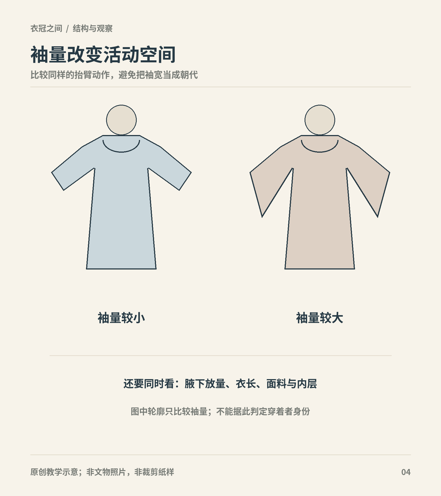
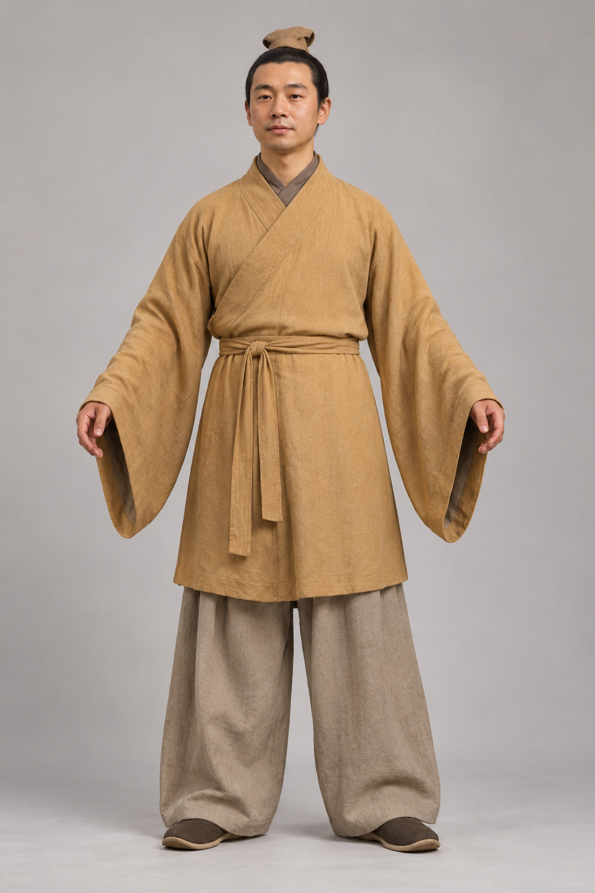

# 第5章　魏晋南北朝：宽衣、小袖与跨地域交流

“魏晋风”在当代服装语境中常让人想到宽袖、长带和飘逸人物。历史上的魏晋南北朝，却同时存在短衣、裤、窄袖和严整的礼仪冠服。这个时期最值得观察的，不是选一种轮廓代表几百年，而是不同衣着怎样共处、流动和改变。

图｜以通用衣物轮廓比较袖量；大袖增加布料垂落范围，但活动感受还受腋下和衣身结构影响。 不是魏晋服装复原图，不能据此确定时期或制作尺寸。 原创教学示意。

## 先把时间与地区展开

三国、西晋、东晋和南北诸政权构成不同的政治与生活环境。南方士人的画像、北方贵族墓中的侍从俑、西北出土的丝织衣物，记录的不是同一个城市、同一阶层和同一活动。把它们放进一张拼图，需要保留各自的地点与年代。

服饰交流也不能简单写成南方只有宽衣、北方只有窄袖。迁徙、仕宦、战争和交往使人物与物品不断流动；一套便于骑行的衣着可以被改造为官员日常服，一套正式冠服又可以被政治改革重新强调。国博《上衣下袴》的研究说明，袴褶装在传播中出现衣袖、裤管与领襟的调整，不能被视为完全固定的外来样式。[研究：国博《上衣下袴》](https://www.chnmuseum.cn/yj/xscg/xslw/201812/t20181224_33119.shtml)

## 袴褶：先看上下组合

袴褶中的袴指裤，褶涉及上身短衣。这个组合让裤装在整体轮廓中更加明显，与长衣覆盖下身形成不同效果。其具体袖宽、衣长和裤管宽度会随材料改变，不宜画成一套永远紧身的“骑兵服”。

北魏元邵墓的侍从陶俑，是很好的观察对象。国博说明将其放在孝文帝服制改革之后的背景下，指出这类衣着既保留上衣下裤的组合，又出现宽袖、大裤管和右向交掩等变化。因而，名称的延续与外观的变化可以同时发生。[资料：国博《侍从陶俑》](https://www.chnmuseum.cn/zp/zpml/kgfjp/202111/t20211111_252106.shtml)

看这类形象时，先找衣摆结束的位置，再看裤管是否从衣摆下连续露出。宽大的裤管有时会被误认成裙，两腿并拢、雕刻简化或照片阴影都会加重这种错觉。判断必须依靠两腿分界、步行动作或更多角度，不能只看外轮廓是否宽。

<!-- visual-study:model-northern-kuzhe -->

**上身观察｜北魏袴褶：让两条裤腿进入视野。** 两条独立裤腿是本图重点；不要把宽裤的中缝误看作裙褶。

**图像性质与边界：** AI 生成的成年模特展示，非史料、非真人实拍，非馆方认证复原。从陶俑与说明转译宽袖上衣、大口裤的关系，不是陶俑隐藏结构的精确还原。颜色、布料、腰带具体结法、小冠材料与鞋为展示性补足。

**依据与支持特征：** [中国国家博物馆《上衣下袴》](https://www.chnmuseum.cn/yj/xscg/xslw/201812/t20181224_33119.shtml)：元邵墓侍从俑的束发小冠、宽袖上衣与宽大裤管组合，及右衽变化。 [中国国家博物馆《侍从陶俑》](https://www.chnmuseum.cn/zp/zpml/kgfjp/202111/t20211111_252106.shtml)：墓主卒于528年；馆方描述上衣下裤、上衣左向右掩。

<!-- /visual-study:model-northern-kuzhe -->

## 宽衣如何表达身份与姿态

宽衣博带确实是理解这一时期部分上层人物形象的重要线索，但衣宽本身并不能解释全部社会。宽松衣物在画像中可突出人物的姿态、节奏和身份；画家如何处理衣纹，也会强化这种印象。衣着与“风度”的关系，需要同时讨论穿着和表现方式。

故宫所藏《洛神赋图》卷为宋摹本，画中人物属于叙事与神话情境。观看它，可以研究流传的早期人物画传统，却不能把洛神的长带和仙姿当作魏晋女性走街串巷的统一装束。[资料：故宫《顾恺之洛神赋图卷（宋摹）》](https://www.dpm.org.cn/collection/paint/234597.html)

尤其要把飘带、衣缘和垂饰分开。有些线条属于衣物构造，有些增强人物运动感；图像没有给出的缝合点与重量，也无法仅凭线条确定。当代商品所说的“魏晋风”，可以是一种审美标签，但不等同于一套已被考古完整确认的历史服制。

## 北朝绞缬绢衣：回到真正的布

中国丝绸博物馆藏北朝绞缬绢衣，让抽象的轮廓变成可以细读的衣物。馆方修复报告记录了短身、宽袖、单层无里、局部拼缝与系带等信息。它的花纹来自染整工艺，不能因为点状图案看起来规整，就判断为织出来的提花。[一手修复记录：楼淑琦、王淑娟《北朝绞缬绢衣的保护修复》](https://www.chinasilkmuseum.com/gskt/info_319.aspx?itemid=27772)

这件衣物还有一个值得学习的细节：馆藏简目把领襟概括为交领，而详细修复记录将它描述为基本对襟、下摆处略相交。两种文字并不适合被硬凑成一个绝无疑义的标签；比较实物展开图与修复说明，才能准确理解其开口关系。[对读：国丝《绞缬绢衣》藏品简目](https://www.chinasilkmuseum.com/zggd/info_21.aspx?itemid=1815)

修复后的外观也包含保护材料。背衬、补缝与残缺加固是为了保存文物，并不都属于原来的制作。观察时分辨原物、修补和复原线图，才不会把一层现代保护织物误记成古代里衬。

<!-- visual-study:model-northern-jiaoxie -->

**上身观察｜北朝绞缬绢衣：短身与宽袖。** 全身用来看短衣与宽袖的比例，近景用来看基本对襟、微交下摆和两组系带。内搭与下裙并非已知出土套装。

**图像性质与边界：** AI 生成的成年模特展示，非史料、非真人实拍，非馆方认证复原。白色点圈为近似外观，不是微观织物或染缬工艺复刻；腋下拼缝与褶不能由此照片精确确认。灰裙、白内搭、发式为现代展示补足，不代表已有整套出土搭配。

**依据与支持特征：** [楼淑琦、王淑娟《中国丝绸博物馆：北朝绞缬绢衣的保护修复》](https://www.chinasilkmuseum.com/gskt/info_319.aspx?itemid=27772)：短身、基本对襟且下摆微交、喇叭宽袖、单层、红褐两组系带、斜向白色小圈绞缬点阵。

<!-- /visual-study:model-northern-jiaoxie -->

## 襦与裙：短衣也有不同的身体比例

短身衣物并不意味着一定紧贴身体。上衣较短而袖管展开，视觉重心可能落在肩臂；同一件上衣若被裙腰遮住部分下摆，又会形成不同的上下比例。因此，讨论女服不能只分“大袖长衣”和“窄袖短衣”两类。绞缬绢衣的展开形状与穿着想象之间，还隔着身体宽度、下身衣物和系结位置。没有整套组合的直接证据时，可以分别展示衣物结构与可能效果，并明确两者性质。

## 改革与日常可以走不同速度

国家服制改革关心冠帽、官服和正式场合，也可能改变公共空间中的身份表达。但衣物生产、家庭习惯与身体活动不会在同一天完全改换。某一政令强调某种衣冠，与墓中仍有不同组合，并不必然矛盾。

理解这一点，有助于避免用一条线描写所谓“胡汉服饰融合”。交流不是把两种纯粹样式各取一半，也不是每件衣物都具有清楚可分的血统。可观察的是领襟怎样变化，衣袖如何调整，裤装何时进入某类身份场景，以及哪些冠服仍被保留。

## 这一时期怎样衔接隋唐

袴褶、圆领与翻领衣物、不同冠帽及织物装饰，为后续衣着提供了多种资源。隋唐的面貌并非突然出现，而是在政治整合、交通与工艺条件下继续选择和发展。今天看一套“魏晋”或“北朝”复原衣着时，与其先比它是否足够飘逸，不如先检查它把哪几类材料组合在一起。

这样观察，衣冠史便从抽象的时代气质，变成可以逐项比较的结构变化。宽袖和窄袖不再互相排斥，而是告诉我们不同场合的人怎样使用衣物。

## 观察练习

并列看元邵墓侍从俑、北朝绞缬绢衣和宋摹《洛神赋图》。分别记录“下身是裙还是裤”“手如何伸出袖口”“哪些细节受媒介影响”。第三项无法确认时，直接记下理由。

## 本章资料

- 中国国家博物馆：《上衣下袴》《侍从陶俑》，见正文链接。
- 故宫博物院：《顾恺之洛神赋图卷（宋摹）》，见正文链接。
- 中国丝绸博物馆：《绞缬绢衣》及楼淑琦、王淑娟执笔的保护修复记录，见正文链接。
