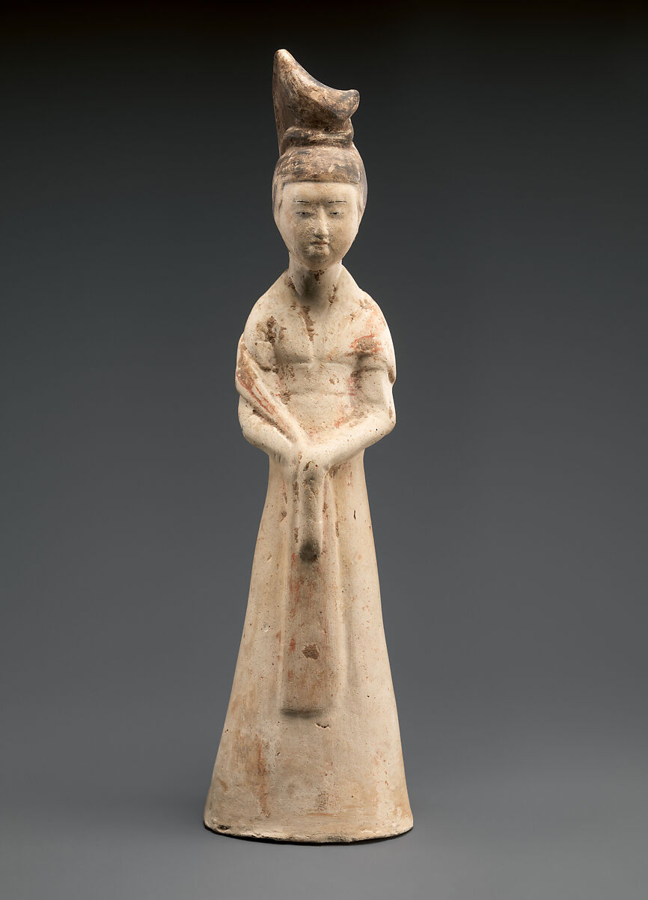
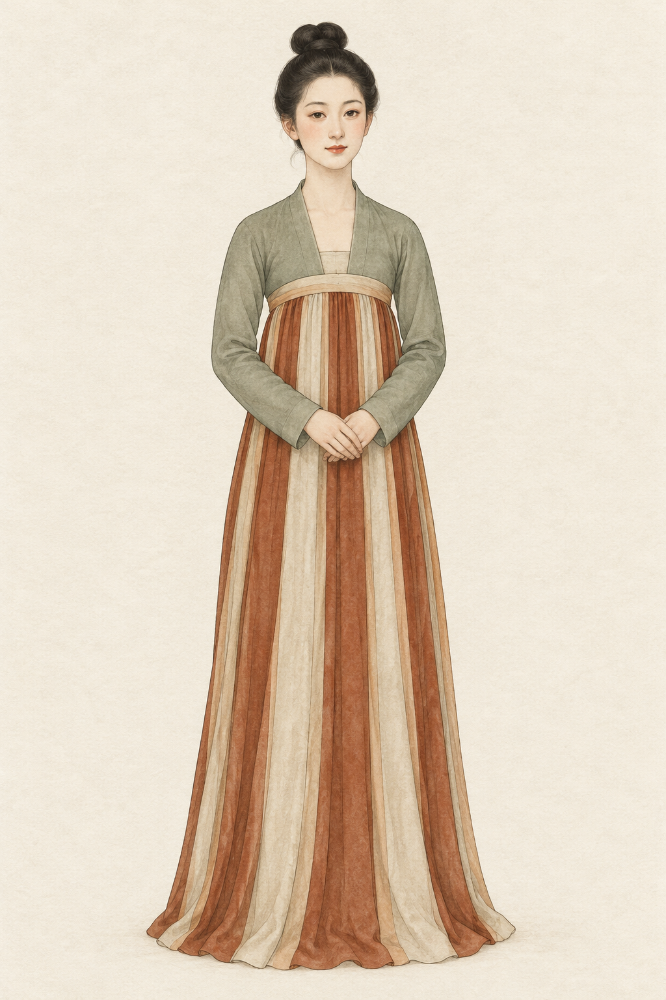

# 第6章　隋唐五代女服：襦、裙、半臂与帔帛

隋唐女服的图像很多，也最容易被浓缩成一幅印象：高束长裙、披帛、华丽发髻。把几百年的材料仔细分开，会看到衣衫长短、袖形、裙身轮廓和外层组合都在变化。同样高束的裙，搭配不同上衣，已经是不同的着装关系。

图｜唐彩绘陶侍女俑（Female attendant），7世纪中叶。可观察高髻、领口、手部遮挡与纵向垂褶形成的整体廓形。 陶俑是衣着图像证据，不能直接证明衣物内部裁片和隐藏系结；正面图。 资料与图片：[The Metropolitan Museum of Art（大都会艺术博物馆），2015.500.7.3](https://www.metmuseum.org/art/collection/search/54077)。图片权利：Public Domain；Met Open Access（CC0）。

图｜窄袖短衣与高束条纹裙的组合，AI教学插画；参考本章故宫陶俑条目中的可见服装描述。颜色、面料质感与人物造型是示意性选择，不作为原件复原或裁片证据。

## 先认组合，不先背套装名

襦或衫与裙相配，是理解隋唐女服的重要入口；部分形象还加穿半臂，肩臂间另有帔帛等织物。它们分别承担上身覆盖、下身围合、外层叠穿与装饰作用。现代“襦裙”可以方便地概括组合，却不能替代每件衣物的具体结构。

故宫藏一件唐代陶彩绘女俑，穿窄袖对襟短衣和竖条纹长裙，裙腰较高。这尊俑让我们看见短衣、裙腰与条纹怎样形成整体比例；它没有告诉我们所有唐裙都采用同样的裁片和系带。[资料：故宫《陶彩绘女俑》，藏品网页233402](https://www.dpm.org.cn/collection/sculpture/233402.html)

因此，“齐胸”在看图时首先是对裙腰位置的描述。它不自动回答裙片是连成一周还是分片围合，也不回答背后如何固定。把可见比例与隐藏裁剪分开，才能避免从一个正面形象推出整套纸样。

## 初唐、盛唐与晚唐不能合成一张脸

初唐的一些女俑表现短窄上衣、瘦长裙身与修长体态，后来的部分人物形象则呈现更宽松、丰润的比例。国博彩绘双环髻女陶俑的介绍，明确提示早期与盛唐形象的区别。[资料：国博《彩绘双环髻女陶俑》](https://www.chnmuseum.cn/zp/zpml/csp/202209/t20220901_257159.shtml)

但这不意味着全国女性在同一年一起改变身体和穿法。墓主身份、地区、人物角色和制作风格都会影响俑像。“唐代以胖为美”不足以解释整个唐代，更不能让我们忽略纤细人物和劳动、侍奉、表演等不同姿态。

比较时最好控制一部分条件：先选年代相近、同类身份的两件材料，再逐渐扩大范围。若把初唐侍女俑和晚唐贵族画像并排，能够观察差异，却不宜把全部差异只归因于时间。

## 半臂怎样形成层次

故宫陶彩绘持腰鼓女俑，被描述为内穿窄袖襦衫、外罩半臂、下着长裙。它让层次关系变得具体：袖长的差异使内外两层在手臂上同时可见。[资料：故宫《陶彩绘持腰鼓女俑》](https://www.dpm.org.cn/collection/sculpture/233415.html)

半臂不宜简单翻译成现代马甲。它与袖部的关系、衣长、领口和闭合方式，都需要看具体对象。故宫[“半臂”词条](https://www.dpm.org.cn/lemmas/239744.html)也介绍了学界对其名称与适用范围的不同认识。观察时先写“短袖外层衣”，再说明资料采用的定名，通常更容易沟通。

半臂也不是每套唐装的必备层。人物动作会让短袖外层显得利落，但舞乐场景有自己的需求。不能仅因乐俑穿着方便，就认定同样组合覆盖了宫廷礼仪、劳作与旅行。

## 帔帛是怎样的一条织物

帔帛（现代也常写披帛）沿肩、臂或身体周围形成柔长线条，给上衣与裙之外增加另一层视觉节奏。读图时应找到织物的连续路径，而不是把所有长带都归为帔帛：裙腰系带、衣带与长巾，在功能上并不相同。

国博彩绘风帽女陶俑，将风帽、对襟小袖衣、高腰长裙与帔帛组合在一起，显示女服还需要考虑遮护头部和不同活动的情境。[资料：国博《彩绘风帽女陶俑》](https://www.chnmuseum.cn/zp/zpml/csp/202011/t20201109_248040.shtml)

实际穿用中，织物的宽度、重量与摩擦决定它是否贴伏或滑动。博物馆图像可以显示外观，却未必显示隐蔽固定件。现代演出为了稳定而加扣、加针，是现代使用条件下的选择，不能反过来当作古代结构证据。

## 领口与身体，不能只用“开放”解释

图像中领口较低、颈胸部露出较多，是可以记录的外观；由此外推女性社会地位或社会整体自由程度，则需要更多证据。不同场合的身体展示、宫廷与民间的资源差异、人物身份与雕塑惯例，并不会由一条领缘全部揭示。更有解释力的问题是：短衣怎样被裙腰覆盖，外层怎样改变可见领口，姿态又遮住了哪些部分？先把衣着关系说明白，才有条件继续讨论社会意义。

## 条纹、印花与裙的布量

条纹裙可以帮助我们阅读纵向分区和身体比例，但条纹不一定都由不同颜色的长条拼缝而成。织造、染印与拼接都可能形成视觉分区，确认工艺仍需实物。

香港古物古迹办事处介绍的橙色印花小绢裙，出土于吐鲁番阿斯塔那230号墓，现藏新疆维吾尔自治区博物馆，长度只有二十余厘米。这样的尺寸首先提醒我们确认对象规模，不能把小型随葬衣物直接当作成人实穿裙的完整测量依据。[资料：《橙色印花小绢裙》](https://www.amo.gov.hk/sc/visitor-centre/exhibitions/heritage-discovery-centre/tang-exhibition/ag22/index.html)

看裙子还应注意布量。静立时被身体压住的部分，活动时可能展开；大裙摆并不意味着腰部同样宽松。裙腰与裙身如何连接，正是图像最容易省略、实物最值得细看的地方。

## 五代：延续并不等于原封不动

进入五代，不应把女服只当成唐代尾声。故宫藏南唐升元七年（943年）陶彩绘女俑，出土于李昪钦陵，表现高髻、对襟外衣、长袖与层叠装饰。它属于具体的宫廷与丧葬语境，既有前代传统，也显示不同的组合重点。[资料：故宫《陶彩绘女俑》，藏品网页230517](https://www.dpm.org.cn/collection/sculpture/230517.html)

这件材料与初唐短衣高束裙并看，会发现“古代女子长裙”是很宽的概括。上衣长度、裙腰露出程度、袖部布量和肩部装饰改变后，身体重心与视觉节奏都会不同。历史章节之间的连接，应通过这些变化完成，而不只靠朝代名称切换。

## 观察练习

选本章三件女俑，每件只画衣物边界，不画脸与纹样。标出上衣下摆、裙腰、袖端与外层织物。观察哪两个部位决定了“短上衣、高束裙”的印象，再记录仍看不到的背面固定方式。

## 本章资料

- 故宫博物院：唐代《陶彩绘女俑》《陶彩绘持腰鼓女俑》、南唐《陶彩绘女俑》，见正文链接。
- 中国国家博物馆：《彩绘双环髻女陶俑》《彩绘风帽女陶俑》，见正文链接。
- 香港古物古迹办事处：《橙色印花小绢裙》，阿斯塔那墓出土藏品展项，见正文链接。
