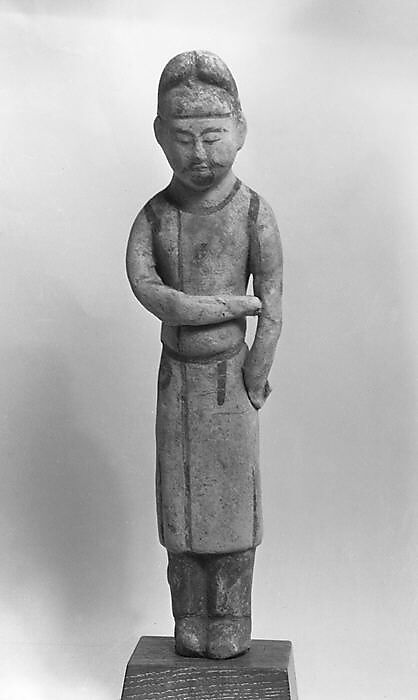
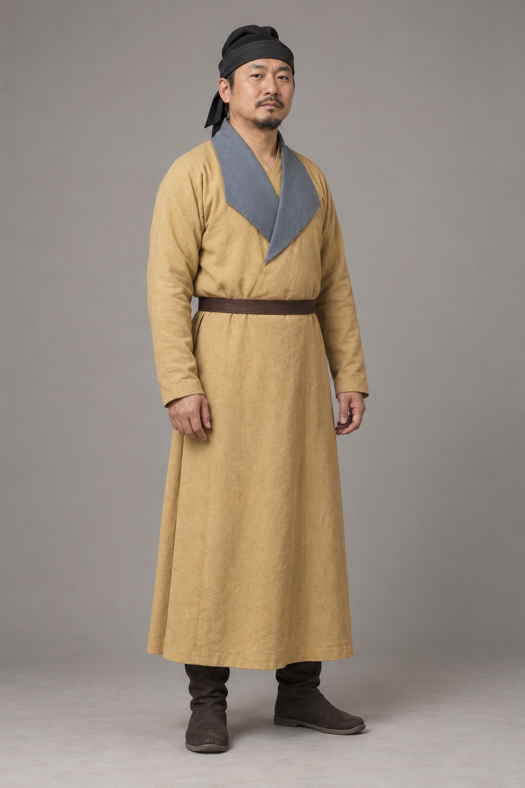

# 第7章　隋唐男子与骑行衣着：圆领袍、幞头和靴

隋唐衣冠不仅有高束裙和帔帛，也有以袍、巾帽、带和靴组成的醒目轮廓。它们把不同活动连接起来：官员在公共场合出现，牵马者俯身用力，人物骑乘出行，女性也可能选择通常被视为男装的组合。理解这套衣着，要从头到脚看，而不能只记住圆领。

图｜唐彩绘泥塑男侍俑（Male attendant），7世纪。可观察圆形领口、束带、较窄袖身及足部。 泥塑/旧黑白照片，不能据此讨论原衣色；图像不展示后背和内部裁片。 资料与图片：[The Metropolitan Museum of Art（大都会艺术博物馆），52.190.3](https://www.metmuseum.org/art/collection/search/54075)。图片权利：Public Domain；Met Open Access（CC0）。

## 圆领不是一件衣服的全部

国博陶男俑的说明，把圆领袍、幞头与靴放在同一套常服中讨论，同时提示袍服宽窄随时期而变。领口相似，并不保证袖形、衣身布量和穿着场合都相同。[资料：国博《陶男俑》](https://www.chnmuseum.cn/zp/zpml/kgfjp/202111/t20211116_252268.shtml)

从正面观察圆领袍，可以先找领口是否闭合，再看前身有没有斜向或侧向的开合痕迹，最后观察腰带上下的布量。圆形颈口不表示它像现代套头衫一样穿入，也不表示衣襟必须在正中竖直开到底。外观与穿入路径，需要通过更多角度和结构资料相互核对。

衣长同样重要。膝下或近足的袍身，与裤、靴如何相接，决定下半身的整体覆盖。袍身较长时，侧面是否开衩、活动时怎样展开，远比一张正面静立图更能解释行动方式。

<!-- visual-study:model-tang-round-collar -->

**上身观察｜唐代圆领、束带与靴的整体轮廓。** 从圆领向下连续看腰带、袍长与靴，避免只记一个领型。

**图像性质与边界：** AI 生成的复原展示，非史料。 原参照为旧黑白照片，不能确认原色；图中褐色不代表品级。 帽内构造、闭合方式、靴材质与背面未获该图证明。

**依据与支持特征：** [The Metropolitan Museum of Art, Male attendant, 7th century, 52.190.3](https://www.metmuseum.org/art/collection/search/54075)：已查看馆藏史料图：圆领、较窄袖、腰带、膝下袍身和足部的组合。该页确认年代与藏号。 [中国国家博物馆《陶男俑》](https://www.chnmuseum.cn/zp/zpml/kgfjp/202111/t20211116_252268.shtml)：馆方对唐代圆领窄袖袍、幞头与靴组合的解释。

<!-- /visual-study:model-tang-round-collar -->

## 常服与礼服，不是一套衣服的豪华版和简化版

“常服”在制度语境中具有特定含义，不能简单理解为今天在家随便穿的休闲衣。与重大典礼使用的冠服相比，它可能更适合日常公务和公共活动；但其材料、色彩和配饰仍可能参与等级表达。

读服制规定时，必须保留年代与身份。同一种颜色在不同政令和场合中的意义未必一致，绘画中的褪色和颜料变化也会影响判断。不能在任何唐代图像上套一张永远不变的“颜色对应官品表”。若不知道人物身份，应先描述色彩与装饰，再决定是否能够讨论品级。

这套衣着传播广，并不意味着所有男子时时处处穿同样衣物。劳作、僧道身份、军事行动、地方气候和家庭条件，都可能带来不同选择。一个有代表性的俑可以作为入口，但不能替所有未被记录的人发言。

## 幞头：从包裹方式看形状变化

幞头不只是长了两只翅膀的黑帽子。国博牵马俑说明，唐代幞头涉及布帛包裹、内部支撑与巾脚形态的变化；晚期形象与早期并不完全相同。[资料：国博《三彩釉陶牵马俑》](https://www.chnmuseum.cn/zp/zpml/kgfjp/202111/t20211116_252267.shtml)

观察幞头，应分别看帽顶、贴头部分、额前轮廓和两脚。巾脚下垂、上翘或横出，是不同的可见特征，不能只因都呈黑色就画成宋代官帽的样子。侧面资料常能显示正面看不见的体积，背面则有助于判断巾脚与包裹的关系。

故宫幞头词条还梳理了后续形态的发展，说明同名冠帽在长时期内持续变化。因此，看到“幞头”二字，应把它看作进一步检索的起点，而不是已经获得了精确外形。[资料：故宫《幞头》](https://www.dpm.org.cn/lemmas/240564.html)

## 带与靴怎样改变身体轮廓

腰带把袍身收束，也使悬挂物有了位置。带上是否有附属小带、扣具和悬物，应看具体材料。今天一些复原形象把所有已知配件一次挂满，这样便于展示种类，却不一定对应某个真实穿着者的一次出行。

靴使裤脚、踝部与小腿连成较整齐的轮廓，鞋履则可能露出更多足踝关系。对图像而言，先确认足部被什么覆盖，再讨论鞋头、靴筒与材料。陶俑上的光滑表面并不能独自说明使用何种皮革，也不能让我们还原完整鞋底工艺。

带、袍摆和靴放在一起，才有助于解释动作。抬腿时衣摆怎样分开，伸臂时袖口是否靠近手腕，俯身时腰带是否限制衣身移位，都是可以在形象中提出的问题。若缺少侧面或背面，问题可以保留，不必为了讲解顺畅而补上答案。

## 骑行与翻领衣物

国博牵马俑穿翻领窄袖袍，馆方将其放在唐代流行的胡服背景中。这里的“胡服”首先是历史分类与交流语境，不能把一切非交领衣物都装进同一个不变的外来衣类。[资料：国博《三彩釉陶牵马俑》](https://www.chnmuseum.cn/zp/zpml/kgfjp/202111/t20211116_252267.shtml)

故宫藏红陶骑马狩猎俑也提供翻领外衣与骑乘姿态相结合的对象。看这类材料，窄袖、衣长和身体动作确实值得比较；但“穿来方便”是功能解释，不能单独证明某种衣物唯一的起源。[资料：故宫《红陶骑马狩猎俑》](https://www.dpm.org.cn/collection/ceramic/246348.html)

服饰交流并不是一件衣服从某地搬到另一地后保持原样。穿着群体、制度、织物供应和审美都会参与改造。与其争取给每一条领缘找到单一祖先，不如明确我们能确认的形制，以及材料尚不能解决的传播路径。

<!-- visual-study:model-tang-turn-collar -->

**上身观察｜翻领窄袖袍：翻折领面与束带的关系。** 翻折领面与袍身色区可以分开看。本图没有骑马，不提供骑行姿态、马具或开衩位置的证据。

**图像性质与边界：** AI 生成的复原展示，非史料。 此图站立观察翻领，不是骑马姿势或骑具复原；不能据此断定隐藏开衩。 釉色只能辅助辨认色区，不能证明原服染料；帽、靴与隐蔽系结简化。

**依据与支持特征：** [中国国家博物馆《三彩釉陶牵马俑》](https://www.chnmuseum.cn/zp/zpml/kgfjp/202111/t20211116_252267.shtml)：馆方明确浅黄色翻领窄袖袍、中腰束带；已下载查看其正面图片，蓝色翻领与袍身关系清楚。

<!-- /visual-study:model-tang-turn-collar -->

## 女性穿袍：形制与性别并不永远重合

国博男装女陶俑，表现高髻、圆领袍、腰带和靴的组合。它使我们看见，袍服与穿着者性别之间不是机械的一对一关系。[资料：国博《男装女陶俑》](https://www.chnmuseum.cn/zp/zpml/kgfjp/202111/t20211116_252274.shtml)

讨论这种现象，需要区分事实与评价。某些文献会把女着男装当作值得评论的社会现象，记录者的语气不等于穿着者自己的解释；一尊人物俑也不足以证明所有女性都享有同样选择。我们能比较的是服装组合如何跨越某些性别惯例，以及它在哪些材料中出现。

这种观察同样适用于今天。现代穿着者选择圆领袍或翻领衣物，可以参考历史造型，也会受到自己的身形、活动和审美影响。只要清楚说明参考与调整，就不必让一件现代成衣承担无法证明的古代身份。

## 观察练习

选一件圆领男俑、一件翻领牵马俑和一件男装女俑。逐项比较帽顶、领口、袖口、腰带、袍摆与足衣。暂时忽略脸部特征，观察仅靠衣物能辨认哪些共同点、哪些差别；再写出不能由衣服单独判断的身份信息。

## 本章资料

- 中国国家博物馆：《陶男俑》《三彩釉陶牵马俑》《男装女陶俑》，见正文链接。
- 故宫博物院：《幞头》《红陶骑马狩猎俑》，见正文链接。
