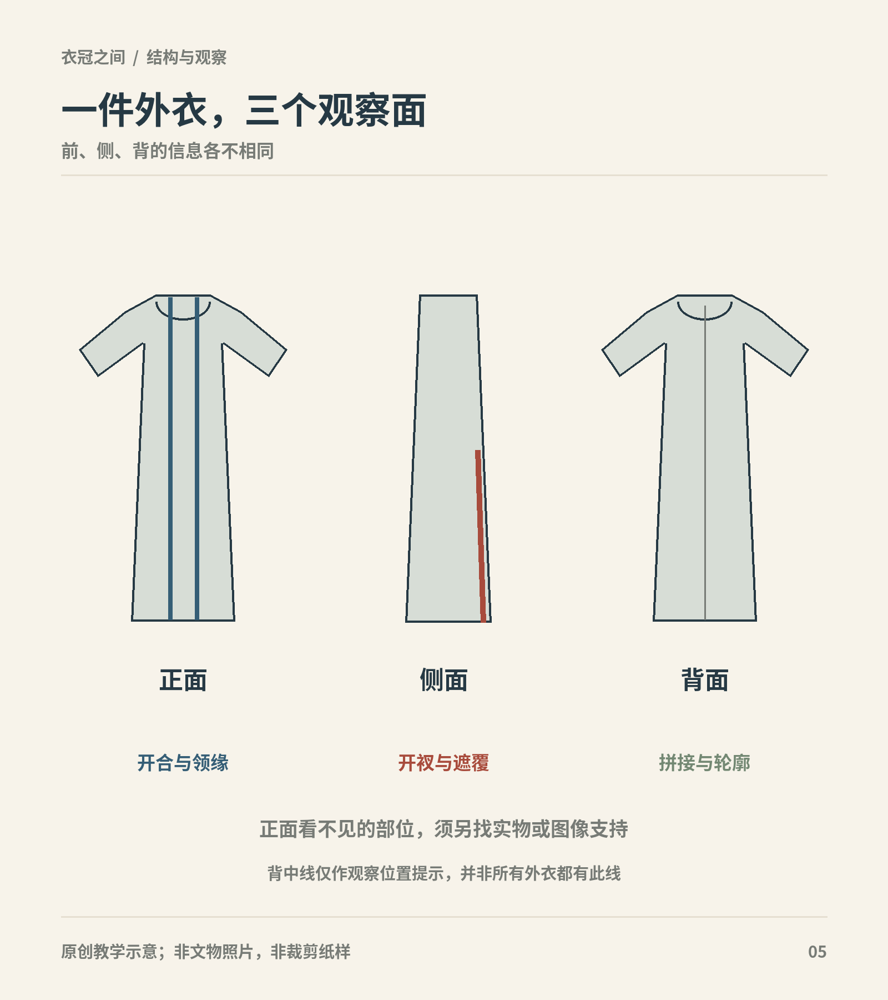

# 第8章　两宋：褙子、衫、裙与城市生活

图｜用对襟长外衣概念轮廓展示正面开合、侧面开衩与背面拼接的不同观察任务。 不是宋代褙子的精确复原；图中背中线仅作拼接观察位置提示，不宣称所有衣物都有此线。 原创教学示意。

## 从两件衣服开始

一件长至膝下、两侧开衩的对襟衣，容易让今天的读者认出“褙子”。但衣物之间的差别，比一个名称容纳的内容更多。中国丝绸博物馆藏江西德安周氏墓出土素罗单衣，领襟有异色缘边，前襟还保存一粒同料纽扣；黄昇墓出土的紫褐色罗印金彩绘花边单衣，则是合领、对襟，襟上不设纽袢或系带。前者较长，后者衣长73厘米。它们都能进入宋代女服的讨论，却不能因此画成同一件衣服的不同配色。[资料：周氏墓素罗单衣](https://www.chinasilkmuseum.com/gskt/info_319.aspx?itemid=28354)；[资料：黄昇墓单衣](https://www.chinasilkmuseum.com/gskt/info_319.aspx?itemid=31584)。

观察这组差别，可以学会三件事：先把结构记录清楚，再讨论名称；同一时期存在不同衣长和封闭方式；一件衣服有纽扣，不等于当时全部同类衣服都以纽扣合襟。衣物史中的变化，经常表现为同处一时的多种办法，而非一种新办法立刻取代所有旧办法。

## 褙子是入口，不是统一纸样

“褙子”也写作“背子”。文献中的名称、考古报告的定名和现代商家的分类，未必一一对应。博物馆在介绍周氏墓衣物时使用过“素罗背子”，也使用“素罗单衣”；“单衣”在这里强调无衬里的构造，“褙子”讨论的则是服式归属。两个名字回答的问题不同，并不必然相互排斥。[资料：馆藏素罗背子](https://www.chinasilkmuseum.com/zggd/info_21.aspx?itemid=1830)。

读者可以依次记录领口是否合拢、衣襟是否重叠、袖口宽窄、开衩高度、缘边宽度和有无系结。记录到这一层，即使暂时无法确定它在某篇宋代文献中叫什么，仍已获得有用知识。反过来，只写“宋制褙子”，却不说明参照哪件藏品，往往无法让另一位读者复核。

开衩尤其值得看。它会改变行走时衣片的分离方式，也使下层裙、裤和上衣的边缘间歇露出。因此，静立正面轮廓不能说明全部穿着效果。复原展示应提供侧视与活动状态；若只依据一张正面人物画，衣侧的构造仍应留作未知。

## 衫、裙和内层共同形成外观

把宋代女服简单压缩成“一件褙子加一条裙”，容易忽略真正决定轮廓的内层。上衣与裙腰如何交接，外衣敞开到什么程度，裙的褶量分配在何处，都会改变腰腹与下摆的线条。同样长度的外衣，搭配较窄或较丰的裙，行走时会产生不同的间隙和摆动。

中国丝绸博物馆的南宋服饰复原研习课程，将褙子与围裹式两片裙放在同一组结构研究中。这个安排提醒我们：成套穿着是相互配合的衣物系统，不能只研究外衣，再随意补一条现代长裙。[资料：南宋褙子与围裹式两片裙研习](https://www.chinasilkmuseum.com/yg/info_13.aspx?itemid=31106)。不过，研习使用的一套方案，也不代表宋代所有裙子都只有两片、只有一种围合方式。

下层衣物还会影响外衣的透明度。罗衣的孔眼可以让内层颜色参与外观。博物馆中平铺在衬底上的衣物，与真人穿在另一层衣服上时，视觉效果并不相同。解释历史颜色时，必须考虑染料变化、展示衬底和照明，而不宜把展柜里的深褐色当作整套服装的原初标准色。

## “宋风清雅”遮住了什么

“清雅”可以形容观者的感受，却不能代替工艺分析。黄昇墓单衣的花边包含印金和彩绘等装饰，纤细的缘饰需要材料、工时和技巧。奢华并不总表现为满身巨大纹样；它也可能集中在近看才能分辨的织物与边饰中。[资料：单衣保护修复](https://chinasilkmuseum.com/jz/info_15.aspx?itemid=27752)。

所以，看到素色大面积衣身，应继续追问它是素织物还是暗花织物，花边是织成、绣成还是印绘，金色是否来自金属材料。以“淡色、窄袖、无花”概括整个宋代，既忽略豪华消费，也会漏掉地区、季节、身份和场合的差别。

男子服装同样不能成为女服章节的背景。圆领袍、幞头等具有不同制度和用途，劳动者的短衣与官员仪礼装束也不属于同一观察样本。讨论“宋人穿什么”时，最有效的范围常常是某个人群在某种活动中如何穿，而不是把一个王朝当作一间统一衣橱。

## 城市图像怎样读

生活图像适合观察衣物与动作的关系：挑担时袖口怎样处理，骑乘者的下摆怎样分开，店铺内外的人是否使用相同衣长。但画中人物通常很小，色层又可能损伤。不能把看不清的一条线直接解释成某种扣具，也不能以某个站立人物的外观推导完整裁片。

墓中衣物则提供另一种偏向：能保存下来的丝织衣物，往往来自具备一定财力的家庭，入殓穿戴也不等于日常出门时的层数。两类资料应互相校正。实物帮助认识布和缝，图像帮助认识穿和动；两者相接的部分较可靠，没有接上的部分应保留疑问。

## 长衣短衣与活动空间

在北宋张择端《清明上河图》中，可以比较行旅、搬运、经商与闲游人物的衣冠。故宫藏品说明特别提示画中人物身份不同、衣冠各异。[资料：故宫藏《张择端清明上河图卷》](https://www.dpm.org.cn/collection/paint/228226.html)。长衣能够覆盖更多身体，也需要在大步行走和屈膝时处理下摆；短衣让裤腿和腰部更显露。袖口较宽时，手臂动作还涉及如何避免衣袖碰到货物、工具或饮食。这样的比较可以把服装从静态轮廓带回工作环境。

衣长与袖量并非简单的贵贱开关，但它们确实会改变动作成本。再把人物所带的帽、包袱、工具与鞋纳入，读者便能理解一套衣着为何适合特定活动，而不只记住一件上衣的名称。

## 一次小观察

打开本章两件罗衣的馆藏页，分别画一个正面轮廓，不必画人物。只标衣长、领口、纽袢和开衩，再写一句“我能确认什么”。随后把“宋代褙子都是……”改成“这件南宋衣物具有……”。这个改写会让知识更精确，也为下一章跨地区比较留下空间。

## 本章资料

- 中国丝绸博物馆：《一物Vol.38｜素罗单衣》，2021年。
- 中国丝绸博物馆：《郑嘉励：南宋黄昇墓与紫褐色罗印金彩绘花边单衣》，2024年。
- 中国丝绸博物馆：馆藏《素罗背子》及《南宋褙子、围裹式两片裙的裁剪与制作》课程说明。以上链接列于相应段落，分别支持实物特征、保存背景和复原方法。
