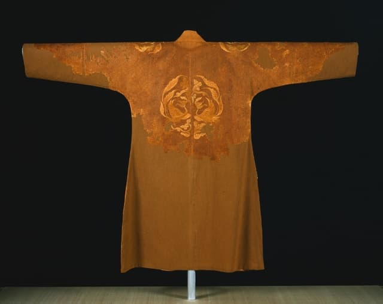

# 第9章　辽金元：并存的衣冠与服饰交流

图｜辽女袍（Woman's Robe），背面，907—1125年。可观察背部成对凤鸟、肩部纹样、衣身与袖的整体展开关系。 辽代衣物，应置于交流比较背景；此图为背面，不能拿它直接标领襟开合方向。馆方对右向交叠的解释是推测。 资料与图片：[Cleveland Museum of Art（克利夫兰艺术博物馆），1995.20](https://www.clevelandart.org/art/1995.20)。图片权利：CC0；CMA Open Access。馆藏页明确允许复制、修改和分发，无须另行许可。

## 时间线不是一条接力线

两宋之外，还存在辽、西夏、金等政权。它们不是等宋代服饰结束后才出现，也不能用一张“宋服—元服”的换装图替代。一个世纪里，不同地区可以同时使用多种袍服、裙装和首服；迁徙、通婚、使节、贸易与工匠流动，又使这些系统相互接触。

中国国家博物馆“中国古代服饰文化”展将民族交流作为理解这一时期的重要线索。对汉服学习而言，辽金元不是必须跳过的空白，而是观察衣冠怎样跨越政治与地域边界的一段关键历史。[资料：中国古代服饰文化展](https://www.chnmuseum.cn/portals/0/web/zt/202102gdfsh/)。

不过，“交流”不是一句能解释所有相似外观的万能话。两件衣服都有窄袖，可能与共同的活动需要有关，也可能有传播关系；要判断具体路径，还需年代、地区和结构细节。相似本身只是研究起点。

## 辽墓中的多种衣着系统

王春燕结合辽墓壁画与出土衣物研究指出，辽境内可见契丹服与汉服等不同衣着系统，且各自随时间变化。她举出的契丹袍后开衩与汉式长袍两侧开衩的比较，比单纯比较颜色更有辨识力；女服图像也显示高腰裙装、襦裙组合与褙子装的并存及接触。[资料：王春燕《辽朝服饰的考古学观察》](https://www.nopss.gov.cn/n1/2024/0125/c458484-40166604.html)。

这不表示看见后开衩就能立即判定穿着者族属。一件衣物的领襟方向、袖口、腰带、裤靴和发式应合在一起看；墓主身份还要由墓志、葬俗等材料判断。衣物可以流动，人的身份也可能复杂。把服装当作固定民族徽章，会把真实生活压扁。

同样，左衽与右衽固然重要，却不是脱离时代的鉴定开关。辽金材料中可见开襟方式的变化与并存。有些图像还因拍摄翻转或临摹而发生方向错误，现代观察首先应核对原图，而不是据一张转载图作文化归属结论。

## “春水秋山”怎样进入衣物

纹样也能记录制度与生活。金代文献将与皇家游猎相关的鹰鹘捕鹅雁等题材称为春水之饰，山林虎鹿等题材称为秋山之饰。中国国家博物馆研究馆藏玉器时，将这些图像与文献、服饰记载对读，说明“春水秋山”不仅是今天的古玩分类名称。[资料：国博《馆藏辽金元春水、秋山玉器初探》](https://www.chnmuseum.cn/yj/xscg/xslw/201812/t20181224_36421.shtml)。

读者应把题材、使用情境和载体分开：同类图像可以进入织物、金玉饰物，不同载体的表现又会变化。仅见一只鹿或一只鸟，不能自动把整件物品定为某种特定礼仪服装。确定纹样名称之后，还要核查组合、构图与出土背景。

## 元代辫线袍：腰部结构的力量

辫线袍的典型结构，是交领右衽、窄袖、腰间密集钉缀编结辫线，下摆放宽，腰部收束与腿部活动量相配合。中国丝绸博物馆相关藏品页同时说明：该件原物仅存左肩一片，上见蹙金绣月兔纹；右肩日纹属于结合文献与纹样配置作出的推测。因此，馆方对辫线袍类型的一般介绍，不等于这件残片本身保存了完整腰部和下摆。[资料：馆藏辫线袍及残存状况](https://www.chinasilkmuseum.com/zggd/info_21.aspx?itemid=1848)。

这类袍服不宜简单翻译为“古代的连衣裙”。观察相关完整实物或有依据的结构复原时，重点是上身、腰部与下摆怎样衔接，腰部的线与褶是否参与收束，以及穿着时如何配合裤靴；观察上述残片，则应集中于实际保存的织物与刺绣。现代同名商品可能用松紧、织带或装饰缝线模拟腰部外观；外观相似并不能证明工艺相同。

更不宜把所有元代袍都叫辫线袍。朝廷礼仪、日常穿用和不同群体的衣物，不会只有一种结构。把某个类型的复原形象放大成整朝统一服装，是图鉴中尤其常见的失真。

## 质孙服是场合与制度的概念

元代质孙服与宫廷宴飨有关。国博介绍《元世祖画像》时，说明这类服饰在重大庆典、宴会中使用，参与者身份不同，衣物等级也不同，并有季节区别。[资料：国博《元世祖画像》](https://www.chnmuseum.cn/zp/zpml/csp/202208/t20220817_257047.shtml)。因此，“质孙”不能仅凭一条密集腰线识别，也不能等同于任何一件窄袖袍。

这也解释了服饰分类为什么需要多条线索：辫线袍偏向结构观察，质孙服偏向特定制度和场合，某些对象可能同时落入两类讨论，却不能把两个词直接当作同义词。正如现代的“西装”与“婚礼服”有交集，重合不等于同一概念。

## 西夏也在这张地图里

西夏服饰同样不能从这段历史中省去。研究西夏朝服的论文将文物与文献对读，指出部分朝服构成与中原制度相似，同时讨论冠、发式与配饰上的具体差别。[资料：《西夏学》前期西夏朝服研究](https://xxax.cbpt.cnki.net/portal/journal/portal/client/paper/9ecae5fac3780726842d9d411f18cbb8)。这提醒我们，采用相近礼服语言，可以与保留本地身份表达同时发生。

西夏供养人图像属于重要材料，但图像中的礼仪人物不代表全体居民的日常装束。分析时应先标明窟号、年代判断、人物身份及绘画位置，再与相应文字记录比较。服饰交流的地图不只是“中原向外扩散”的箭头，而是存在不同需求、选择与再组合的网络。

## 从元到明，保留的不是一个标签

研究明代断腰袍的论文通过文献、图像与实物比较，讨论蒙元服饰在明代的延续、改造与重新配置。这样的研究路径，比“某朝恢复旧制，因此后一朝完全没有前朝影响”的说法更能解释具体衣物。[资料：《从文化因素的角度看服饰的传承与演变：以蒙元质孙服和明代断腰袍为例》](https://scfk.cbpt.cnki.net/portal/journal/portal/client/paper/a754dab8020c4e6dd81772cb7e1678b8)。

政治语言中的复古、恢复与实际制作中的沿用可以同时存在。工匠掌握的织造和剪裁技术、穿着者熟悉的舒适度、宫廷活动的需要，都可能让某种做法继续使用。服饰史因而既有显著转折，也有跨越政权的缓慢变化。

## 一次小观察

选一件辽墓人物图、一件元代辫线袍和一件明代有褶袍服，各写四项：领襟、开衩、腰部、下摆。把“像”落实到可描述的细节，再标出图中看不见的地方。只有当这些信息可以比较，讨论继承和变化才有坚实起点。

## 本章资料

- 中国国家博物馆：“中国古代服饰文化”展、《元世祖画像》与春水秋山玉器研究，分别支持并存背景、质孙服场合和纹样制度。
- 王春燕：《辽朝服饰的考古学观察》，2024年，作者研究成果介绍。
- 中国丝绸博物馆：馆藏《辫线袍》。
- 《纺织科技进展》：蒙元质孙服与明代断腰袍传承研究，2024年。具体链接见正文。
