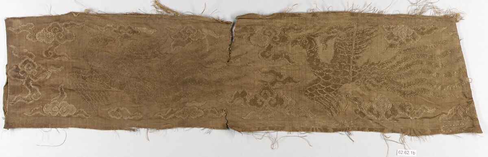
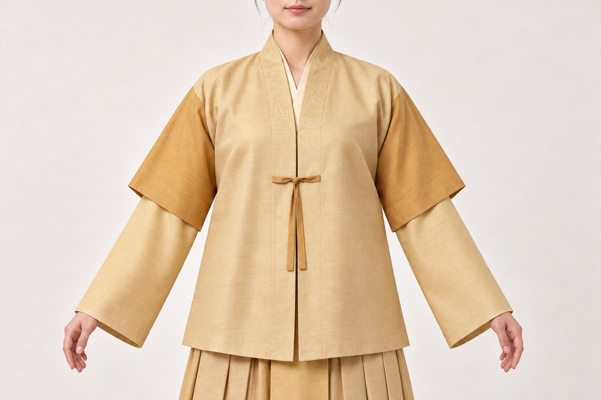

# 第10章　明代女服：衫袄、比甲、披风与裙

图｜明袍前残片，局部b（Fragments of Robe-Front），17世纪上半叶。此图为组内横向残片，可观察织纹与金色装饰残存状态。 不是完整袍服，也不是整组全部残片；不能从本图画出完整衣服的领襟袖身。 资料与图片：[The Metropolitan Museum of Art（大都会艺术博物馆），62.62.1b（整组62.62.1a–d）](https://www.metmuseum.org/art/collection/search/70324)。图片权利：Public Domain；Met Open Access（CC0）。

## 明代女服有三百年的时间深度

今天的“明制女装”常让人联想到立领长袄、马面裙和外搭披风。这个组合是有用入口，却不是从洪武到崇祯、从北方到江南人人相同的衣着。明代延续近三百年，衣长、袖形、领襟、材料和装饰均有变化，贵族礼服、富裕家庭衣物与劳动衣着也不能混成一套。

先看中国丝绸博物馆收藏的一组明初钱姓女子衣物：内穿直领对襟长袖衫，外搭短袖衫，下配有褶绢裙。外衣以系带合襟，并非立领长袄。这套材料让“明代女服”从一个固定印象，变为可以逐项观察的衣物组合。[资料：绢短袖衫、绮长袖衫、绢裙](https://www.chinasilkmuseum.com/zggd/info_21.aspx?itemid=1870)。

## 衫与袄，先看有几层

在日常语言中，“衫”与“袄”容易被当作纯粹的外形名称。实际阅读藏品资料时，应同时看有无衬里、有无絮料、衣身长短和用途。名称在不同时期的使用也有变化，不能只从现代词义反推。

观察一件上衣，可以沿领口向下追踪外襟，到腋侧寻找固定点，再看袖口、侧衩及下摆。交领、对襟、方领或立领描述的是不同部位的安排，且未必处在同一分类层级。例如立起的领座与具体开襟方式需要分别记录，不能把“立领”和“对襟”必然看作二选一。

晚明万黄氏墓出土黄绮折枝花卉女单衣，是另一个重要参照。它采用交领右衽，袖口宽，左右开衩，以扣与袢固定外襟。由此可知，交领上衣并未因立领流行而立刻消失。[资料：黄绮女单衣与曲水如意云罗裙](https://www.chinasilkmuseum.com/info_151.aspx?itemid=27787)。研究晚明形象时，应容纳并存样式，而不是用单一领型划出整齐年代线。

## 比甲、短袖外衣与披风不能混称

比甲通常进入无袖外衣的讨论，但历史材料中的长度、领襟和穿用者并不完全一致；今天所谓“比甲”也可能泛指许多长马甲。明初钱氏组合中的外搭物有短袖，便不宜因为穿在外面，就随意改名为无袖比甲。

披风在明代服饰语境中也不是现代那种没有袖子、以一块布裹住肩背的斗篷。讨论时应说明是否有袖、前襟怎样相对、侧面如何开合。把所有飘动的外层都称为“披风”，会让读者误解结构。

这些差别会改变层次：无袖外衣让内层袖部完整可见，有袖外衣则需要两层袖围互相容纳。若内衫袖子比外层宽很多，衣袖可能在内部堆积，抬臂时产生牵扯。复原穿着既要观察正面颜色，也要检查衣物是否真正容得下彼此。

<!-- visual-study:model-ming-qian-three-piece -->

**上身观察｜钱氏三件套：短袖在外，长袖在内。** 外短袖、内长袖、下裙须分别辨认。衣长与裙褶共同决定比例，不是随意给长裙加一件短外套。

**图像性质与边界：** AI 生成的现代成年模特复原展示，非史料、非馆方认证复原。只示范正面层次。色相、现代发髻、鞋及具体刺绣细节为展示性补足，不复原染前原色或隐藏结构。

**依据与支持特征：** [中国丝绸博物馆《绢短袖衫&绮长袖衫&绢裙》](https://www.chinasilkmuseum.com/zggd/info_21.aspx?itemid=1870)：钱姓女子三件套，直领对襟、短袖外层和长袖内层、外衫系带、裙褶与较宽中央褶。

<!-- /visual-study:model-ming-qian-three-piece -->

## 裙与上衣一起决定比例

明代裙装具有多样的褶裥和装饰，马面式的围合与裙门安排是重要部分。看裙时，可以先找腰与裙身的缝合线，再看无褶区域及两侧褶的分布，最后看膝襕、底襕等纹样如何与结构配合。

上衣逐渐变长，会遮挡裙腰和上部纹样；衣长较短时，裙身更早进入视野。由此，同样的裙襕宽度，在不同上衣下会呈现不同视觉重心。这是读者可以从实物搭配中检验的关系，但不宜凭它给所有明代衣裙指定唯一比例。

无锡钱樟夫妇墓的服饰修复展，提供了夹袄、襴裙等多种衣物和保存信息。与宫廷华服相比，这批材料更接近地方名门家庭，却仍不是所有平民衣橱的平均样本。[资料：“钱家衣橱”展](https://www.chinasilkmuseum.com/yz/info_18.aspx?itemid=25798)。将“民间”直接理解为朴素、廉价或人人都能拥有，同样不准确。

## 礼服与日常衣物是不同问题

大衫、霞帔等礼服需要放在受封身份与规定场合中理解。某件衣物的袖子很宽，不足以证明它就是特定品级礼服；装饰华丽，也不自动意味着婚服。研究明代女袍服的故宫论文，正是从具体对象的纹样、结构与身份语境展开，而非从“喜庆”观感出发。[资料：故宫《端雅庄重的细节之美——从一件明代女袍服说起》](https://www.dpm.org.cn/Uploads/File/2019/08/27/u5d650b271ea77.pdf)。

对普通读者而言，可以把“这件衣物怎样做”与“谁在何时获准穿”分成两张记录。前一张关注结构、材料、工艺，后一张关注制度、场合和文献。这样既不会忽略礼制，也不会让品级表取代衣物本身。

## 日期并不只有一个

万黄氏墓的墓志涉及1672年，而馆方依据随葬织物上的“南京局造”等信息，将相关衣物的制作背景判断为明末。墓葬年代、衣物制作年代与穿用年代可以不同。旧衣可能长期保存，衣物也可能在制作多年后入墓。[资料：万黄氏衣裙的年代讨论](https://www.chinasilkmuseum.com/info_151.aspx?itemid=27787)。

这个例子尤其适合纠正“朝代一换，全部衣物马上改样”的想象。历史由真实的人生活出来，衣物不会在历法翻页时自动从柜中消失。判断年代需要多种线索，而不是只摘取墓志上的最后一年。

## 正面之外，接缝也会说话

今天的穿着照片常把注意力集中在领口与胸前。研究衣物却需要继续看侧面和背面：袖片是否接长，侧衩从哪一高度开始，背中是否有缝，纹样在接缝处怎样被切断或对齐。这些细节能帮助理解布幅、用料与制作，而不只是判断造型好不好看。

例如同一图案若横跨整件上衣，制作时便需要考虑裁片之间的图案对应；若纹样仅集中在边缘或局部，布料安排又可能不同。仅凭正面成衣照片，未必能区分织造时已规划的服装纹样和事后拼合的装饰。遇到这类问题，应回到展开资料和织物研究，避免用想象补齐工艺。

<!-- visual-study:model-ming-qian-sleeve-layers -->

**上身观察｜钱氏三件套近看：两层袖子怎样相接。** 同一虚拟试制设计近看两层袖口和中心系结；这张照片式展示仍不能替代实物接缝与经纬记录。

**图像性质与边界：** AI生成的现代成年模特复原展示，非史料。沿用整身图的同一虚拟试制设计，近景用于看短袖外层和长袖内层，不用于复制具体绮纹、刺绣针法、缝线或染色。色差为增强层次阅读的展示选择。

**依据与支持特征：** [中国丝绸博物馆《绢短袖衫&绮长袖衫&绢裙》](https://www.chinasilkmuseum.com/zggd/info_21.aspx?itemid=1870)：钱姓女子三件套，直领对襟、短袖外层和长袖内层、外衫系带、裙褶与较宽中央褶。

<!-- /visual-study:model-ming-qian-sleeve-layers -->

## 一次小观察

比较钱氏三件套与万黄氏单衣，先忽略颜色，只写领、袖、固定点、衣长及侧衩。再比较各自裙装，标出上衣遮住的区域。若无法从资料确认某件衣服的背面，记录“背面资料不足”，保留它，比补画一个想当然的背缝更有价值。

## 本章资料

- 中国丝绸博物馆：明初钱氏三件套、万黄氏衣裙藏品与研究说明。
- 中国丝绸博物馆、无锡市文化遗产保护和考古研究所：“钱家衣橱”展览说明，2017年。
- 故宫博物院：《端雅庄重的细节之美——从一件明代女袍服说起》。各资料链接见正文。
