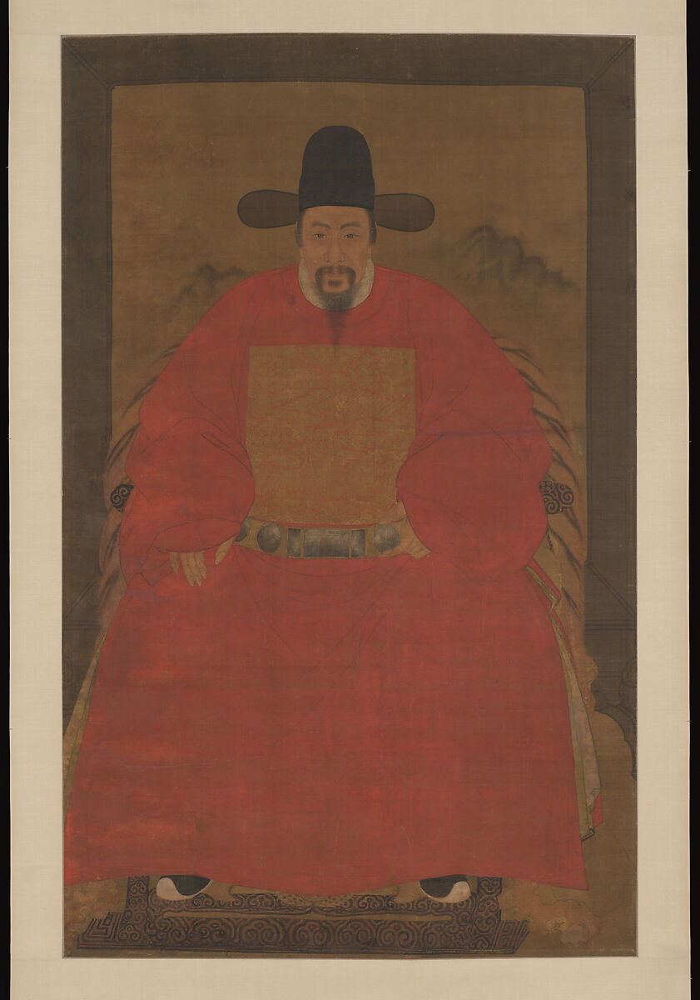

# 第11章　明代男服：袍衫、道袍、直身与曳撒

图｜明佚名《人物像》（Portrait of a Gentleman），16或17世纪。可观察帽、红袍、方形补子与腰带在肖像中的组合。 绘画不是服装实物；馆方提醒补子可能含身份理想化，不能仅凭画像确认人物实际官阶。 资料与图片：[The Metropolitan Museum of Art（大都会艺术博物馆），51.39.4](https://www.metmuseum.org/art/collection/search/48939)。图片权利：Public Domain；Met Open Access（CC0）。

## 先分清三种名字

“圆领袍”“道袍”“飞鱼服”经常出现在同一份商品目录里，却不是三个处于相同层级的分类。“圆领”首先指出领口形态；“道袍”涉及一类袍服及其历史名称；“飞鱼”指纹样及相关服用语境。理解明代男服，第一步是把结构、装饰和身份制度分别记录。

这也意味着，一件衣服可以同时拥有领型、具体结构和特定纹样三个名字。把所有绣着龙形动物的有褶袍都叫“飞鱼曳撒”，既可能认错纹样，也可能认错衣身构造。没有足够细节时，写“带动物纹样的交领袍服”比贸然细分更准确。

## 圆领袍衫与官服系统

明代官服继承并改造了唐宋以来的诸多要素，但官员不是每个场合都穿同一套衣服。故宫《明代官员服饰研究》区分朝服、祭服、公服、常服等用途，也指出制度在明代内部经过多次调整。[资料：故宫《明代官员服饰研究》](https://www.dpm.org.cn/Uploads/File/2019/11/25/u5ddbb3f9e989e.pdf)。因此，影视中一套乌纱帽、圆领袍和腰带，不能替代全部明代官服。

观察圆领袍，需要看圆形领口怎样闭合，外襟向哪边延伸，衣侧是否有衩或补充的衣片，袖根和袖口怎样变化。颜色与补子也必须结合年代、身份和规定场合。胸前一块方形装饰并不是独立的“官员身份证”，它只有放回具体制度，才可能表达品级。

圆领也不是官员独有的外观。判断人物身份，应让题记、画像名称和随身物件参与，而不是从一个领口直接推出官职。

## 道袍和直身：去衣侧寻找区别

在董进对明代宫廷便服及定陵材料的梳理中，道袍的内摆从前襟侧部接出，折入并连至后襟里侧；直身则在前后衣侧配置外露摆片。前者把补充布量藏在衣内，后者在衣侧形成可见的双摆，有的还加衬摆。这是理解“暗摆”与“外摆”的具体入口，不只是看开衩高低。[资料：董进《图说明代宫廷服饰（六）——皇帝便服》](https://www.dpm.org.cn/Uploads/File/2020/04/22/u5e9fff2deb2d4.pdf)。

实际辨认时，先看是否为长身交领衣，再转向侧面：如果开衩内另有连接前后身、向里折入的布片，便进入暗摆结构的讨论；若衣身外侧可见前后摆片相叠，则与外摆直身相比较。暗摆能够遮住开衩处的内层，褶又储存活动布量；外摆则把这种覆盖关系放在外侧。两者正面可能相近，背侧及翻看内侧才能说明关键差别。以上是限定材料范围的比较，不表示所有时代的“道袍”“直身”名称都遵守同一分类。

研究道袍结构的论文特别指出，其衣身仍采用平面剪裁方法，暗摆等局部细节却具有鲜明特征。对初学者而言，这正是值得追踪的部位：开衩与遮蔽如何共存，增加的衣片怎样折入，静立时与迈步时各露出多少。[资料：明代道袍暗摆结构研究](https://scfk.cbpt.cnki.net/portal/journal/portal/client/paper/5253b952251223d679ff006dbbf0766e)。

这里的“道袍”还不能与全部道教法衣直接画等号。道教服装内部具有不同名称与仪式用途，文化机构收藏的道教袍服，也可能带有八卦等专门图像。[资料：国家文化记忆库《道袍》](https://tcmb.culture.tw/zh-tw/detail?id=110000009013&indexCode=MOCCOLLECTIONS)。同一个词在日常袍服研究与宗教服饰目录里可能指向不同对象，阅读时应先看时代、馆藏说明和用途。

## 曳撒与贴里：腰缝不只是一条线

先看一个有明确墓葬背景的实例：常州毕宗贤墓出土本色棉质曳撒，前身在腰部上下分裁，后身通裁，下摆设有马面与工字褶。它把前身收束和下摆展量连在一起，却没有让后身也横向断开。[资料：《明代本色棉质曳撒》研究介绍](https://epaper.csstoday.cn/epaper/read.do?eid=55215&idate=12_2026-09-08_A12&iid=7479&m=i&sid=258211)。

作为入门比较，可把这类马面式曳撒与温州博物馆所述贴里放在一起：

| 观察部位 | 这类马面式曳撒 | 常见贴里比较模型 |
| --- | --- | --- |
| 前身腰部 | 上下分裁相接 | 上下分裁相接 |
| 后身腰部 | 通裁，不以横腰缝断开 | 上下分裁相接 |
| 腰下布量 | 中央较平整的马面与两侧褶区结合 | 下部以褶裥展开，不设同类中央马面 |
| 侧面 | 关注外摆与衣片覆盖 | 通行模型不配同类外摆，开衩存在个案差异 |

资料：[温州博物馆《馆藏释读｜温博里的明代陶制“手办”都穿啥？》](https://www.wzmuseum.cn/Art/Art_18/Art_18_12292.aspx)。表中“常见模型”不是全部实物的硬性定义：董进在上述宫廷服饰研究中还明确提到，贴里有后身左侧开裾的实物，不能把“绝不开衩”用作无例外规则。

相关研究对蒙元质孙服与明代断腰袍进行三重证据比较，说明明代袍服包含继承与改造。将曳撒一律画成某一种马面式结构，会遮住不同阶段和不同对象的变化。[资料：蒙元质孙服与明代断腰袍研究](https://scfk.cbpt.cnki.net/portal/journal/portal/client/paper/a754dab8020c4e6dd81772cb7e1678b8)。学习的稳妥顺序，是先确定一件有出处的衣物，再使用研究者对该对象的命名，而非先选名字，再替它拼出一件衣服。

贴里也并非只能以华丽织金袍理解。江西丰城明墓出土的本色夏布贴里，上衣与下部衣片在腰间分裁相接，还保存托领、腋下补片和不同手缝处理。它提供了材料与局部加固的另一种面貌。[资料：郑瑶、刘大玮《明代本色夏布贴里》](https://www.cssn.cn/skgz/bwyc/202609/t20260915_6067349.shtml)。从身体活动看，腰部收束稳定上身，腰下褶裥储存布量；褶的方向及缝合深度会影响坐下、迈步时的展开。

## 飞鱼纹不等于一种剪裁

飞鱼、蟒、斗牛等称谓与赐服、纹样识别相连，彼此不能仅凭“几只爪”作机械判别。对非专业读者，先承认纹样辨识需要局部高清图，再核查馆方定名，是更可靠的办法。

孔府旧藏是研究明代衣冠的重要实物群。中国丝绸博物馆对其中交领蟒衣、圆领衫及蟒裙等进行保护修复，说明同类高等级装饰并不只存在于一种外形的袍上。[资料：孔府明代服装保护修复](https://www.chinasilkmuseum.com/jsfw/info_212.aspx?itemid=28024)。这一事实有助于理解：纹样、服装构造和穿用资格必须分别核查，不能用一个“飞鱼服”标签包办。

## 形象完整，不等于配件越多越好

巾帽、内衬、裤、鞋与腰带需要与外衣相配。现代展示常增加挂件，使人物看起来信息丰富，但物件越多并不意味着越接近某一历史场景。应先问画像里出现哪些东西，相关制度允许什么，再考虑看不见的部分。

孔府衍圣公朝服研究把衣裳与梁冠、中单、带、佩绶等合看，展示了成套衣冠如何承载身份。这样的研究适用于特定礼服对象，不能直接拿来要求所有明代便服都具备同样配件。[资料：徐冉《明代品官朝服探析》](https://www.rujiazg.com/article/23686)。

## 袍下的裤与靴履

袍服下摆会随动作分开，裤及足衣因此参与整套衣着。静立时被遮住的部分，坐下、上阶和迈步时可能成为主要可见层。复原展示若只完成外袍，内层裤的颜色、宽度与穿用方式随意处理，活动画面便可能与所参照的历史对象脱节。

不过，遮蔽本身也意味着证据不足。不能从一幅长袍画像直接推定裤裆结构，或给所有人物配同一种靴。对已知外袍与未知内层，应分别标注；实际穿着需要补充内层时，可以明确使用当代适配方案。清楚说明这一点，比宣称整套毫无疑问地复原更便于后续研究和修改。

## 一次小观察

选一件有正反展开资料的男袍，将腰缝、侧缝、褶、摆片用四种线标出，再给纹样另开一栏。最后把“这是什么衣服”拆成三句：结构如何、装饰为何、适用什么人物与场合。无法回答的项目保持空白，正是下一步检索的方向。

## 本章资料

- 故宫博物院：《明代官员服饰研究》。
- 《纺织科技进展》：明代道袍暗摆研究与蒙元质孙服、明代断腰袍研究，期刊原站链接见正文。
- 中国丝绸博物馆：孔府明代服装保护修复项目。
- 董进：《图说明代宫廷服饰（六）——皇帝便服》；温州博物馆：明代陶俑服饰释读。
- 中国社会科学报、网：《明代本色棉质曳撒》；郑瑶、刘大玮《明代本色夏布贴里》，2026年，见正文链接。
- 徐冉：《明代品官朝服探析——以孔府旧藏衍圣公朝服为例》，《文物天地》2021年第12期。
- 国家文化记忆库：馆藏道教《道袍》说明，仅用于区分宗教服饰语境。
