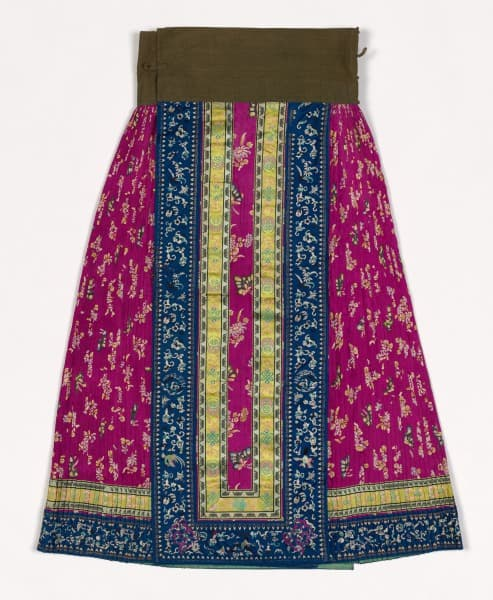

# 第12章　清代至近代：变革、延续与服饰记忆

图｜彩绣裙（Skirt），约1875—1900年。可观察中央宽面、两侧褶、下摆边饰和明亮色块；馆方材料标为绣丝与羊毛。 馆方通名未明确细分族属；本图用于裙结构与晚清装饰的实例，不据此推断所有现代马面裙的历史准确性。 资料与图片：[Cleveland Museum of Art（克利夫兰艺术博物馆），1956.78](https://www.clevelandart.org/art/1956.78)。图片权利：CC0；CMA Open Access。馆藏页明确允许复制、修改和分发，无须另行许可。

## 变化不是一夜完成的

明清之际，政权更替和服制政策显著改变了衣冠生活，尤其影响男子发式与服装。但清代近三百年中，地区、身份、性别、职业和场合依然使衣着呈现差异。讨论这一段历史，既不能略去强制政策，也不能把全部居民画成一套宫廷袍服。

“男从女不从”常被用作便于记忆的概括，相关“十从十不从”叙述在大众传播中尤其普遍。它不能替代对具体年代、法令、执行情形和地区材料的核查。本书以服装实物与可靠研究讨论实际延续，不把一句口号当作全部清代服饰的统一法条。

## 男子长袍与马褂：长短两层的组合

清代男子衣着的重要组合，是长袍或长衫外罩较短的马褂。前者构成从肩到下腿的连续轮廓，后者覆盖躯干，长短衣身的边缘在腰部附近形成层次。马褂有对襟、大襟、琵琶襟等不同形式，不能一律画成同一排扣、同一袖长。[资料：故宫《清代服饰艺术（续）》](https://www.dpm.org.cn/embroiders/talk/203177.html)。

看这类组合，可先沿长袍外襟找到向右的开合，再区分外层短褂自身的开口，最后观察袍侧开衩与裤的关系。仅凭正面黑色一整块，很容易把两件看成一件。朝廷规定的礼服、获赐服饰和民间袍褂也有区别，普通马褂不能与具有特定制度背景的黄马褂互换名称。

中国丝绸博物馆藏20世纪30年代几何纹暗花绸长袍，属于较瘦长的近代实例；馆方将它放在清末以来袍形变化的背景中解读。同一“长袍”名称下，衣身肥瘦、袖围与长度可以改变，穿着时也可搭配礼帽、布鞋或皮鞋。[资料：薛雁《一物Vol.42｜几何纹暗花绸长袍》](https://www.chinasilkmuseum.com/cs/info_164.aspx?itemid=28358)。这使我们看见，男子传统衣物也在适应新的身体轮廓与公共生活，而不是只有女服发生变化。

## 汉族女服的延续，包含持续变化

大学博物馆保存的清代汉式女装，包含衫、褂、裙等不同品类。上衣与裙相配这一方式仍可见，但领口、门襟、袖围、衣长、镶缘与纹样不断发展。[资料：江西服装学院服装博物馆清代汉式女装展区](https://museum.jift.edu.cn/info/1080/1917.htm)。延续某类衣物，不等于结构与装饰停留在明末。

东华大学对清朝闺秀服饰展的说明，也将旗女的袍、褂、坎肩组合与江南妇女的上衣下裙组合并置。这个对照适合认识两个重要系统，但“江南闺秀”并不代表全部汉族女性；城市富裕家庭藏品，也不能代替乡村劳作衣着。[资料：东华大学清朝闺秀服饰展](https://www.dhu.edu.cn/2016/0105/c7783a141545/pagem.htm)。

读者看见一件晚清女衫时，可以依次记录立领、右侧大襟、袖口和衣缘，不急于给它贴“保留明制”或“完全满化”的结论。延续与吸收经常同时发生，不是两种互斥状态。

## 马面裙为什么越看越不同

马面裙在清代继续发展，裙门、裙褶和边饰形成丰富变化。国立台湾历史博物馆藏粉红丝质提花鱼鳞百褶裙，推测年份为1890至1930年，正跨越晚清与近代。其名称同时交代颜色、材质、组织或花纹表现，以及褶裥特点，是很好的细读对象。[资料：台史博藏鱼鳞百褶裙](https://collections.nmth.gov.tw/CollectionContent.aspx?a=132&rno=2004.028.4844)。

比较时，应把裙门与两侧褶区分别看。裙门上复杂的刺绣会吸引目光，褶裥的缝合与连接却更直接地改变活动效果。有些裙褶被连接成起伏的表面，动起来与完全自由散开的褶不同。只保留前面一块绣花布，再换成另一种裙身，可能保留了装饰印象，却改变了结构。

清华大学艺术博物馆馆刊中的马面裙研究，将不同裙式和装饰展开比较，也提示清代裙装不是一个固定模板。[资料：清华艺博馆刊马面裙研究](https://www.artmuseum.tsinghua.edu.cn/xsyj/gk/202401/W020240103371490290335.pdf)。今天讨论“传统马面裙”时，最好进一步说明参照明代、清代何时何地的哪件实物。

## 旗装与汉式女服的关系

相邻衣着系统可以借用装饰与材料，也可能在特定时期出现相近轮廓。中央民族大学民族博物馆介绍北方民族服饰时，将清代满汉女服相似与交流放在具体语境中讨论。[资料：中央民族大学民族博物馆北方民族服饰](https://bwg.muc.edu.cn/info/1021/1153.htm)。这不等于可以抹去二者结构、穿法与社会背景的差别。

观察袍与衫裙组合，应先看衣身是否连续，前襟怎样延伸，开衩位置和内层是什么，再看镶缘和刺绣。纹样相近可能来自同一工艺环境，外形相似也可能遮住不同的内层系统。只有把细节拆开，才能判断哪部分发生了借用。

## 身体史中不能美化的部分

衣冠史还包括身体受到的约束。女鞋、裙长与行走姿态的关系，不能只用“纤巧”“优雅”概括。研究缠足相关衣物，应关注身体伤害、劳动条件、年龄与地区差别，并避免把某类鞋自动配给所有时期、所有女性。

展柜中的小鞋是具体历史实践的遗存，不是今天复原穿着必须复制的身体标准。现代展示完全可以保留衣物知识，同时使用适合正常足部活动的鞋。说明这种调整，会使历史理解和当代穿用各自清楚。

## 近代的新衣橱怎样形成

进入近代，制服、学校服装、西式裁剪、工业织物和新式消费共同参与衣着变化。传统袄裙、长衫、旗袍、西装等可在同一社会、甚至同一家庭中并存。衣橱的变化不是从“古装”瞬间跳到“现代装”。男子方面，1929年《服制条例》把蓝长袍配黑马褂列为国民礼服的一种形式，长袍并未因西装和中山装出现便马上退出公共场合；国丝的长袍研究以这一规定与实物、照片相互说明。[资料：几何纹暗花绸长袍及近代服制背景](https://www.chinasilkmuseum.com/cs/info_164.aspx?itemid=28358)。

读近代合影时，可以比较同场人物分别选择长衫、袍褂、西装或制服，而不把其中一类当作唯一“时代标准”。帽、鞋和外衣还可能跨系统搭配：长袍加礼帽与皮鞋，已不是一整套清代衣冠的简单照搬。具体组合应由照片与人物背景确认，不能把一种搭法普遍化到所有地区。

中国丝绸博物馆的“更衣记”展以1920年代至2010年代时装为线索，呈现服装在社会生活中持续调整的过程。[资料：中国丝绸博物馆展览与馆藏入口](https://www.chinasilkmuseum.com/zz/info_17.aspx?itemid=26319)。这一段应与当代汉服复兴联系起来理解：今天重新选择历史衣物元素的人，面对的已经是工业生产、现代交通和现代身体观念构成的生活环境。

因此，现代汉服并非从清代之前原封不动搬来的一整间衣橱。它通过收藏、考古、出版、手艺、研究和设计重新组织知识。承认这一过程，不会削弱文化兴趣，反而能帮助读者辨明实物传统、知识传承与当代创造各自的作用。

## 旗袍不是一条没有变化的旁支

现代旗袍的发展也说明传统如何在近代重组。较宽松的早期轮廓，与后来强调曲线、改变袖长和衣长的样式，不能压缩成一个不变剪影。中国丝绸博物馆“更衣记”通过不同时期服装，展示旗袍形成、成熟及中西搭配的变化。研究汉服至当代的历程时，旗袍与袄裙等相关传统应拥有自己的历史，而不是只被当作某个分类争议的例子。[资料：“更衣记”展览出版说明](https://www.chinasilkmuseum.com/xscg/info_28.aspx?itemid=27949)。

同一人的照片如果跨越数十年，还可显示衣物选择随年龄、社会角色和生活方式改变。个人衣着史能够补充朝代史，让宏大转折落到真实身体和日常选择中。

## 一次小观察

选一件明代裙、一件清代裙和一张近代衣着照片，分别写出“仍在使用的办法”和“已发生的变化”。两栏都应落实到领襟、褶、工艺、穿法或场合。不要让朝代名称代替你实际看到的东西。

## 本章资料

- 江西服装学院服装博物馆、东华大学清代服饰展资料：支持具体藏品群与衣着系统比较。
- 国立台湾历史博物馆：粉红丝质提花鱼鳞百褶裙，登录号2004.028.4844。
- 清华大学艺术博物馆馆刊：马面裙研究。
- 中央民族大学民族博物馆：北方民族服饰展。
- 故宫博物院：《清代服饰艺术（续）》；薛雁：《一物Vol.42｜几何纹暗花绸长袍》，中国丝绸博物馆，2021年。所有对象与研究链接见正文。
