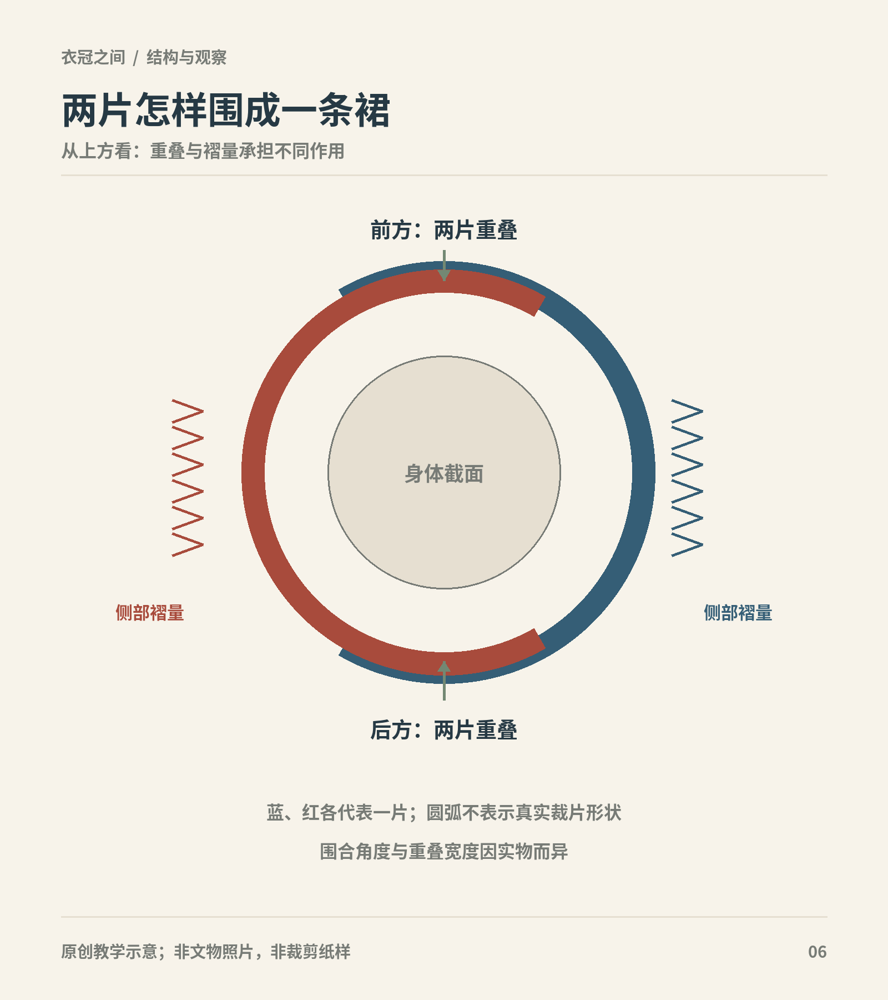
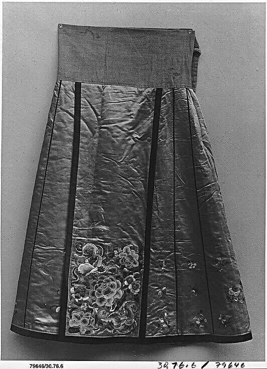
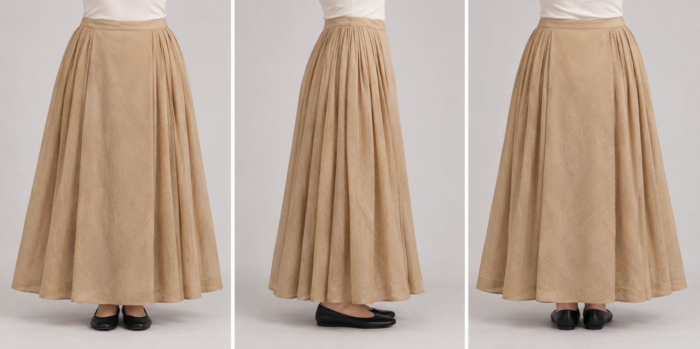

# 第13章　裙的结构：裙片、褶裥、裙门与围合

一条裙子的外形，来自布如何被连接、收拢和围到身体上。站立时看到的直线轮廓，可能藏着宽大的展开量；前面看起来完整的长方形，也可能由两个重叠部分形成。认裙时只记住“百褶”“齐胸”或“马面”还不够，需要把裙腰、裙片、褶裥和系结连起来看。

图｜两片式围裙类结构可通过前后重叠获得遮覆，侧部褶量提供容量；需结合具体裙实物理解。 圆截面为围合关系示意，非马面裙裁剪图；不代表所有历史裙装。 原创教学示意。

图｜清裙（Skirt），19世纪。可观察裙腰、无褶宽面、侧向褶和下部刺绣的关系。 旧黑白馆藏照，不能判断原色；馆方通名为Skirt，未细分族属或具体裙型，书中结构辨读须标为观察。 资料与图片：[The Metropolitan Museum of Art（大都会艺术博物馆），30.76.6](https://www.metmuseum.org/art/collection/search/68989)。图片权利：Public Domain；Met Open Access（CC0）。

## 从布面到身体，先问四个问题

第一，裙身由几片裁片拼成？这里的“片”可能指一块裁剪部件，也可能指已经缝好、能够独立围裹的一大部分，读不同资料时必须确认计数口径。第二，布量在哪里收拢？可以在裙腰打褶，也可以让裁片本身呈现不同宽度。第三，裙子怎样闭合？系带、扣袢、交叠都可能参与。第四，剩下的布量如何供人行走？褶展开、两片相对滑动和下摆开口，是不同的活动机制。

中国丝绸博物馆将南宋的一类裙明确称作“围裹式两片裙”，并把它与褙子放在结构和工艺研习中讨论。这个名称强调的是围合方法，不等于所有宋裙，也不能单凭它推导出裙片的全部尺寸。[资料：国丝古代服饰结构与工艺复原研习班](https://www.chinasilkmuseum.com/ngcxg/info_11.aspx?itemid=31129)

## 褶裥怎样容纳多余的宽度

把一张纸折出若干褶，再把上端固定，就能理解褶裥的基本作用：腰部保持较小周长，下部保存较大的布量。人体迈步时，布料不需要像弹力布那样被拉长，只需让折叠部分张开。褶的方向、深浅、间距以及固定长度，会共同影响轮廓。

向同一方向叠合的褶与彼此相向的褶，展开方式不同；仅在腰边固定和沿褶线缝下一段，活动效果也不同。所以“百褶”首先提示褶多，并不保证每一条裙恰好有一百褶，更不自动说明它是哪一朝的标准式样。观察时要分别记录褶数、褶向和固定方法，不能把一个名称当作完整纸样。

这一点在明代曲水如意云纹罗裙上尤其清楚：馆方说明它的前后裙门地两侧有对称折裥，中央由两片交叠形成大褶，裙腰另用平纹绢。读者由此可以把“哪里平整、哪里收褶、哪里交叠”逐一对应到实物，而无需先套上今天的商品分类。[资料：曲水如意云纹罗裙](https://www.chinasilkmuseum.com/zggd/info_21.aspx?itemid=1905)

## 马面裙，重点在裙门与侧褶的关系

今天常说的马面裙，最醒目的特征是前后较平整的区域与侧部褶裥形成对比。但具体实物有时代、地区和工艺差异，不能把现代某一种系法倒推为唯一古法。中国丝绸博物馆的一件藏品以两片裙身构成，其中一片有纽扣，另一片有扣绊；相扣之后，前后形成相应的平整部位，两侧为褶。这说明“马面裙一定只有长带、没有纽扣”的说法并不成立。[资料：国丝马面裙藏品说明](https://chinasilkmuseum.com/zggd/info_21.aspx?itemid=1974)

裙门也不是随意贴在表面的一块装饰布。它与裙片的边缘、交叠顺序及腰部固定有关。观察正面时，应当接着看背面和展开图：前后平整部分是否相同？侧褶向哪里收？装饰在重叠处能否对齐？看不见的地方，应标记“照片未示”，不能自行补画。

马面裙的明清发展也不宜压缩成一个样子。清华大学艺术博物馆的“裙裳华彩”展按发展与变化展示相关裙装，说明一种裙式能够延续，同时在褶、裙襕、装饰密度和穿着组合上改变。[资料：清华艺博“裙裳华彩”](https://www.artmuseum.tsinghua.edu.cn/cpsj/zlxx/zlhg/202509/t20250926_20317.shtml)

<!-- visual-study:model-mamian-three-views -->

**上身观察｜前后裙门与侧褶：同裙三面观察。** 由左至右看正、侧、背：前后中央平整区与侧褶的分工比表面纹样更重要。三视没有展示隐藏的系扣。

**图像性质与边界：** AI 生成的现代成年模特复原展示，非史料、非馆方认证复原。仅为前后中央重叠、侧面布褶关系的简化试制；不复刻曲水如意云纹、实物尺寸或隐藏系扣。现代上衣、鞋和本色方案专用于观察，不是一套明代服饰。

**依据与支持特征：** [中国丝绸博物馆《曲水如意云纹罗裙》](https://www.chinasilkmuseum.com/zggd/info_21.aspx?itemid=1905)：前后裙门两侧对称折裥，裙身正中由两片交叠成大褶，裙腰和裙身缝缀。

<!-- /visual-study:model-mamian-three-views -->

## 裙襕为何影响观看顺序

横向的装饰带可以把长裙切分成几个视觉区域。膝部或近底缘的裙襕，与裙门上较集中的纹样，形成了上下和前后的观看节奏。不过，纹样的位置必须与实物对应；不能见到两道装饰便把所有裙装都归入同一种形制。

结构和图案还存在实际配合：平整区域适合展示较完整的纹样，细密褶裥会把图案切分成节奏。当裙子行走展开时，原本藏在褶内的颜色和图案可能显露。这里的“适合”是从布面关系出发的观察解释，不代表每位古代制作者都有一套相同的设计理论。

## 高束与腰束，是穿着位置问题

裙腰位于身体何处，会改变可见比例，但不能独自证明裁剪。唐代女俑中可以看到高束裙的形象；俑面上的裙腰高度，是图像可以支持的观察，裙片数量、系带在背后的路线，则往往需要另外的纺织实物或图像。故宫藏陶彩绘女俑的说明提供了裙腰及胸的具体案例，应读作这件作品所见，而不是全体唐代女性的统一穿法。[资料：故宫陶彩绘女俑](https://www.dpm.org.cn/collection/sculpture/233402.html)

一条当代裙也可能通过调整系带改变位置，但这并不意味着它在每个位置都具有同等的舒适度。裙腰承重、上身活动和裙长是相互关联的：原来及地的裙子向下系，便可能拖地；把本来腰束的裙硬拉高，也可能令裙腰和躯干不贴合。

## 把几种分类放回各自的位置

读裙装说明，可以把常见词分成几组。齐腰、较高位置束系，描述裙腰相对于身体的位置；百褶、侧部收褶，描述布量安排；间色、印花、织金，描述色彩和装饰；单裙、夹裙，则涉及成衣层数。这些词可以组合，不能替代彼此。因此，“这是百褶裙，所以不可能是某种围裹裙”的判断并不充分：一条围裹裙完全可能同时安排许多褶。

同样，裙片多不自动等于裙围大。窄片拼成的裙与宽片拼成的裙，可以有近似的总宽度；腰部收进去的褶量不同，穿着后呈现的体积又会变化。比较实物时，优先看展开宽度、裙长、褶深和围合后的状态，不以片数作质量排名。

当代商品还可能以拉链、松紧腰或装饰性假系带改变闭合方法。它们可以保留某些历史裙装的视觉线索，却已经采用不同的穿用结构。应按实际做法说明，而不是只根据商品名称推定古法。

## 自己做一次结构观察

不必先购买裙子。找一件有正面、背面和展开照片的馆藏，画出三个简单矩形，分别标记平整区、褶区和闭合区。用另一种颜色标出实际看不到的部位。随后把名称暂时遮住，只根据记录写一句描述，例如“前后存在平整部位，两侧以褶储存布量，腰部通过扣袢围合”。这句话比单写“很有明制感”包含更多可核查的信息。

## 本章资料

- 中国丝绸博物馆：[南宋褙子、围裹式两片裙的裁剪与制作](https://www.chinasilkmuseum.com/ngcxg/info_11.aspx?itemid=31129)。
- 中国丝绸博物馆：[曲水如意云纹罗裙](https://www.chinasilkmuseum.com/zggd/info_21.aspx?itemid=1905)。
- 中国丝绸博物馆：[两片式马面裙藏品说明](https://chinasilkmuseum.com/zggd/info_21.aspx?itemid=1974)。
- 清华大学艺术博物馆：[裙裳华彩：马面裙的古韵今风](https://www.artmuseum.tsinghua.edu.cn/cpsj/zlxx/zlhg/202509/t20250926_20317.shtml)。
- 故宫博物院：[陶彩绘女俑](https://www.dpm.org.cn/collection/sculpture/233402.html)。
