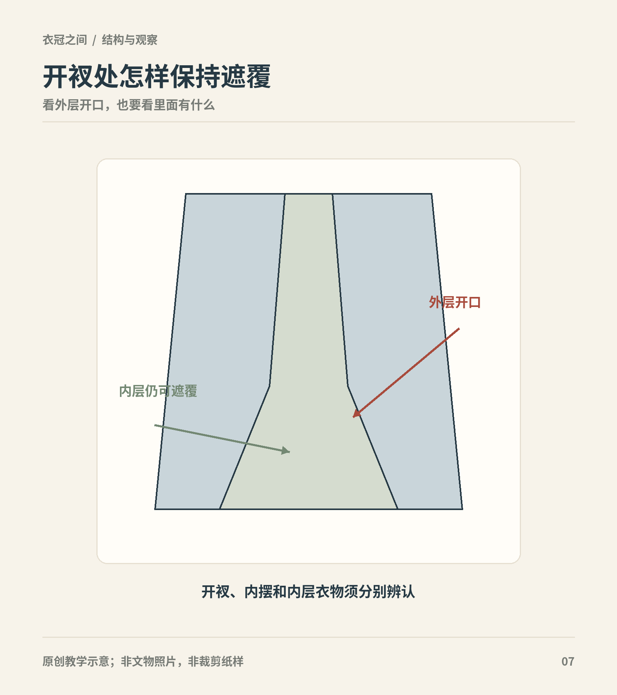
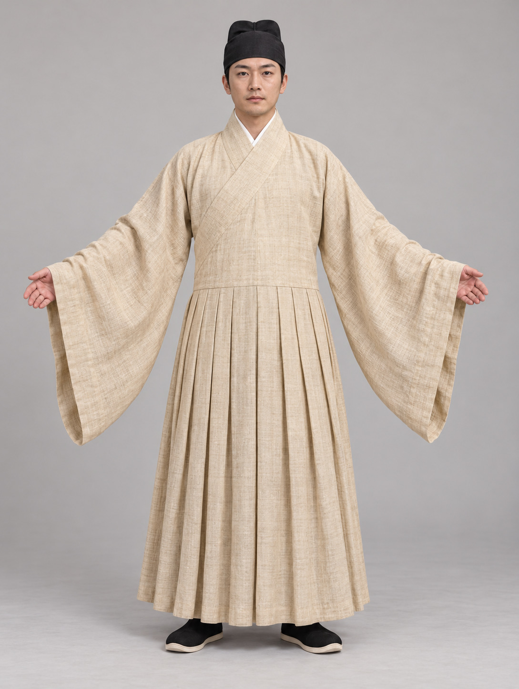
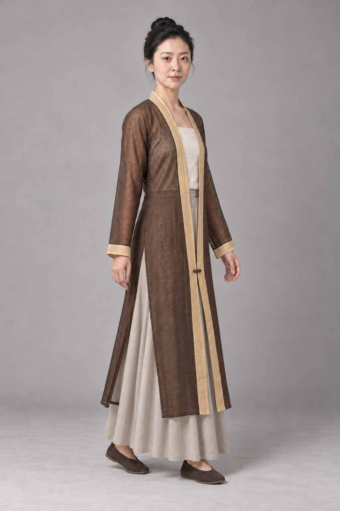

# 第14章　袍服比较：结构、开衩与内外层

长衣看起来相似，穿起来却可能相差很大。有的依靠长襟绕掩，有的在领侧扣合；有的下摆直接放宽，有的在腰部以下安排褶或另接部件。“袍”这个大名称让我们知道衣物覆盖范围较长，却不能替我们回答全部结构问题。

图｜放大示意开口边缘与内层遮覆的关系；外部开口不能单独说明完整衣着结构。 几何概念图，非某一种道袍或直身结构，不能据此判断具体衣物的摆与缝合。 原创教学示意。

## 名称是入口，结构才便于比较

讨论古代衣物，应保留资料原名，再补充自己的结构描述。例如“直裾式丝绵袍”同时涉及衣边形态和填充材料；“圆领袍”首先强调领口；“蟒袍”主要提示装饰与制度背景。它们不在同一分类层级。若把曲裾、圆领、飞鱼、道袍并列为互斥的四种款式，就会混淆剪裁、装饰和历史名称。

观察时可按顺序记录：衣身有无腰部接缝，领口如何闭合，前襟交叠到哪里，袖身与袖口怎样变化，侧边在哪里打开，下摆是否有额外布量。这个顺序是本书的观察方法，并非古代制衣术语体系。

<!-- visual-study:model-ming-tieli-ramie -->

**上身观察｜贴里试制：断腰与连续褶裥。** 沿着领口、腰缝、褶区依次观察：本例下裳接在上身，不是另穿一条裙。

**图像性质与边界：** AI 生成的现代成年模特复原展示，非史料、非馆方认证复原。这是跨材料互证的结构试制，不是丰城实物裁片复刻。袖幅、褶数、帽鞋与具体尺度未经丰城实物高清图确认；不能用图推定其身份，也不复制帝王纹样。

**依据与支持特征：** [郑瑶、刘大玮《明代本色夏布贴里》，中国社会科学网](https://www.cssn.cn/skgz/bwyc/202609/t20260915_6067349.shtml)：江西丰城明墓本色夏布贴里，交领右衽、上衣下裳分裁相接、腰部施褶、夏布材料。 [董进《图说明代宫廷服饰（六）——皇帝便服》，故宫博物院](https://www.dpm.org.cn/Uploads/File/2020/04/22/u5e9fff2deb2d4.pdf)：贴里上下分裁、前后断腰、下部施褶、无同类中央马面；文章附定陵实物与结构参照，见115–116页。

<!-- /visual-study:model-ming-tieli-ramie -->

## 曲裾与直裾：先辨衣襟的延伸

曲裾与直裾的比较，应放回具体实物。马王堆的两件素纱襌衣形制不同，衣物的伸展方向也不同；这里的“襌”读作 dān，说明没有衬里的单层衣，并不等于所有单层衣都必须透明。香港古物古迹办事处的汉代文物展，则提供绛紫绢地“长寿绣”丝绵袍的尺寸和出处，展示了与轻薄襌衣不同的另一种成衣条件。[资料：绛紫绢地“长寿绣”丝绵袍](https://www.amo.gov.hk/sc/visitor-centre/exhibitions/heritage-discovery-centre/han-exhibition/ag29/index.html)

衣襟绕掩的长短，会影响收束方式和正侧面的层次。要理解这种区别，最好看平铺照片，再与俑或绘画中的穿着状态对照。不能把平铺后的宽度直接当作人体胸围，也不能只凭穿着后的斜线就确定裁片形状。

“深衣”还牵涉礼书解释和服饰史研究。它与考古报告中的袍服、襌衣不是简单的一对一对应。阅读时保留“文献中的名称”和“实物中的构造”两栏，可以避免把所有交领长衣都叫作深衣。

## 圆领不表示从头套入

今天常见的圆领汗衫从头穿入，容易让人误以为圆领袍也是整圈领口、前面不开。古代圆领袍服则可能有偏向一侧的开襟与固定点。无锡博物院对绘画中唐装的讲解，特别说明了襟部掩合后在颈侧固定、形成闭合领口的观察方法。[资料：无锡博物院“名画中的唐装”](https://www.wxmuseum.cn/News/Details/d846c13d-f1bc-437b-9ea9-ac33e7b1827d)

这种结构让“领口的最终形状”和“开襟方向”成为两个问题。领口敞开时出现翻折，也不能只根据翻折外观立即判断另一种时代或族属。故宫的三彩骑马狩猎俑，记录了翻领窄袖袍、幞头与靴的完整组合；它比一张无背景的衣领特写更能帮助理解穿着场景。[资料：三彩骑马狩猎俑](https://www.dpm.org.cn/collection/sculpture/228314.html)

## 开衩与摆：站立轮廓之外的活动空间

长袍要覆盖腿部，也要让人跨步。活动空间可来自下摆放量、侧部开衩、褶裥或附加的布片，不同衣物采用的方式不同。比较两件看似相近的袍时，侧面常比正面更有信息：衩从哪里开始，衩内是否有另一层布，前后衣片能否独立移动。

当代汉服讨论中，道袍、直身、直裰等名称常伴随内摆、外摆和侧衩的区别。初学者可以把这些词作为检查线索，但不应拿一套现代商家术语裁定全部历史材料。同名衣物在文献、馆藏定名和现代制作中未必完全一致；没有结构图的对象，应暂缓精确归类。

袖子的活动空间也不可只看最宽处。大袖身配较收的袖口，手臂向上抬起时，布的运动和真正敞口的宽袖并不一样。测量“袖宽”之前，必须知道量的是腋下、袖身中段还是袖口，否则不同卖家的数字无法直接比较。

<!-- visual-study:model-song-beizi-side -->

**上身观察｜素罗单衣侧衩与内层裙：小步移动参照。** 看得到的侧衩与看不到的内部裁片要分开记录；外轮廓不能替代结构图。

**图像性质与边界：** AI 生成的复原展示，非史料，不是等比例纸样。 小步移动及内层胸前覆盖、裙、鞋是演示安排；不宣称周氏生前如此成套搭配。 仅解释侧衩使衣片分离的关系，背中缝、全部内层与罗组织微观仍不在证据范围。

**依据与支持特征：** [中国丝绸博物馆《一物Vol.38｜素罗单衣》](https://www.chinasilkmuseum.com/gskt/info_319.aspx?itemid=28354)：同一周氏墓单衣，馆方记录两侧约64cm长衩、窄袖、对襟、异色缘边与一粒同料纽扣。

<!-- /visual-study:model-song-beizi-side -->

## 袍服从来不是孤立的外壳

袍内可能另有上衣、裤、护膝、袜等，外面又可能加披风或其他衣物。国丝对明代墓葬服饰修复的年度记录，把圆领、搭护、交领衣、裤、袜、靴分别列出，正好提示我们：一套衣着需要多个部件才能完成。[资料：国丝2020年度报告，相关服饰修复条目](https://www.chinasilkmuseum.com/uploadfiles/2021/03/20210319162232242.pdf)

不过，同墓共存不等于这些衣物必定在每一天同时穿用；出土时层叠也需要结合位置、葬俗和研究说明。复原整套穿法，应明确哪些层次有实证，哪些依据同期资料，哪些出于试穿判断。

内层影响外层的垂落。厚衣会改变胸背体积，衬裤影响袍摆与腿之间的摩擦，腰带又把布量重新分配。只有外袍的照片，不能完整解释身体轮廓。今天试穿也一样：换掉内层后显得更贴身，不一定是外袍裁剪改变了。

## 长度、层次与名称怎样交叉

同一件长衣可以同时是交领、右衽、宽袖，并具有衬里；这些特征分别来自领襟、袖型和层次，不必互相排斥。反过来，两件都被今天称为“圆领袍”的衣物，也可能在衣长、袖口、侧衩和内衬上不同。整理衣橱或制作图鉴时，用一个大类收纳，再以结构字段描述，比不断制造新类别更清楚。

“单”不等于夏季唯一用衣，“夹”也不等于厚棉衣。一层、两层及夹有絮料，是构造线索，穿用温度仍要考虑整套搭配与环境。资料没有说是否有里时，不应因为衣服显得厚重，就自行标成夹袍。

还要注意文物测量与成衣尺码的差异。博物馆记录的通袖长，通常描述衣物展开后的横向尺寸；它不是从肩点量到手腕的一段现代袖长。不同测量方式混在一张表里，数字即使准确，也会产生错误比较。

## 一次有用的比较练习

选两件不同年代的长衣，尽量各有平铺与侧面图。只比较五点：领口、衣襟、腰部接缝、侧边、袖口。把“有明确图像”“根据说明得知”“无法判断”分别标出。最后再讨论时代风格。这样既能看见差异，也能知道结论止于哪里。

## 本章资料

- 香港古物古迹办事处：[长寿绣丝绵袍、手套与夹袜](https://www.amo.gov.hk/sc/visitor-centre/exhibitions/heritage-discovery-centre/han-exhibition/ag29/index.html)。
- 无锡博物院：[醉马风流——名画中的唐装](https://www.wxmuseum.cn/News/Details/d846c13d-f1bc-437b-9ea9-ac33e7b1827d)。
- 故宫博物院：[三彩骑马狩猎俑](https://www.dpm.org.cn/collection/sculpture/228314.html)。
- 中国丝绸博物馆：[2020年度报告](https://www.chinasilkmuseum.com/uploadfiles/2021/03/20210319162232242.pdf)，明代服饰保护与修复部分。
