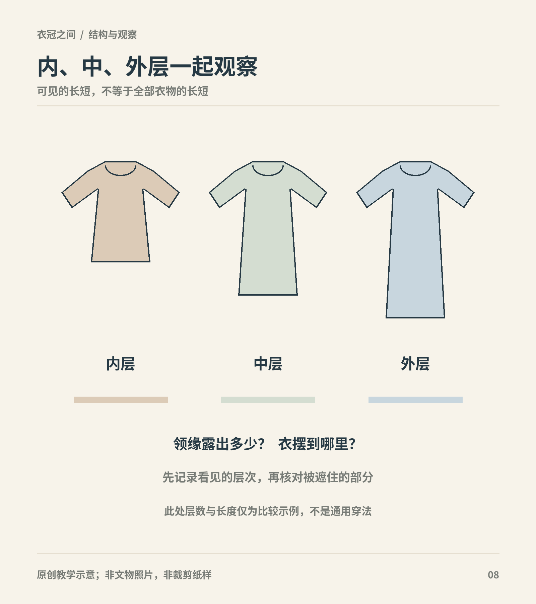

# 第15章　内衣与裤：衣着系统中不显眼的部分

画像最容易保存衣着的外轮廓，贴身衣物却常被外层遮住。如果只根据画像想象古人的衣橱，就会觉得他们似乎只有长袍与裙。裤、内层上衣、袜和保暖夹层，正是理解行动、卫生与季节调节不可缺少的部分。

图｜以三个通用衣物轮廓说明内中外层的长度可不同，实际层数与组合取决于时代、场合和具体衣物。 示意不是任何历史时期的标准三层配置；图中没有断言内衣形制。 原创教学示意。

## “内衣”是穿着关系，也有历史名称

本章用“内层”指穿在其他衣物里面的部件，用“贴身层”强调它与身体接触。两者并不完全等同：一件夹在内外两层之间的衣服，可以是内层，却不贴身。古代的襌衣、中单、裹肚、抹胸等词，又各有文献和时代背景，不能拼成一条每个朝代只有一种内衣的简单进化表。

同样，单、夹与绵涉及成衣层次或填充条件，并不直接决定它在整套衣着中的位置。透明衣可能罩在外面，不透明的衣物也可能穿在里面。单凭面料薄厚认定“这是古人的内衣”，证据不足。

## 裤的历史，不能从一个字推完

“袴”“裤”“裈”等词在历史材料中有不同用法；具体结构是否连裆、裤脚怎样处理、腰部如何固定，需要看图和测量。把所有早期裤都说成“只有两条裤管”，或断言某个时期的人普遍没有裤，都会抹去地域与结构差别。

中国国家博物馆的《上衣下袴》从文献、图像与俑像讨论裤装的变化，特别指出北朝袴褶服中短衣与裤的组合，并讨论袖管、裤管放宽后的式样变化。这提示我们，裤不是外袍史之外的小注脚，它参与了跨地域衣着的重新组合。[资料：国博《上衣下袴》](https://www.chnmuseum.cn/yj/xscg/xslw/201812/t20181224_33119.shtml)

国博藏侍从陶俑是具体例子。观看时不要停在“宽裤很方便”这一推测，应先观察裤管的可见宽度、上衣长度与脚部关系，再读馆方对北朝服饰背景的说明。俑上的裤褶表现了体积，却未必能说明真实衣物全部接缝。[资料：侍从陶俑](https://www.chnmuseum.cn/zp/zpml/kgfjp/202111/t20211111_252106.shtml)

## 外裙下面，证据常常不完整

穿裙与穿裤并非互相排斥的现代分类。具体时期和场合下，一套衣着可能同时包含裙与裤或其他腿部覆护物。不过，判断某幅仕女图裙下穿什么，需要独立证据。不能因为今天穿安全裤舒服，就把它当作画中人物的历史穿法；也不能因为画面没有裤脚，就认定裙下没有任何内层。

明代实物保护记录中，裤、护膝、袜与不同上衣能够同时进入研究视野。国丝2020年度报告列出的墓葬服饰包括绫裤、缎袜、护膝、搭护等，这些细小部件让整套衣着的层次比单件袍服复杂得多。[资料：国丝2020年度报告](https://www.chinasilkmuseum.com/uploadfiles/2021/03/20210319162232242.pdf)

研究者仍需区分“同墓发现”“出土时有层叠关系”“可证明生前穿用习惯”。这三个判断的强度不同。随葬衣物有时保存了生活用品，有时又承载特殊的丧葬安排。

## 贴身衣物的形状与用途

胸腹覆护物可以依靠肩颈、胸背或腰部的系带固定，覆盖范围不一定相同。当代商品中一件无袖短上衣被称作“抹胸”，并不足以证明它与某件古代抹胸相同。读实物说明时，应记录面料、形状、边缘处理、系带位置，以及是否存在后期改动。

中国丝绸博物馆“丝路霓裳”展的清代“红缎地彩绣夫妻双双把家还肚兜”，在展览正文中亦称抹胸，采用大红素缎和彩绣，颈部有银链。这个实例能够支持对该件衣物材料和固定部件的讨论，却不意味着所有时代的抹胸都有银链或同样的覆盖范围。[资料：丝路霓裳——中国丝绸艺术](https://www.chinasilkmuseum.com/yz/info_18.aspx?itemid=26598)

贴身层还影响外衣能否平整垂落。接缝、系带结和厚边位于哪处，可能在轻薄外衣下显现；相反，厚重外衣会掩盖许多内层细节。看穿着图时，把“可见的内层领缘”与“推测的完整内衣”分开，是很重要的观察习惯。

## 保暖不只是增加衣服件数

夹层、填充、覆盖面积和层间空气，都关系到保暖。汉代丝绵袍中的“丝绵”指丝质絮填充，不应因为同音就写成棉花。香港古物古迹办事处展示的马王堆长寿绣丝绵袍，与同展的手套、夹袜一起，帮助我们从躯干、手部和足部理解衣着保护。[资料：长寿绣丝绵袍、手套与夹袜](https://www.amo.gov.hk/sc/visitor-centre/exhibitions/heritage-discovery-centre/han-exhibition/ag29/index.html)

历史衣物的实际保暖效果还受厚度、潮湿、风和活动量影响。馆藏名称只能提供构造和材料线索，不能让我们直接得出适用于所有人的温度表。今天做复原试穿，应当记录天气、内层数量和活动条件，避免只写“穿起来一点也不冷”。

## 功能可以帮助提问，不能替代考证

贴身与中间层可能承受汗液和摩擦，也可能用于保暖、遮蔽或调整外衣线条。一件衣物可以承担多种功能，不能只凭一种合理用途便认定它的历史身份。例如，看到方形布片与系带，可以提出“是否覆盖胸腹”的问题，却仍需看尺寸、系带方向和出土位置；它也可能是其他身体部位的覆护物。

内层是否经常清洗，同样需要资料。不能因为现代人会频繁更换贴身衣物，就把这种习惯直接写进每个时期的日常生活。纺织品的价格、获取条件与家庭劳动都可能影响维护方式；没有证据时，宁可说明尚不清楚。

读者今天穿着汉服，可以根据舒适与活动选择现代内衣和裤袜。这样的选择不影响了解历史，记录时写明现代部件即可。若进行研究性复原，则应把现代替代物和有依据的部件分开，避免一张完整照片掩盖了证据上的差别。

## 从隐蔽部位读懂整体

找一件有出土衣物清单的服饰案例，做一张表：部件、身体部位、材料、直接证据、未知信息。把外层、可能的内层和其他随葬用品分开。你会发现，最有价值的结论不一定是完整复原整个人物，而可能是确认“这里有裤”“这里有袜”“这件衣物带填充”，同时保留其具体搭配的未知部分。

## 本章资料

- 中国国家博物馆：[上衣下袴](https://www.chnmuseum.cn/yj/xscg/xslw/201812/t20181224_33119.shtml)。
- 中国国家博物馆：[侍从陶俑](https://www.chnmuseum.cn/zp/zpml/kgfjp/202111/t20211111_252106.shtml)。
- 中国丝绸博物馆：[2020年度报告](https://www.chinasilkmuseum.com/uploadfiles/2021/03/20210319162232242.pdf)。
- 中国丝绸博物馆：[丝路霓裳：中国丝绸艺术](https://www.chinasilkmuseum.com/yz/info_18.aspx?itemid=26598)。
- 香港古物古迹办事处：[丝绵袍、手套与夹袜](https://www.amo.gov.hk/sc/visitor-centre/exhibitions/heritage-discovery-centre/han-exhibition/ag29/index.html)。
