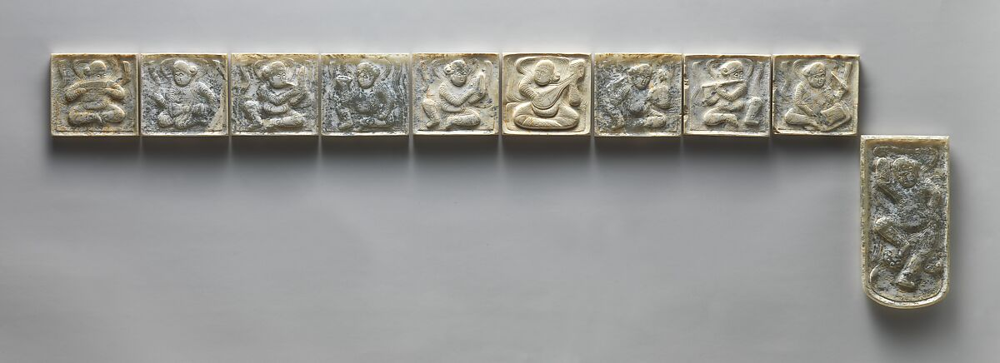
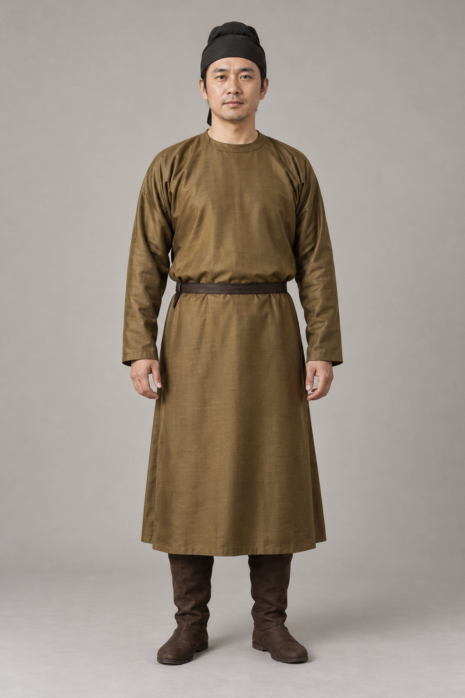

# 第16章　冠巾、发式与足衣：从头到脚看整体

一件袍服配什么头饰、什么鞋，往往比衣身颜色更能缩小观察范围。不过，冠、巾和靴也不是可随意组合的时代符号。它们与发式、身份、活动及整套衣物有关；把一顶醒目的帽子贴到任意长袍上，并不能得到有依据的历史穿着。

图｜唐胡人乐舞纹玉带板（十件）（Set of decorative belt plaques），7世纪至8世纪初。十块带板上的乐舞人物可与服饰配件、材料和跨地域交流并读。 这是带板陈列照，不是整条带的穿用图，不能据摆放直接复原腰带全部装配。 资料与图片：[The Metropolitan Museum of Art（大都会艺术博物馆），1992.165.22a–j](https://www.metmuseum.org/art/collection/search/42180)。图片权利：Public Domain；Met Open Access（CC0）。

## 头上的东西怎样固定

先把形状和固定方法分开看。发髻可以成为固定小冠的基础；簪可能穿过冠孔与头发；布巾则可能包裹、束结或依托内部结构成形。头饰的高低与外轮廓，只是最终结果，内部是否有胎骨、如何与头发结合，常需要实物和说明。

国博藏明代簪镶宝石金冠出自益庄王万妃棺，为女冠；可以看到冠盖、横纵支架与插簪孔之间的关系。它说明华丽冠饰并非一团悬浮在头上的装饰，而是由金圈、支架、孔位和簪共同实现佩戴的器物。[资料：簪镶宝石金冠](https://www.chnmuseum.cn/zp/zpml/kgfjp/202104/t20210415_249724.shtml)

但一件贵族金冠不能代表人们的全部日常头饰。材料、工艺和出土身份本身就是研究信息。玉、金等耐久材料也更容易进入收藏视野，不能因为博物馆里金玉头饰醒目，就以为普通人的布帛包头并不重要。

## 冠、帻与幞头不能混成一种帽子

不同头服有不同组合。国博对笼冠陶俑的解释，涉及冠与帻相配、外部构架与内层包头物的关系，提醒我们注意一件头饰内部仍可能有层次。[资料：笼冠陶俑](https://www.chnmuseum.cn/zp/zpml/kgfjp/202111/t20211111_252109.shtml)

幞头在唐代俑像中十分常见，但它的轮廓并非始终相同。软质包裹与后来趋于定形的结构，不能只靠“两根带子”概括。故宫藏三彩骑马狩猎俑与国博藏三彩釉陶牵马俑，分别提供了幞头与骑行服饰组合的观察对象。[资料：故宫三彩骑马狩猎俑](https://www.dpm.org.cn/collection/sculpture/228314.html)；[国博三彩釉陶牵马俑](https://www.chnmuseum.cn/zp/zpml/kgfjp/202111/t20211116_252267.shtml)

对照时可以看包头的体积、额前边缘、两脚的位置和软硬感；不要把宋代绘画中某种平展轮廓直接移到所有唐代人物头上。俑像又会概括布料细节，因此能说“外形可见”，未必能说“内部必有某种支架”。

## 发式让衣着的年代问题更具体

发式和衣物可以互相校验，却不能互相替代。一幅图中的高髻、额饰与衣领组合，可能帮助判断人物形象所采用的风尚；若画本是后世摹本，还要考虑摹绘者的改动。对于发量、假发、支撑物等看不见的部分，也不应只凭造型大胆补全。

观察发式时，把头发本身的形状与发饰分开记录：髻在头顶还是后部，是否双髻，簪钗穿插在哪里，耳饰与衣领会不会遮住系带。现代复原为了保持稳定所用的发夹、发包和金属骨架，若无对应证据，应写成当代技术选择。

这并不贬低复原的价值。相反，明确哪些部分是今天为便于佩戴而增加的，才能让读者同时理解历史线索与现实制作。

## 足衣也有层次

袜、鞋和靴分别覆盖身体的不同区域。研究鞋履时，应观察鞋面、鞋底、鞋头、后跟和开口，不能只凭鞋尖是否上翘确定年代。鞋的尺寸与形状还可能受到儿童使用、仪礼、身份或身体习俗影响。

马王堆夹袜是可以与躯干衣物共同阅读的例子：古物古迹办事处给出它的足底长和袜高，并与丝绵袍、手套同页展示。它提供了足部衣物的具体实物信息，而不是一幅仕女图中被长裙遮住的猜想。[资料：长寿绣丝绵袍、手套与夹袜](https://www.amo.gov.hk/sc/visitor-centre/exhibitions/heritage-discovery-centre/han-exhibition/ag29/index.html)

骑行俑中的靴与长裙下隐约露出的鞋尖，能够告诉我们不同程度的信息。前者可见靴筒与裤脚关系，后者可能只能辨出前端。观察记录应相应收敛，不以一小块鞋尖补出整双鞋。

## 不把所有“古风鞋”放在同一格

清代旗装中的花盆底鞋，与汉族妇女缠足背景中的小鞋，以及不同地区常人的布鞋，都需要分开讨论。故宫对雪青色缎绣竹蝶纹花盆底鞋的说明，明确提供了清代后妃鞋履类型的语境；这不等于“清代女子都穿高底鞋”。[资料：雪青色缎绣竹蝶纹花盆底鞋](https://www.dpm.org.cn/collection/embroider/230207.html)

历史上的身体约束，也不应被描述成今天必须模仿的美。讲解缠足鞋，是理解特定社会实践及其造成的身体改变；当代汉服穿着完全可以选择适合正常行走的鞋。历史知识与今天的穿着决定属于不同问题。

## “不完整的套装”也可能信息充分

观众常希望看见一套从头到脚完全配齐的衣服，但完整的展示不一定比残缺材料更可靠。一顶保存良好的冠，可以让我们研究支架与簪孔；一双鞋底残件，可以让我们研究缝合和磨损。若为了凑齐全身而加入无依据的配件，反而容易让这些确定信息被想象遮住。

看展时还要区分原件、补配和展示支架。支撑冠饰的透明材料、填在鞋内的软垫、使衣袖展开的托衬，都属于今天的展示条件。它们帮助保护与观看，并不说明古代身体也采用同样支撑。若馆方另有复原图，应对照图注再读。

现代佩戴还会面对剪短的头发、不同发量和日常步行的需要。发簪插得稳不稳、鞋底是否适合路面，是今天的实际问题；不能靠“古人都这样”跳过试戴，也不应把今天的便利改造伪装成已证实的古代细节。

<!-- visual-study:model-tang-round-collar -->

**上身观察｜唐代圆领、束带与靴的整体轮廓。** 袍、带、靴可用来做全身位置观察；帽内构造与靴料未获证实。没有证据的配件宁可简化，也不添加“古风”装饰。

**图像性质与边界：** AI 生成的复原展示，非史料。 原参照为旧黑白照片，不能确认原色；图中褐色不代表品级。 帽内构造、闭合方式、靴材质与背面未获该图证明。

**依据与支持特征：** [The Metropolitan Museum of Art, Male attendant, 7th century, 52.190.3](https://www.metmuseum.org/art/collection/search/54075)：已查看馆藏史料图：圆领、较窄袖、腰带、膝下袍身和足部的组合。该页确认年代与藏号。 [中国国家博物馆《陶男俑》](https://www.chnmuseum.cn/zp/zpml/kgfjp/202111/t20211116_252268.shtml)：馆方对唐代圆领窄袖袍、幞头与靴组合的解释。

<!-- /visual-study:model-tang-round-collar -->

## 做一次全身核对

把一件有年代的俑像分成头、躯干、腿、足四栏，各写三项可见事实。再标出信息最薄弱的部分。若头饰细节清楚而衣摆遮住了脚，就不要为了“完整”强填鞋型。最后看这四栏是否出自同一个对象、同一个时期。这样的记录能防止把唐代幞头、明代袍服和清代足衣拼成一套没有来源的“古人装束”。

## 本章资料

- 中国国家博物馆：[簪镶宝石金冠](https://www.chnmuseum.cn/zp/zpml/kgfjp/202104/t20210415_249724.shtml)、[笼冠陶俑](https://www.chnmuseum.cn/zp/zpml/kgfjp/202111/t20211111_252109.shtml)。
- 中国国家博物馆：[三彩釉陶牵马俑](https://www.chnmuseum.cn/zp/zpml/kgfjp/202111/t20211116_252267.shtml)。
- 故宫博物院：[三彩骑马狩猎俑](https://www.dpm.org.cn/collection/sculpture/228314.html)。
- 香港古物古迹办事处：[夹袜及相关汉代衣物](https://www.amo.gov.hk/sc/visitor-centre/exhibitions/heritage-discovery-centre/han-exhibition/ag29/index.html)。
- 故宫博物院：[雪青色缎绣竹蝶纹花盆底鞋](https://www.dpm.org.cn/collection/embroider/230207.html)。
