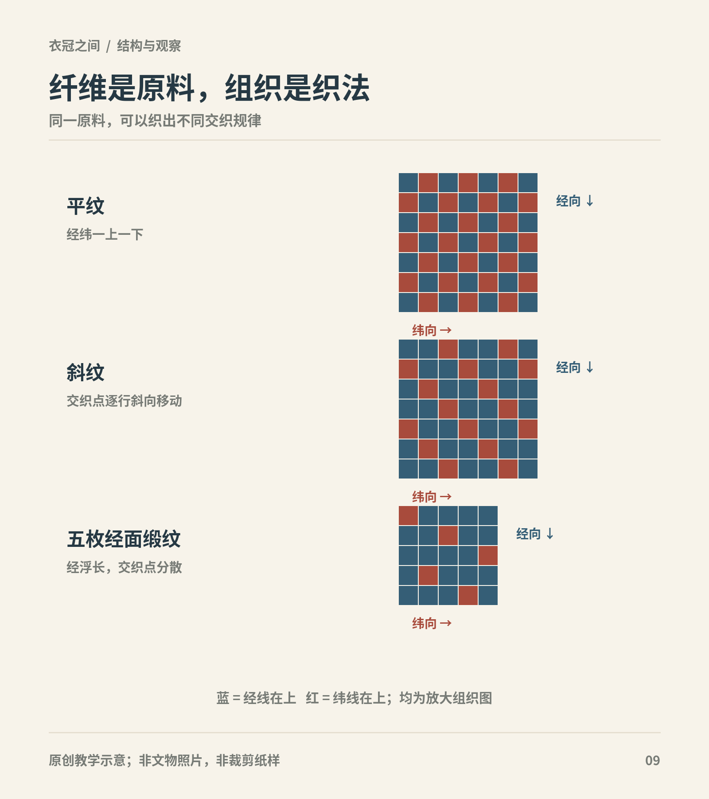
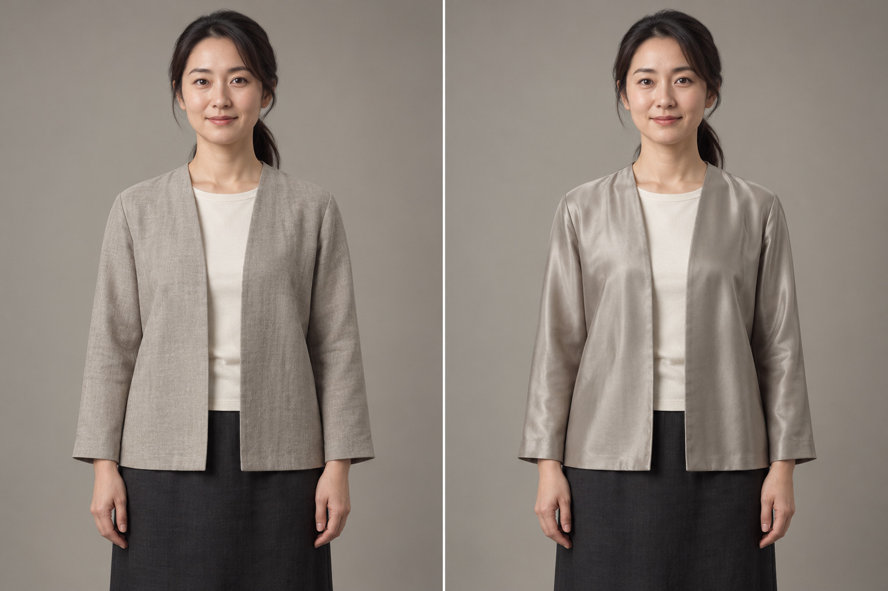

# 第17章　丝麻棉毛：材料、织物与身体感受

“这件衣服是真丝的，还是缎的？”这个问题把两种分类混在一起。丝是纤维材料，缎主要指向织物组织与外观，二者可以同时成立。认清材料与结构的关系，既能读懂馆藏说明，也能避免购买当代衣物时被漂亮的面料名称带偏。

图｜平纹、二上一下斜纹与五枚经面缎纹的简化组织图，以蓝色表示经线在上、红色表示纬线在上。 不表示历史织物的密度、线径或光泽；“缎纹”是组织类别，不能据图推断纤维成分。 原创教学示意。

## 从纤维到成衣，至少有四层信息

一件衣物先有纤维原料，再经过制线和织造，随后可能染色、印花、刺绣或整理，最后裁剪缝合。每一层都会改变结果。相同原料可以织成不同布；同样的组织也可以采用不同粗细、密度和捻度的线。

中国丝绸博物馆把平纹、斜纹与缎纹作为理解织物组织的基础，并介绍罗与部分纱采用的绞经组织。古代名为纱的织物也有稀疏平纹，如马王堆素纱襌衣所用的素纱；不能把所有“纱”一概归为绞经。这里的“组织”指经纬线如何交织，不是纹样画了什么。[资料：国丝“什么是绫罗绸缎”上篇](https://www.chinasilkmuseum.com/gskt/info_319.aspx?itemid=30898)

因此，比较面料时应把原料、组织、厚薄与装饰分开。写“红色丝织物”仍不知道它的织法，写“暗花缎”也尚未说明今天这块布究竟使用什么纤维。

## 丝不只是一种光滑表面

丝可以制成平整的绢、具有斜纹效果的绫、疏透的罗或表面较光洁的缎，具体术语在不同历史时期也有变化。国丝对绢、缎、锦的介绍，显示同属丝织物，组织和显色方式可以很不同。[资料：“什么是绫罗绸缎”下篇](https://www.chinasilkmuseum.com/gskt/info_319.aspx?itemid=30975)

绢通常有利于理解较简单的平纹交织；罗的孔隙与经线绞转关系有关；缎的较长浮线让表面呈现不同光泽。它们不是“低级到高级”的一条等级表。用途、劳动成本、染织技术和社会制度，共同决定某种织物为何被使用。

透明也不直接等于轻软。同样有孔隙，线粗细和密度不同，布的挺软会有差别。隔着玻璃观看馆藏时，最好不要把视觉的“像雾一样”直接转写成确定的触感。

## 麻布需要放回自己的历史

古文中的“布”不能一概理解为现代棉布。麻纤维加工在长期衣物生产中占有重要位置，具体又涉及不同植物和技术。国博吐鲁番出土麻布的说明，还联系到庸调等赋役用途，显示布不仅用于穿衣，也是经济和制度中的实物。[资料：国博麻布](https://www.chnmuseum.cn/zp/zpml/kgfjp/202111/t20211116_252183.shtml)

麻布也不等于粗糙的麻袋。成都博物馆介绍马王堆等材料时，特别展示了细密麻织物的技术信息。粗细、脱胶和整理程度的差别，会带来不同的触感与用途。[资料：成都博物馆“识丝”](https://www.cdmuseum.com/xinwen/202204/2722.html)

今天一件标作“棉麻感”的化纤衣，可能只模拟表面纹理。视觉相似不能替代纤维成分，商品标签和实物检查仍要分别看。

## 棉的普及有地域与时间差

棉花种植、加工工具和织造技术的传播，是长期过程，不能写成某一年突然让全国改穿棉衣。中国科学院武汉植物园的纤维植物科普，将棉在宋代以后向长江、黄河流域的传播与种植扩大联系起来；这可作为理解历史趋势的入口，仍需保留地域差异。[资料：哪些植物可以用来纺布制衣](https://www.wbg.cas.cn/KPPJ/zrjy/hbsjt/202111/t20211117_6259603.html)

国博棉布藏品说明还提醒我们，布织成之后，可以继续浆染和印花。也就是说，一种原料进入衣橱，并不只带来一种外观。棉布的使用要和生产、贸易及地方需求一起理解。[资料：国博棉布](https://www.chnmuseum.cn/zp/zpml/csp/202112/t20211221_253280.shtml)

“丝绵”尤其容易写错。它是丝质絮料，与棉花不同；馆藏丝绵袍不能改写成现代意义的棉袄。判断保暖结构时，应先看填充记录，不能只看外面是不是丝织物。

## 毛织物让服饰史超出单一农业图景

中国古代衣物也包含毛织品，其分布与畜牧、贸易及区域交流有关。丝、麻、棉、毛并非轮流登场后便彼此取代。中国丝绸博物馆对丝路织物技术的介绍，把不同地区适用的纤维资源联系起来，适合用来理解多种纺织传统并存的条件。[资料：藏在丝绸里的“高科技”](https://www.chinasilkmuseum.com/cs/info_164.aspx?itemid=28054)

讨论毛织物时，仍要区分纤维与成品方法，不能把毛毡、毛织布和皮裘当作一种东西。皮裘保留毛皮结构，毡通过纤维结合成面，织布则有经纬交织。这些差别决定接缝、边缘与活动方式。

## 薄厚、光泽与透气，分别提问

材料标签不能包办穿着体验。“真丝”可能包含轻薄、密实、挺括或绉感不同的布；棉与麻也有粗细和密度差别。通风是否顺畅，既与纤维有关，也与组织、整理、层数和衣物开口有关。因此不能用“天然就凉快”或“化纤一定闷”替代对一件实际衣物的比较。

古代织物的表面光泽也不只是原料带来的。长短不同的浮线、线的方向及照明角度，会使暗花时隐时现。一张正面平光照片可能看不清暗纹，换一个角度却很明显；这不意味着图案突然出现，而是反射条件改变了。

面对当代复原成衣，还应区分“外观近似”和“材料工艺相近”。机器织物可以模拟古代纹样，现代染料也可以接近某种色相，但它们解决的是相似的视觉效果。若要研究历史工艺，则还需要说明纤维、线、组织、染料和制作方法，不能只给一张漂亮照片。

<!-- visual-study:model-fabric-comparison -->

**上身观察｜相近版型，不同表面光泽。** 相近版型的哑光与反光外观对照。图能提示你观察亮面和褶线，不能告诉你纤维成分、透气率或真实手感。

**图像性质与边界：** AI 生成的现代材质外观对照，非历史复原、非织物检测。两图只演示哑光/反光与褶线的可见差异；不把左图确定为麻、右图确定为丝，不从图推断透气、耐磨或保暖。

**依据与支持特征：** [加拿大文物保护研究所《Caring for textiles and costumes》](https://www.canada.ca/en/conservation-institute/services/preventive-conservation/guidelines-collections/textiles-costumes.html)：织物组织、纤维和加工应分别判断；文中讨论缎组织长浮线与表面光泽，不能单靠光泽识别纤维。

<!-- /visual-study:model-fabric-comparison -->

## 从面料读懂衣服的轮廓

薄而柔的布容易顺着身体和系结形成细褶；较挺的布会让袖口、领缘和裙褶保留更明确的边界。但衣服的结果还取决于衬里、包边和裁剪，不能把所有轮廓变化都归因于“古人面料更好”。

对当代衣物，可做一个简单实验：用两块相近大小的干净布，分别平放、悬挂、轻折，记录光泽、垂落、折痕和透视程度。不要只用手摸一下就评判“高级”。这套观察方法不会自动鉴定纤维，却能让你更清楚地描述材料如何参与造型。

## 本章资料

- 中国丝绸博物馆：[什么是绫罗绸缎（上）](https://www.chinasilkmuseum.com/gskt/info_319.aspx?itemid=30898)、[下篇](https://www.chinasilkmuseum.com/gskt/info_319.aspx?itemid=30975)。
- 中国国家博物馆：[麻布](https://www.chnmuseum.cn/zp/zpml/kgfjp/202111/t20211116_252183.shtml)、[棉布](https://www.chnmuseum.cn/zp/zpml/csp/202112/t20211221_253280.shtml)。
- 成都博物馆：[麻、绫、绢、锦、纱有什么不一样](https://www.cdmuseum.com/xinwen/202204/2722.html)。
- 中国科学院武汉植物园：[哪些植物可以用来纺布制衣](https://www.wbg.cas.cn/KPPJ/zrjy/hbsjt/202111/t20211117_6259603.html)。
- 中国丝绸博物馆：[藏在丝绸里的“高科技”](https://www.chinasilkmuseum.com/cs/info_164.aspx?itemid=28054)。
