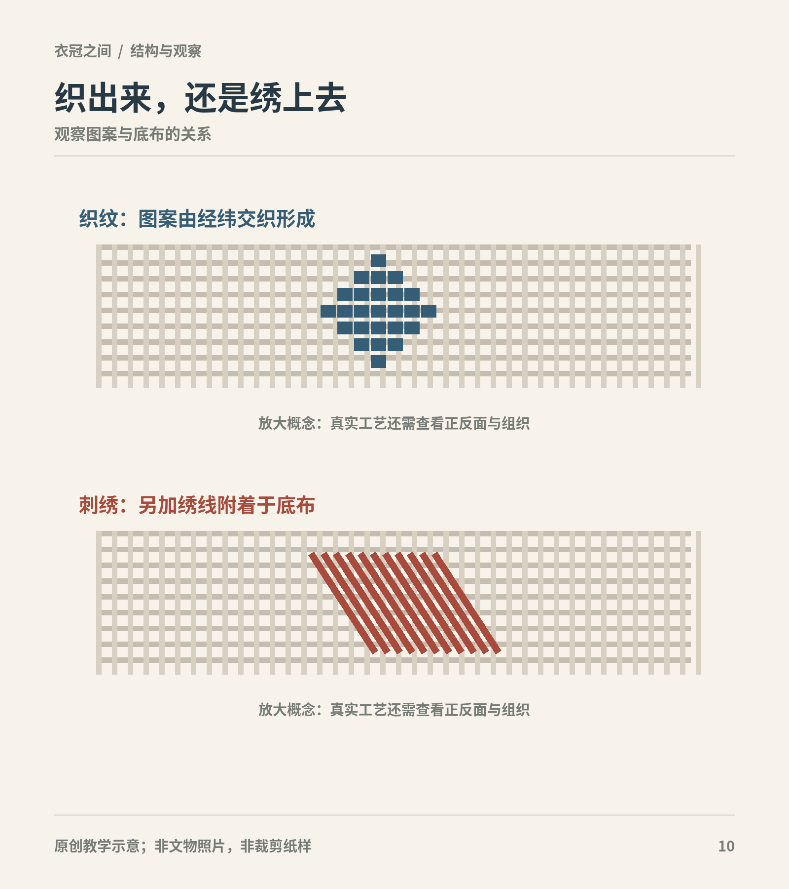

# 第18章　染色、纹样与装饰工艺

远看一朵花，可以很难分清它是织出来、绣出来、印出来还是画上去的。工艺差别却会影响布的反面、厚度、耐磨方式和制作顺序。读汉服上的颜色与纹样，应该先问它怎样出现，再讨论它意味着什么。

图｜以放大概念图比较图案进入经纬交织系统、与在底布上另加绣线的区别。 不是具体历史纹样或织绣工艺的完整操作图；复杂织锦和刺绣还存在多种技术。 原创教学示意。

## 颜色不是一个固定的屏幕数值

历史颜色由染料、纤维、染色条件、光照与保存共同影响。今天照片上的褐色，可能包含原染色、纤维老化、埋藏环境和拍摄色温的作用。不能从一张藏品照片取色，就宣布古人的“某某色”精确等于一个十六进制色值。

同一古代色名，也可能在不同文献和时期中覆盖不完全相同的范围。严谨的色彩复原需要实物分析、档案和染色实验互相配合；本书中的屏幕示色只用于比较观看，不是染色标准。

茜草、红花、苏木等都与历史红色染料有关，原料相同也不保证最终色相一致。北京中医药大学中医药博物馆介绍茜草时，将它与文献记载及马王堆长寿绣底色相联系，是一个可以把植物、文物和历史用语放在一起读的例子。[资料：中药茜草的染色应用](https://bowuguan.bucm.edu.cn/kpzl/zyyzs/65747.htm)

南京大学的云锦展示资料进一步说明，红花染色涉及提取色素、调节染液条件及反复漂染等工序。漂亮颜色的背后不是“把花泡水”这么简单。[资料：南京大学Art Lab“赤”](https://artlab.nju.edu.cn/heritage/brocade/red/)

## 先染线，还是先织布

如果经纬线在织造之前就带有颜色，图案能够通过不同颜色线的交织出现；若先织成布再染，颜色又可能作用于整体或局部。还有印花、彩绘及织后再绣等方式。一件衣物完全可能结合多种工艺。

国丝对绢、缎与锦的讲解中，介绍了妆花等织物在地组织与显花纬线上的变化。它提示我们，“底布是什么”和“花纹怎样做”可以同时有不同答案。[资料：什么是绫罗绸缎（下）](https://www.chinasilkmuseum.com/gskt/info_319.aspx?itemid=30975)

看正面时，可先找花纹边缘：是由规则的经纬交织形成，还是有线脚压在已经完整的底布上？反面若有清楚图像，常能提供进一步线索。不过，博物馆通常不允许观众翻动实物；看不到反面时应读技术说明，不凭想象定工艺。

## 绣、织与缂丝，别用一个“刺绣”概括

刺绣是在底料上以针线构成纹样；织花则把显花安排进织造过程。缂丝又具有分区回纬的技术特点，故宫对相关藏品的说明用“通经断纬”解释不同色纬的局部织入。它能够产生富于绘画感的图像，却仍属于织造，不能因为图案细腻就说成刺绣。[资料：故宫“缂丝”](https://www.dpm.org.cn/lemmas/239962.html?hl=%E7%BC%82%E4%B8%9D)

金色纹样也不只一种做法。金线可以参与织造，也可能以铺线再用其他线钉住的方式固定在表面。故宫对红纳纱百蝶金双喜单氅衣的说明，将多种针法和装饰方式放在具体藏品中解释；读者可以由此知道“金色”是视觉结果，工艺还要另查。[资料：红纳纱百蝶金双喜单氅衣](https://www.dpm.org.cn/collection/embroider/231344.html)

工艺差异不等于简单的贵贱排名。大面积金线、细密刺绣与轻薄纱罗，各有不同的制作条件和使用效果。是否适合活动、怎样与衣身结构配合，同样值得关注。

## 防染让“没有染到”也成为图案

绞缬通过扎、缝、缚等方法限制染液进入局部，解开后形成花纹；蜡缬使用蜡形成防染区域。图案不是最后贴上去，而是由受染与未受染部分共同构成。国丝的绞缬课程用扎结和染色解释这一过程，适合理解防染的基本原理。[资料：染缬——绞缬蓝染](https://www.chinasilkmuseum.com/bwgf/info_309.aspx?itemid=30784)

馆藏朵花纹蓝地蜡缬绢又提供了具体实物，并讨论蜡缬传播的历史背景。这里应保留馆方对源流的谨慎措辞，不把尚有讨论的问题写成唯一确定的起点。[资料：朵花纹蓝地蜡缬绢](https://www.chinasilkmuseum.com/zggd/info_21.aspx?itemid=2286)

防染图案的边缘可能带有色晕或重复节奏，但这不能成为万能鉴定法。现代印花也能模拟相似效果。历史工艺判断需要观察纤维和染色痕迹，不能只凭“看起来像手工”。

<!-- visual-study:model-northern-jiaoxie -->

**上身观察｜北朝绞缬绢衣：短身与宽袖。** 远看点阵分布，近看图案与领袖区域的关系。生成的白色点圈只模拟外观，不证明绞缬的绑结、浸染或织物微观。

**图像性质与边界：** AI 生成的成年模特展示，非史料、非真人实拍，非馆方认证复原。白色点圈为近似外观，不是微观织物或染缬工艺复刻；腋下拼缝与褶不能由此照片精确确认。灰裙、白内搭、发式为现代展示补足，不代表已有整套出土搭配。

**依据与支持特征：** [楼淑琦、王淑娟《中国丝绸博物馆：北朝绞缬绢衣的保护修复》](https://www.chinasilkmuseum.com/gskt/info_319.aspx?itemid=27772)：短身、基本对襟且下摆微交、喇叭宽袖、单层、红褐两组系带、斜向白色小圈绞缬点阵。

<!-- /visual-study:model-northern-jiaoxie -->

## 纹样意义需要语境

云、花、鸟兽、文字及几何纹，不同组合可以产生不同观看重点。某些纹样在特定礼制中关联身份，另一些用于祝愿或装饰。不能看到龙就认定是皇帝，看到凤就认定是皇后，也不能拿一套现代“吉祥寓意大全”解释所有年代。

更可靠的做法是先描述，再解释：图案在前胸、两肩、袖上还是裙摆？以单独纹章出现，还是反复排列？人物的身份与时代是否明确？制度文献是否确实谈到这种图样？当证据只支持“花卉纹”，就不用强行给每一枝花配上确定的爱情故事。

同样，颜色和纹样常共同起作用，但不是一一对应。服色限制、材料成本、染织供应和个人选择，可能同时影响衣物。讨论制度时，还需要区分“规定应该怎样”与“实物实际怎样”。

## 图案为何必须连同衣片一起看

同样一块花纹面料，裁成衣物后会被领缘、接缝和褶裥重新分割。图案是否在前中相接，是否沿袖展开，是否集中在相对平整的区域，都可以成为具体的观察问题。分析时应先看成衣，再回到纹样局部；只截取一朵花，很容易失去它原来的位置和比例。

这也影响今天的复原。把平面纹样印在一块现代布上，并不能保证裁成衣后与文物相同；排料方向、循环尺寸和接缝处理都可能改变效果。反过来，如果资料只保留了小块残片，我们可能知道纹样和工艺，却仍不知道它原本属于袖、裙还是其他物品。

对于寓意的解释，尽量保留“可能”“馆方释作”等限定。名称相近的植物纹有时仅凭照片难以确认，磨损和修补也会改变细节。与其给出过度具体的象征故事，不如把图像辨认的依据一并交代。

## 一次放大观察

选一件馆藏纺织品，先看整体，记录花纹分布；再看局部，记录线的方向和表面起伏。最后把问题列成三栏：能看见的工艺线索、馆方鉴定、仍不知道的内容。尝试用一句没有褒贬的文字描述它，例如“花纹集中在下摆横带，底部织物与显花工艺需分别辨认”。这比“工艺华丽、寓意美好”更能继续学习。

## 本章资料

- 北京中医药大学中医药博物馆：[中药茜草的染色应用](https://bowuguan.bucm.edu.cn/kpzl/zyyzs/65747.htm)。
- 南京大学Art Lab：[中国传统红色染料与红花染色](https://artlab.nju.edu.cn/heritage/brocade/red/)。
- 中国丝绸博物馆：[什么是绫罗绸缎（下）](https://www.chinasilkmuseum.com/gskt/info_319.aspx?itemid=30975)。
- 故宫博物院：[缂丝](https://www.dpm.org.cn/lemmas/239962.html?hl=%E7%BC%82%E4%B8%9D)、[红纳纱百蝶金双喜单氅衣](https://www.dpm.org.cn/collection/embroider/231344.html)。
- 中国丝绸博物馆：[绞缬蓝染](https://www.chinasilkmuseum.com/bwgf/info_309.aspx?itemid=30784)、[朵花纹蓝地蜡缬绢](https://www.chinasilkmuseum.com/zggd/info_21.aspx?itemid=2286)。
