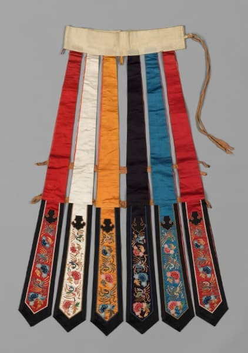
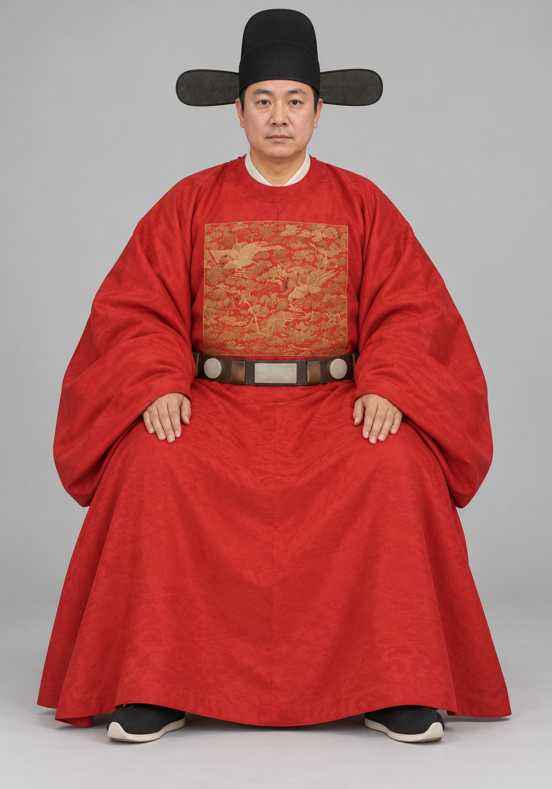

# 第19章　身份、场合与制度：礼服、常服和婚服

图｜彩条婚裙（Rainbow Skirt），19世纪晚期。可观察多色长条、上部裙腰、横向连接及尖端刺绣。馆方将其解释为婚嫁衣物。 不同于常见整幅褶裙，不能用这例婚服概括清代全部女性日常衣着；原有铃铛据馆方文字，照片中未完整显示。 资料与图片：[Cleveland Museum of Art（克利夫兰艺术博物馆），1916.1353](https://www.clevelandart.org/art/1916.1353)。图片权利：CC0；CMA Open Access。馆藏页明确允许复制、修改和分发，无须另行许可。

## 一个人，为什么需要几套不同衣冠

衣服既覆盖身体，也让旁人辨认人在什么关系和活动中。参加祭祀、朝会、办公、宴饮或居家，并不一定使用同样衣冠；同一件衣物在不同历史时期，也可能拥有不同意义。因此，本章谈制度时，始终把三个问题放在一起：谁穿、何时穿、由什么材料证明。

“礼服”首先是场合与制度问题，不是“特别华丽的衣服”的同义词。某件素净衣物可能适用于重要礼仪，一件装饰繁复的衣物也可能属于宴游和便服。现代以视觉豪华程度排序的习惯，不宜直接搬进古代冠服制度。

## 冠服以整套系统表达身份

明代衍圣公朝服的研究显示，主服之外还需观察梁冠、中单、带、佩、绶与笏。身份信息分布在多个部位：只看一件红色上衣，远不足以恢复完整制度。[资料：徐冉《明代品官朝服探析》](https://www.rujiazg.com/article/23686)。

这里不需要先背诵一整张品级表。读者可以先知道：某些区别放在冠上，某些放在腰间或身后，材质和数量也可能参与表达。知道“信息在哪”，再查具体年代与身份的规定，通常比脱离实物死记数字更有效。

一套衣冠也可能经历制度调整。故宫《明代官员服饰研究》对朝服、祭服、公服、常服等分类及变化进行说明；“常服”是历史制度中的名称，不宜直接理解成今天随便穿着的日常衣。[资料：故宫《明代官员服饰研究》](https://www.dpm.org.cn/Uploads/File/2019/11/25/u5ddbb3f9e989e.pdf)。同理，不同朝代的“常服”未必结构相同，不能只因名称一样就串成一件不变衣物。

## 制度规定和实际生活为什么有距离

法令表明统治者希望怎样划分身份，实物、图像和笔记则展示人们如何穿用。二者可能一致，也可能存在差距。衣物会被赏赐、改制、长期保存，地方习惯也可能影响执行。

读到“某色禁用”时，应继续追问哪一年、针对什么身份、什么材料与场合，以及记录来自律例还是后世转述。看见一件与通行概括不符的实物，也不应立刻断言制度全无作用。它可能有特许背景，也可能需要重新定年或核实身份。

这类差距让制度史变得具体：衣冠既是秩序，也处在消费、时尚和人的愿望之中。用“遵守”或“僭越”两个词给所有衣物分组，无法解释丰富生活。

<!-- visual-study:model-ming-yuanling-portrait-study -->

**上身观察｜圆领袍：领口、宽袖、补子和带的位置。** 本图从一幅人物画像转译衣着关系。既然原画像的身份表述可能理想化，更不能让生成补子的鸟纹替你确定一个官阶。

**图像性质与边界：** AI 生成的现代成年模特复原展示，非史料、非馆方认证复原。据画像转译可见位置关系，不是人物复原。补子、带銙细节及织纹为近似；不能据生成的鸟纹判定官阶。内层领、鞋、当代模特及坐具为补足。

**依据与支持特征：** [The Metropolitan Museum of Art, Portrait of a Gentleman, 51.39.4](https://www.metmuseum.org/art/collection/search/48939)：16或17世纪画像中的圆领红袍、方形补子、腰带与带翼帽的组合。馆方提醒画像身份可能理想化。

<!-- /visual-study:model-ming-yuanling-portrait-study -->

## 凤冠霞帔为何不能直接当作全民婚服

凤冠、霞帔各有发展过程，作为特定礼服的组成部分，曾与身份等级密切相连。明清婚俗中，民间对高等级衣冠的借用与重新组合，使“凤冠霞帔”逐渐成为广为人知的婚嫁意象。赵瑶丹对明清嫁衣礼俗的研究提供了一个具体衔接：洪武时期允许平民婚嫁时借用九品等级服装，但这一规定不能直接等同于明确规定人人使用“凤冠霞帔”组合。明中叶以后的婚俗又有自己的发展。制度准许借用某个等级，与地方实践逐渐形成熟悉的新娘形象，是相互关联而不同的历史过程。[资料：赵瑶丹《明清嫁衣中的礼俗嬗变》](https://www.zjnu.edu.cn/2026/0626/c10361a577881/page.htm)。

这条线索不能倒推为先秦至清代所有新娘都穿同一种红衣、戴同一式凤冠。也不能把明代皇后的一顶冠复制后，称为历代平民婚礼的标准配件。研究对象的身份、年代和场合，必须跟着图像一起出现。

国博对孝端皇后凤冠的解读，提示这类冠饰首先关联具体皇后与高等级宫廷生活。[资料：国博《孝端皇后凤冠》](https://www.chnmuseum.cn/zx/gbxw/202505/t20250516_271725.shtml)。它适合帮助理解冠饰工艺与皇权表达，却不足以为任何一场历史婚礼提供全套造型。

## 婚服的颜色与地方差异

今天红色婚服非常常见，但不能将当代习惯当作贯穿古代的定律。具体研究应查看当时礼书、地方志、画像、实物及照片，注意资料分别写的是理想仪式、地方习俗还是特定家庭的做法。颜色名称还可能与现代色卡不同，保存后的织物也会变化。

即使在同一地区，家庭财富、衣物来源与租借制度也可能影响婚礼装束。贫富差异不只体现在刺绣多少，还涉及是否拥有整套配件、能否取得特定织物、衣物是否为家庭反复使用。看一张礼服画像时，不宜因此推算普通人的日常衣橱。

现代举办传统主题婚礼，可以据具体时代和地区选择参照，也可以明确采用当代设计。知识上最重要的是把选择说清楚：哪些部分有实物依据，哪些为了行动便利修改，哪些属于婚礼策划的当代创造。这样既不需假装每个细节都有古代出处，也保留了真正值得学习的历史内容。

## 性别、年龄与人生阶段

衣冠制度还可能涉及年龄、婚姻状态和亲属关系，但一个发式或一件衣服通常不足以单独判断人物。画像可能追绘，礼仪形象也可能使用程式化表达。将某种发式一律归为未婚、某一颜色一律归为已婚，会把地方与时期差异抹去。

冠笄、婚礼和丧礼相关衣冠，更需要区分经书规范、后世礼书实践与当代复原活动。古代文献对理想秩序的描述，可以成为研究对象，却不自动证明某一仪式在所有地区长期按同样方式举行。复原展示宜标明使用哪一版本礼书、参照哪一件衣物，而非只写“古礼”。

## 穿用资格与今日欣赏

古代等级制度限制谁能穿什么，是理解历史的材料，而不是今天必须恢复的社会秩序。现代读者可以欣赏织造与配色，也可以批判其背后的身份压迫。研究者解释一件衣物曾经如何标示权力，不等于赞同这种权力分配。

今天将礼服用于展演或拍摄，需要说明它原来的用途与身份条件，但不必借服装复制旧有尊卑。尤其是入门教学，应让读者知道制度如何运作，同时保留对真实生活者的关心：华服的制作需要谁的劳动，昂贵材料怎样取得，哪些人的衣物更容易被保存。衣冠不只有被看见的穿着者，也有常被忽略的制作者。

## 一次小观察

为一件礼服建一张“身份证”：时代、地域、穿着者、身份、场合、主服、配件、依据。遇到空白，先查资料；仍不明确就写“未详”。最后另写一句它给人的视觉感受。把证据和感受分开，你仍然可以欣赏它的美，也更不容易把美感误认成历史事实。

## 本章资料

- 徐冉：《明代品官朝服探析——以孔府旧藏衍圣公朝服为例》，《文物天地》2021年第12期。
- 故宫博物院：《明代官员服饰研究》。
- 赵瑶丹：《明清嫁衣中的礼俗嬗变》，《光明日报》2026年6月26日，作者所在大学全文发布。
- 中国国家博物馆：《孝端皇后凤冠：欲享其尊，必承其重》，2025年。正文链接分别支持朝服系统、用途分类、婚俗转变和特定冠饰案例。
