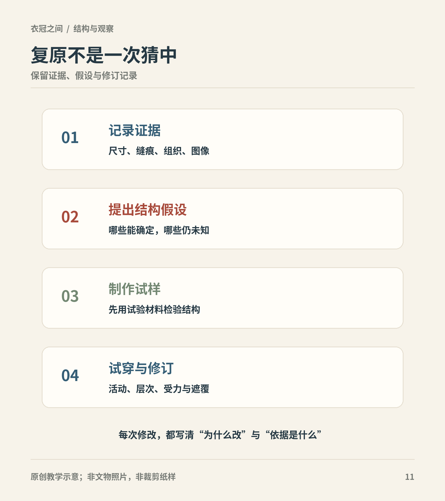

# 第20章　从布到衣：裁剪、缝合与复原

一张服饰复原照最容易让人记住成品，真正困难的部分却在成品出现之前：残缺处怎样判断，衣片如何相接，布幅能否容纳排料，最后又为什么选择这种穿法。理解这些过程，可以让我们欣赏复原，也知道它没有自动解决所有历史问题。

图｜把服饰复原作为有记录、可修订的解释过程，证据与假设须分别保留。 流程是现代研究工作方法概括，并非对某一历史服装纸样的证明。 原创教学示意。

## 复原首先是一组需要交代的选择

本章所说的服饰复原，是根据历史材料提出可检验的成衣或穿着方案。它可能只复原一件衣物的结构，也可能进一步尝试材料、工艺和整套搭配。不同目标的证据要求不同，不能把所有挂着“复原”名称的作品都当作同等强度的研究成果。

中国丝绸博物馆“明之华章”项目将保护、修复、复原、研究展示与教育联系起来，显示复原通常是长期工作的一部分，而不是照着一张画立即缝出一套衣服。[资料：“明之华章”项目](https://chinasilkmuseum.com/cs/info_164.aspx?itemid=30579&parent=)

如果作品只依据人物画的外轮廓，较稳妥的说法是“图像参考下的穿着方案”。若衣片、缝线和纤维都有详细记录，才能继续讨论结构及工艺的对应程度。明确名称，是为了让观看者知道成果可以回答什么问题。

## 先记录原件，再补足缺失

纺织文物常有破损、变形、污染与缺失。展开后的尺寸未必等于刚制作时的尺寸，褶皱和收缩也可能影响判断。因此记录应包括保存状态、织物方向、缝线、针孔、边缘和后期修补，不能只量一个衣长与通袖长。

原件缺失时，可以借助同墓、同时期或相近结构的其他材料，但推断层级必须写清。用另一件衣物补出缺口，是比较研究，不是原件自己提供了这个细节。对于图像未展示的背面，也应明确属于推定方案。

国丝年度报告介绍南宋服饰研究时，把织物结构、纹样、服装形制、图像复原与成衣复原相连接。这个顺序说明，成衣是分析的结果，也会反过来检验分析。[资料：国丝2019年度报告，南宋服饰相关项目](https://www.chinasilkmuseum.com/uploadfiles/2020/04/20200408145939242.pdf)

## 布幅和经纬方向限制了裁剪

现代读者习惯把衣片看成任意形状，古代制衣却同样面对可获得的布幅与材料特性。经纬方向会影响悬垂与变形；一块布能否排下袖身或前襟，取决于实际宽度，而不是示意图上画得是否整齐。

这里也要避免另一种极端：并非所有中国古代衣物都只由矩形构成，更不能为了证明“零浪费”而抹去曲线、斜裁、拼接与修整。具体裁法应回到实物测绘。即使使用矩形主片，腋下、领口、衣缘和下摆仍可能有复杂处理。

国丝复原研习的纪实记录了从排料、裁剪到缝制的连续工作，适合提醒初学者：看懂外形只是第一步，真正制成衣物还要解决工序与部件之间的依赖。[资料：复原研习班第二日](https://www.chinasilkmuseum.com/cs/info_164.aspx?itemid=30859)

## 接缝不是应该被忽略的瑕疵

缝线把平面布片转化为可以穿的体积。肩、袖、腋下、腰部和下摆的连接，决定力量在哪里集中，也决定衣物能否顺利翻转、收边和套穿。接缝还可以显示拼接、改衣或再次利用材料的历史。

观察时，应区分裁片接缝、折边缝和装饰线。衣物表面的一道横线，可能是上衣与下部相接，也可能只是一条装饰或折痕。没有细节图时，不宜把它直接称为“腰接”。相反，一件看似连贯的衣身，也可能因为纹样对齐而隐藏了接缝。

制作次序同样会限制结果。例如先把狭小部位完全封住，后面的收边就可能难以操作。现代复原者可以根据缝制可行性提出工序，但只有针孔、缝法和相关材料能够进一步支持其历史对应程度。

## 材料替换会改变试穿结论

用便宜布做样衣，是减少浪费和检验体积的常见办法；但样衣布和原件材料的挺软、厚度与摩擦不同，试穿效果也可能改变。样衣能检验“袖口是否够手通过”，却不一定能直接说明历史成衣的垂落状态。

国丝2021年度报告将织造与染色工艺的复原、排料推测和成衣缝制放在同一研究链条中，说明材料实验不是后补装饰，而可能是回答结构问题的重要条件。[资料：国丝2021年度报告，服饰复原相关条目](https://www.chinasilkmuseum.com/uploadfiles/2022/03/20220310150444039.pdf)

今天采用化纤或机器绣制作日常汉服，有它的成本和维护理由。只要如实说明，就不需要把它包装成历史材料复刻；研究复原与当代成衣可以有不同目标。

## 让穿着实验留下可比较的记录

好的试穿记录应写明对象与方法：依据哪件文物，采用什么尺寸，哪些地方补配，材料换了什么，穿着者与衣物尺码关系如何。动作也应有条件，例如站立、抬臂、坐下、迈步，各自观察领口、袖身和衣摆变化。

如果领口松开，可能涉及系结、内层、尺寸或材料，不能马上归结为“古人一定这样穿”。反复比较能排除一部分不合理方案，却无法保证剩下的唯一一种就是历史真相。实验的价值在于缩小解释范围，而非把现代体验当作过去的直接证词。

<!-- visual-study:model-ming-qian-sleeve-layers -->

**上身观察｜钱氏三件套近看：两层袖子怎样相接。** 上身照片能提出“外袖是否压住内袖”等问题，但真正的制作记录还要写明尺寸、面料和缝法。本图不是可直接照裁的纸样。

**图像性质与边界：** AI生成的现代成年模特复原展示，非史料。沿用整身图的同一虚拟试制设计，近景用于看短袖外层和长袖内层，不用于复制具体绮纹、刺绣针法、缝线或染色。色差为增强层次阅读的展示选择。

**依据与支持特征：** [中国丝绸博物馆《绢短袖衫&绮长袖衫&绢裙》](https://www.chinasilkmuseum.com/zggd/info_21.aspx?itemid=1870)：钱姓女子三件套，直领对襟、短袖外层和长袖内层、外衫系带、裙褶与较宽中央褶。

<!-- /visual-study:model-ming-qian-sleeve-layers -->

## 一份测量表应该写什么

想比较不同复原方案，测量名目必须一致。衣长从哪里起量，袖长是否包含衣身横宽，腰宽是单片平量还是围合尺寸，都要写清。图上最好同时画出测量起止点，而不是只排列数字。不同文物保存状态不同，破损处的估计长度也应与实际量得长度分别标记。

同一张表还应记录材料厚度、布幅与是否加里。否则一位制作者的“穿着不合身”，可能来自材料替换，另一位的“可以穿”可能来自改变了尺寸，二者并没有检验同一个问题。

当方案修改时，保留前一版与修改原因尤其重要。加大袖根、调整系带位置、改变腰部拼接，都应说明依据是新的历史材料，还是现代试穿中发现的困难。这样，复原才形成能被后来者理解的研究过程，而不是只留下最后一张看似确定的照片。

## 不做真衣，也能学习制衣逻辑

选一件有平铺图的藏品，用纸分别画出可确认的主片与接缝。缺失处用虚线表示，不添加尺寸。给每条线标记“原件可见”“馆方说明”或“自己的推测”。再写出一份部件连接顺序，并检查是否有某一步会让后续收边无法完成。这是一项结构理解练习，不是可直接用于人体裁剪的纸样。

## 本章资料

- 中国丝绸博物馆：[“明之华章”修复与复原项目](https://chinasilkmuseum.com/cs/info_164.aspx?itemid=30579&parent=)。
- 中国丝绸博物馆：[2019年度报告](https://www.chinasilkmuseum.com/uploadfiles/2020/04/20200408145939242.pdf)。
- 中国丝绸博物馆：[复原研习班第二日](https://www.chinasilkmuseum.com/cs/info_164.aspx?itemid=30859)。
- 中国丝绸博物馆：[2021年度报告](https://www.chinasilkmuseum.com/uploadfiles/2022/03/20220310150444039.pdf)。
- 中国丝绸博物馆：[南宋褙子、围裹式两片裙裁剪与制作](https://www.chinasilkmuseum.com/ngcxg/info_11.aspx?itemid=31129)。
