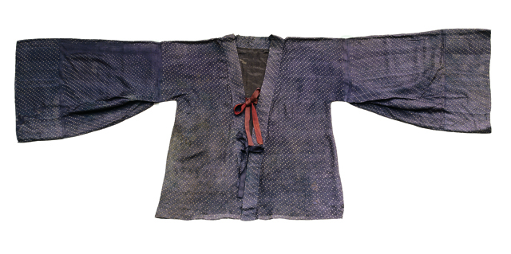
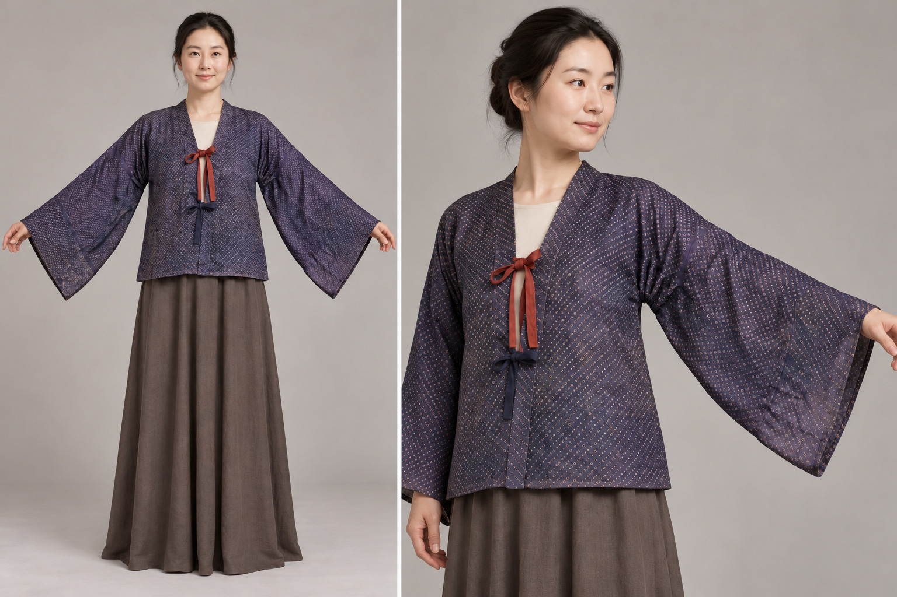
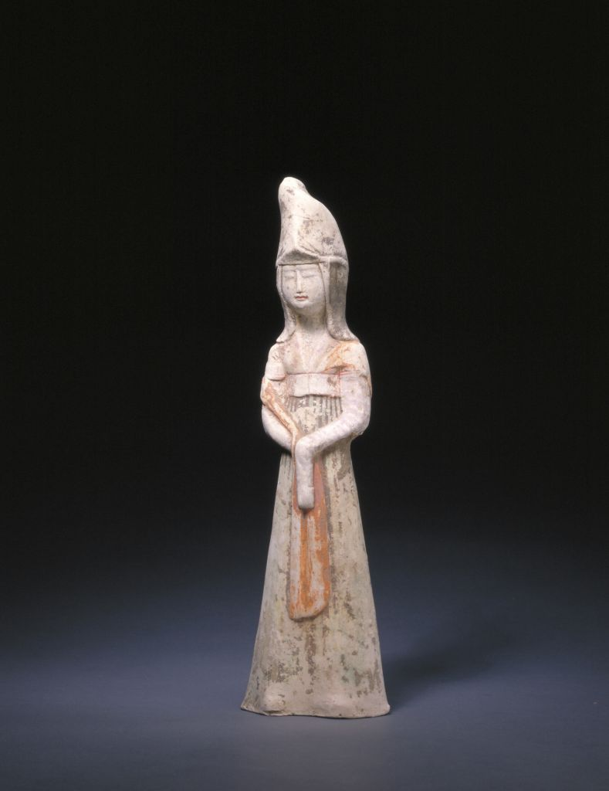
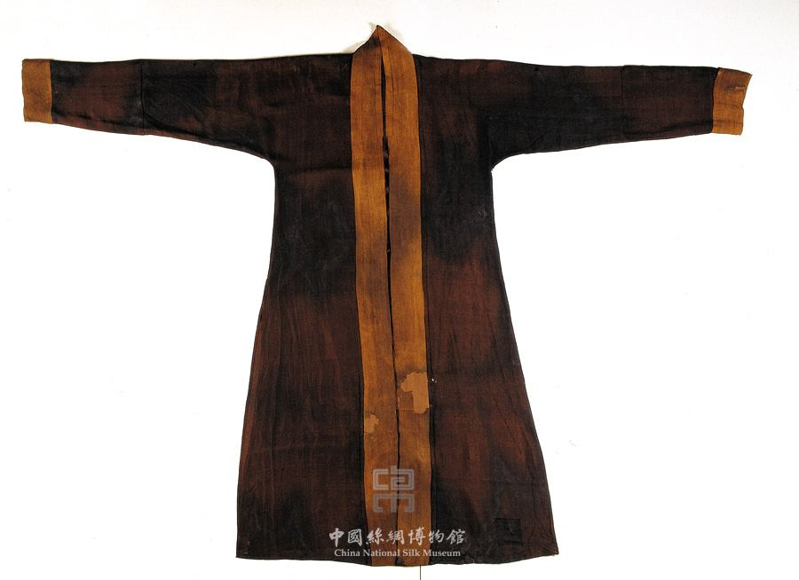
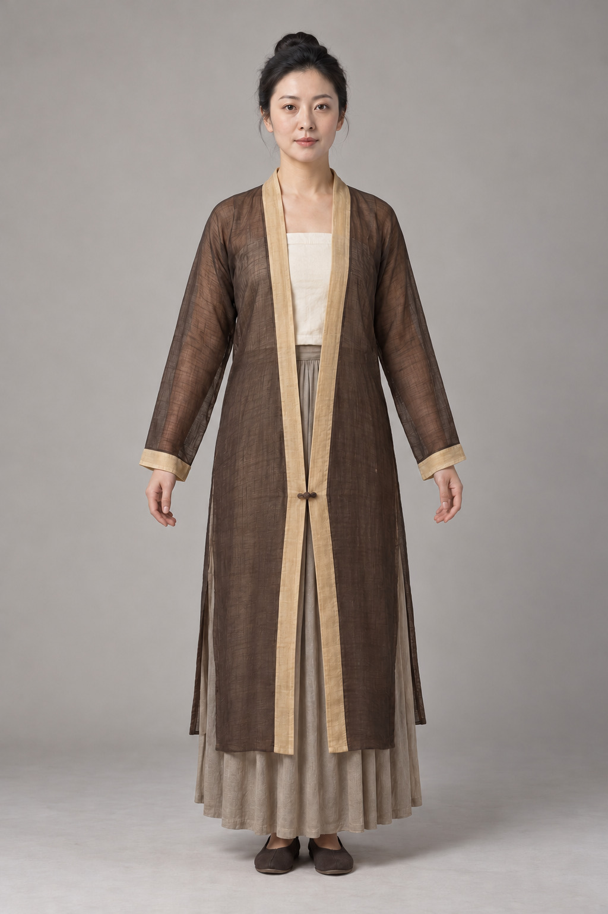
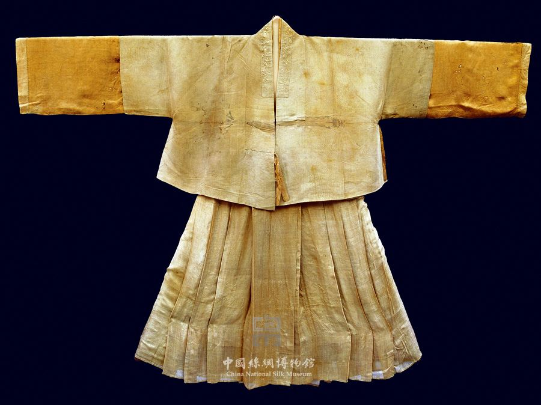
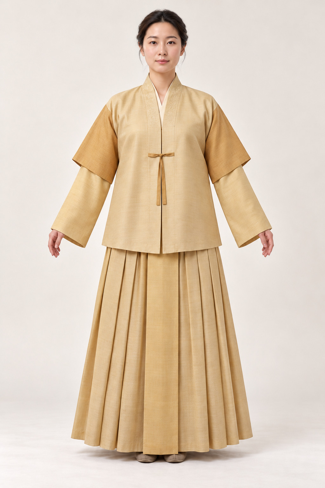
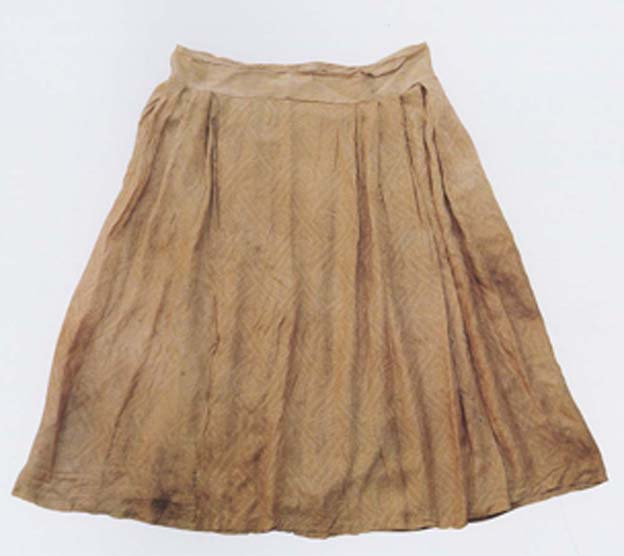

# 第21章　走进博物馆：八组实物与图像细读

博物馆的衣服常被平放，穿衣俑却以立体人物出现。前者可以帮助核对缝线，后者可以提示搭配关系，两者能回答的问题并不相同。本章选八组有机构资料的对象，不把它们凑成一条没有缺口的通史。每看一组，都先问：这是衣物本身、穿衣形象，还是研究者重建的效果？

## 一、北朝绞缬绢衣：一件衣物有不止一种信息

中国丝绸博物馆藏**北朝绞缬绢衣**，为短身、基本对襟的单层衣物。馆方修复报告说明，衣襟有两组系带，袖子张开，腋下拼缝附近另有打褶。与其只记住“大袖”，不如沿领缘、袖根和衣襟找出构造连接：袖宽不是袖口一项尺寸就能完整表达，衣身和袖子之间也有加工处理。[资料：国丝《北朝绞缬绢衣的保护修复》](https://www.chinasilkmuseum.com/gskt/info_319.aspx?itemid=27772)

点状纹样又提供另一条观察路线。看似小白点的图形，放大后有边界与晕染变化；它们与绞缬防染工艺有关，不能直接当成织出来的小花。修复前后的图也值得并置：今天能看见的完整轮廓，含有专业支撑与整理的工作。记录时应把原件、修复图和形制复原图分别命名。

图｜北朝绞缬绢衣（修复后，原报告图12），北朝。可观察基本对襟、宽袖、腋下褶、两组系带以及点状绞缬纹样。 此为修复后照片，包含加固、补配和门襟系带修复，不能把可见完整状态全部归为未经修复的原始状态。 资料与图片：[中国丝绸博物馆](https://www.chinasilkmuseum.com/gskt/info_319.aspx?itemid=27772)。图片权利：版权归原权利人，本节教学评述引用，未标为开放授权。

<!-- visual-study:model-northern-jiaoxie -->

**上身观察｜北朝绞缬绢衣：短身与宽袖。** 与本节原件照片配读：原件支持的短身、宽袖和系带，与生成展示补入的模特、内搭和裙，应写进不同栏。

**图像性质与边界：** AI 生成的成年模特展示，非史料、非真人实拍，非馆方认证复原。白色点圈为近似外观，不是微观织物或染缬工艺复刻；腋下拼缝与褶不能由此照片精确确认。灰裙、白内搭、发式为现代展示补足，不代表已有整套出土搭配。

**依据与支持特征：** [楼淑琦、王淑娟《中国丝绸博物馆：北朝绞缬绢衣的保护修复》](https://www.chinasilkmuseum.com/gskt/info_319.aspx?itemid=27772)：短身、基本对襟且下摆微交、喇叭宽袖、单层、红褐两组系带、斜向白色小圈绞缬点阵。

<!-- /visual-study:model-northern-jiaoxie -->

## 二、唐代陶彩绘女俑：看得见高束裙，看不见全部裙腰

故宫博物院的**陶彩绘女俑**，馆方定为唐代，描述其上穿窄袖对襟短襦衫，下穿条纹长裙，裙腰位置较高。这是观察短上衣与长裙比例的一件具体图像资料。[资料：故宫藏品页](https://www.dpm.org.cn/collection/sculpture/233402.html)

可把视线从肩部移至胸前、双手和裙身，观察上衣边界在哪里被裙或手臂遮住。随后暂停：陶俑无法让我们拆开腰部，也没有展露整片裙子的内侧。它能支持可见的穿着关系，却不足以单独证明当代某一套“齐胸裙”纸样。条纹随表面起伏的表现，也未必等于真实织物每一道褶的精确数量。

图｜陶彩绘女俑，唐。可观察高冠、窄袖短上衣、条纹长裙及较高裙腰位置，正面手势遮挡衣裙交界。 陶俑是衣着图像证据，不能凭正面照片断定裙内系结、裁片数量与真实褶数。 资料与图片：[故宫博物院](https://www.dpm.org.cn/collection/sculpture/233402.html)。图片权利：版权归原权利人，本节教学评述引用，未标为开放授权。

## 三、唐代陶男俑：领、带、靴构成组合

中国国家博物馆藏**陶男俑**，馆方在唐代常服背景下介绍其圆领袍、幞头与靴。研究它时，领型当然重要，但腰间束带与下摆长度同样参与了整体形象。[资料：国博《陶男俑》](https://www.chnmuseum.cn/zp/zpml/kgfjp/202111/t20211116_252268.shtml)

尝试只画头、领、腰带、袍边与靴口五条位置线。这样会发现，服装识别并非寻找一个领子符号。陶俑的体量与姿态又可能改变衣褶表现；没有保存的背部细节、袍内衣层和扣系方式，应继续留空，等待其他资料补充。

## 四、宋代素罗背子：一粒扣子能修正概括

中国丝绸博物馆藏**素罗背子**，馆方定为宋，具体介绍关联南宋女性墓葬，强调直领对襟、窄袖和领襟缘边，并记有前襟中部一粒同类面料编成的扣子。[资料：国丝藏品页](https://www.chinasilkmuseum.com/zggd/info_21.aspx?itemid=1830)

这件实物适合纠正“所有褙子都不系扣”的概括。先分清：某件实物有扣，并不意味着每件同名衣物都有扣；同样，另一些实例没有扣，也不能抹去这一件的存在。馆方不同文章可能使用“背子”“褙子”或“单衣”等称呼，引用时保留资料原名，再说明讨论的是哪件对象。

图｜素罗背子，宋（960—1279）；馆方说明关联南宋女性墓葬。整体图可观察直领对襟、窄袖与浅色缘边；扣子存在据馆方文字和专题局部图，本张整体图中细节不够清楚。 不同官方介绍或称单衣、背子/褙子；本条保留所引馆藏页原名。不开启衣物内部，不能把照片独自当裁剪纸样。保留原图水印。 资料与图片：[中国丝绸博物馆](https://www.chinasilkmuseum.com/zggd/info_21.aspx?itemid=1830)。图片权利：版权归原权利人，本节教学评述引用，未标为开放授权。

<!-- visual-study:model-song-beizi-front -->

**上身观察｜周氏墓素罗单衣的正面试穿参照。** 原件平铺图与上身参照不能互相替代。后者让长衣比例直观，却不能核实原件细小罗孔或扣子的编制。

**图像性质与边界：** AI 生成的复原展示，非史料，不是原件穿着照片或等比例裁剪依据。 胸前覆盖与裙为中性不透内层补足，不宣称是周氏完整穿着组合。 现存褐黄色不等于复原染色；罗孔细观与纽扣编制工艺仍须看实物，不以生成纹理证明。

**依据与支持特征：** [中国丝绸博物馆《一物Vol.38｜素罗单衣》](https://www.chinasilkmuseum.com/gskt/info_319.aspx?itemid=28354)：1274年周氏墓实物；衣长120cm、通袖长140cm；直领对襟、窄袖、长侧衩、异色缘边与一粒同料纽扣。 [中国丝绸博物馆《素罗背子》](https://www.chinasilkmuseum.com/zggd/info_21.aspx?itemid=1830)：同件藏品基本形制及同料纽扣，已查看仓库中的馆藏实物图。

<!-- /visual-study:model-song-beizi-front -->

## 五、明初三件套：层次需要成组证据

国丝的**绢短袖衫、绮长袖衫与绢裙**，年代为明，说明关联明初钱姓女子，包含长袖内层、短袖外层与裙。外层有系带和腋下开衩；内外层织物也不相同。[资料：国丝成组藏品页](https://www.chinasilkmuseum.com/zggd/info_21.aspx?itemid=1870)

把三件衣物逐一标成“贴身与否未知的内层”“覆盖在外的上衣”“下装”，比直接套现代三件套商品名可靠。所谓内层，只说明它在这一组合中的相对位置，不等于证明它直接接触皮肤。此组材料还说明，衣长接近的两件上衣可以借袖长、侧部开口和织物变化形成层次。

图｜绢短袖衫、绮长袖衫与绢裙（明初钱姓女子三件套组合），明（1368—1644）；馆方说明为明初。可观察长袖层、外罩短袖层与下裙成组展示，以及袖长和衣长关系。 展示组合与馆方文字应共同阅读；照片不能直接证明内层是否贴身，也没有显露后背与所有闭合部件。保留原图水印。 资料与图片：[中国丝绸博物馆](https://www.chinasilkmuseum.com/zggd/info_21.aspx?itemid=1870)。图片权利：版权归原权利人，本节教学评述引用，未标为开放授权。

<!-- visual-study:model-ming-qian-three-piece -->

**上身观察｜钱氏三件套：短袖在外，长袖在内。** 这里的三件层次有成组实物支撑；模特的发式与鞋则没有同样程度的依据。

**图像性质与边界：** AI 生成的现代成年模特复原展示，非史料、非馆方认证复原。只示范正面层次。色相、现代发髻、鞋及具体刺绣细节为展示性补足，不复原染前原色或隐藏结构。

**依据与支持特征：** [中国丝绸博物馆《绢短袖衫&绮长袖衫&绢裙》](https://www.chinasilkmuseum.com/zggd/info_21.aspx?itemid=1870)：钱姓女子三件套，直领对襟、短袖外层和长袖内层、外衫系带、裙褶与较宽中央褶。

<!-- /visual-study:model-ming-qian-three-piece -->

## 六、明代曲水如意云纹罗裙：裙名之外有结构

国丝藏**曲水如意云纹罗裙**，定为明代，说明其有对称折裥、裙片重叠及与裙身缝合的裙腰。观察时可分两遍：先追踪无褶区域和褶区的关系，再看曲水骨架与如意云纹。[资料：国丝藏品页](https://www.chinasilkmuseum.com/zggd/info_21.aspx?itemid=1905)

前一遍是在看结构，后一遍是在看织物装饰。裙门不是由纹样是否华丽决定的；同一种结构可以用素料，也可以用花料。馆方使用“雏形”一类历史判断时，应保留其具体语境，不能因此自行推出所有裙式的单一起源路线。

图｜曲水如意云纹罗裙，明（1368—1644）。可观察较宽无褶区域、侧部折裥、裙腰与裙身边界。 整体图纹样不够清晰，不应据它认读织物组织；结构与图案参数须依馆方文字。所谓雏形是资料中的比较判断，不是所有裙式的起源证据。 资料与图片：[中国丝绸博物馆](https://www.chinasilkmuseum.com/zggd/info_21.aspx?itemid=1905)。图片权利：版权归原权利人，本节教学评述引用，未标为开放授权。

## 七、清代红色皮球花纹绸马面裙：别把现代系带套给原件

国丝藏**红色皮球花纹绸马面裙**，年代为清，记录了两片裙及裙腰处的扣、扣绊；裙门、裙边与两侧褶区具有不同装饰。[资料：国丝藏品页](https://www.chinasilkmuseum.com/zggd/info_21.aspx?itemid=1974)

当代常见商品多用长带缠系，这件藏品却提醒我们：围合装置也有具体差异。比较时应画出实际扣位，不能因为名字熟悉，就预设它一定与自己的裙子一样。皮球花、边饰与裙褶分属不同观察层面，把它们分别记录，才能解释“同叫马面裙，为什么看起来并不一样”。

## 八、清乾隆夹袍：通过相邻传统看边界

故宫藏**蓝色簟锦纹暗花绸夹袍**，清乾隆时期，清宫旧藏，编号故00042223。其说明列有圆领、大襟右衽、马蹄袖与四开裾，网页提供正面、背面和局部图。[资料：故宫藏品页](https://www.dpm.org.cn/collection/embroider/230601.html)

此处将它作为清宫服饰的比较对象，不把它直接归入狭义汉服。它同时具有右衽和圆领，说明两个特征不足以判定族属、制度或年代。背面图尤其有用：正面难见的开裾，在背部能得到补充。还应注意，“常服”是特定制度中的名称，皇帝常服不等于当时所有人的日常衣物。

## 将八组观察连起来

这些实例给出了三种不同收获：衣物可以留下工艺与磨损，俑像可以表现穿着关系，成组资料与多视图能减少单一视角的误判。遇到无法解释的边界，先检查证据类型，再寻找更完整的图与报告。承认“不知道内层如何”，往往比给出一张流畅但无据的复原图更接近历史。

**观察练习：**任选本章两件藏品，分别写下三项能直接看见的细节、一项馆方提供的信息和一项仍待核实的问题。不要把自己的推测混写进“直接看见”一栏。

本章资料均由对象旁链接指向藏品机构；藏品名、年代与归藏以相应机构当前说明为准。线上照片可供观察，不等于自动获得复制出版许可。
