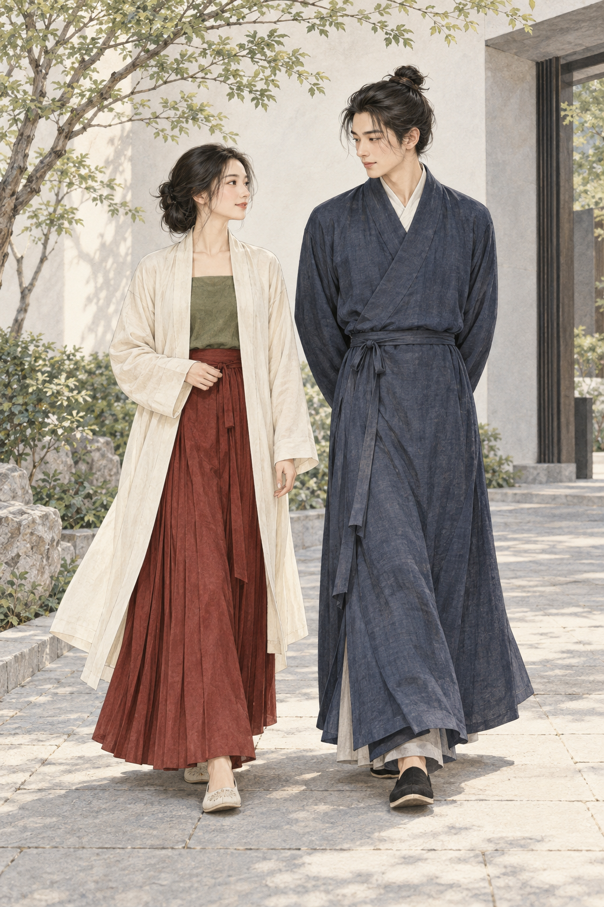
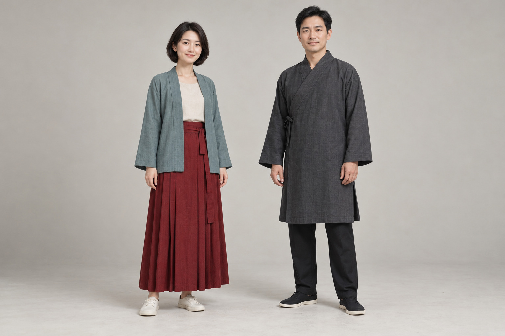

# 第22章　当代汉服：重建、商品与日常穿用

今天的汉服有一个十分现实的特征：它既与历史衣冠有关，又由今天的人制作和穿着。有人研究出土衣物，有人举办节日活动，有人只是喜欢一件裙子在行走时展开的样子。这些动机可以相遇，却不必被压成同一种目的。

图｜当代穿着的层次与衣长关系，AI教学插画。用于观察外衣、上衣和下装的长度及行走状态，不代表某一朝代的标准套装。

## 历史衣物进入今天，需要经过哪些环节

从馆藏到衣橱，至少有资料辨认、结构解释、材料选择、制作和穿着调整几个环节。图像保存的是可见表面，出土实物也可能缺损；复原者需要提出解释，再以样衣检验。中国丝绸博物馆的复原研习纪实，记录了学员比较染色布样与绞缬原件、核对纹样和结构细节的过程。这说明复原的可靠性来自可说明的工作，而不是一张成品照片的古意。[资料：国丝2022年研习班纪实](https://www.chinasilkmuseum.com/ngcxg/info_11.aspx?itemid=30861)

同一件原物也可能出现不同方案。差异可能来自缺失部位的处理，也可能来自现代布幅、缝线或人体尺寸。读者可以比较方案，却不应因为某一方案更流行，就把它当成古代唯一穿法。理想的说明应列明原型、保留部分、推定部分和现代调整。

## 复原、历史参考与当代设计

本书使用以下区分帮助阅读商品说明，并不把它当成行业已统一执行的等级标准。

| 讨论对象 | 应重点说明 | 适合怎样评价 |
| --- | --- | --- |
| 有明确对象的复原实践 | 原型、依据、推定范围、材料替代 | 解释是否透明，构造是否有据 |
| 参考某时期衣物的设计 | 采用了哪些结构，修改了哪些部分 | 来源是否说清，穿着是否合理 |
| 当代汉服或新中式设计 | 实际版型、面料、用途与护理 | 设计、质量、舒适度与场景是否匹配 |
| 舞台、影视及幻想服装 | 叙事与表演需求 | 视觉和表演效果，及历史声明是否准确 |

这些对象都可以有审美价值。问题出现在评价错位：以舞台效果替代历史证明，或用考古复原的要求解释每一次日常穿搭。设计者允许改动，但描述应让读者知道改在哪里。

## 博物馆参与了什么

当代汉服的活动并非只有走秀。国丝2024年“古韵今风”招募文件把传统服饰融入当今生活作为议题；2025年“天工霓裳”活动又集中讨论传统工艺、研究团队与现代设计。两者都显示，机构实践中同时存在研究、制作、展示和公众参与。[资料：2024年活动招募](https://www.chinasilkmuseum.com/cs/info_164.aspx?itemid=31263)；[2025年活动纪实](https://www.chinasilkmuseum.com/ngcxg/info_11.aspx?itemid=31654)

这类资料可以帮助理解当代文化现场，却不能直接证明全国用户规模、购买频率或某家企业的品质。一个展演案例也不代表全部日常穿着。需要讨论行业发展时，应说明调查时间、统计对象和口径；没有这些条件的“增长了多少倍”，对读者帮助有限。

## 当代生活怎样改变衣服

口袋、洗衣机、通勤座椅、手机和室内空调，都会进入今天的衣着需求。加入口袋可能改变裙片受力，缩短衣长会影响层次比例，换用更挺的织物也可能让同一裁剪呈现不同轮廓。变化并非只发生在表面装饰，而是会牵动穿着系统。

所以，讨论“改良”最好说出具体变化：是领口加了暗扣，还是裙腰更换了固定方式？是长度缩短，还是整个袖根重新设计？只写“古法”或“升级”，不足以让人理解实际衣物。现代衣服采用聚酯纤维并不自动失去穿用价值，但不能因此把这种材料描述成古代原料。

<!-- visual-study:model-contemporary-pair -->

**上身观察｜当代男女日常穿用：不冒充某朝标准装。** 两位成年模特展示的是当代搭配：短外套、便于行走的长度、现代裤与鞋。以现代设计的身份阅读它，不为它补一个虚构朝代。

**图像性质与边界：** AI 生成的现代设计样例，非史料，也不对应任何馆藏整套衣着。现代发式、鞋、裤和便利长度是明确的当代选择；不能拿它反推古代制度。

**依据与支持特征：** 本图为现代设计／活动观察练习，不主张任何古代形制或套装事实。

<!-- /visual-study:model-contemporary-pair -->

## 从一次消费转向一种理解

选衣可以从自己的使用场景出发。需要长时间坐着，就观察后背、裙腰和褶区是否受压；要经常走楼梯，就测试衣长与步幅；喜欢研究结构，可以优先找平铺、内侧和背面照片完整的衣物。价格较高并不必然意味着历史依据更充分，便宜也不能替代做工与耐用性的检查。

比“这套够不够正统”更容易回答的问题，是“它参考什么、怎样构成、适合怎样穿”。后一组问题能让审美讨论回到对象本身，也给制作与研究留下改进空间。对某一名称存在分歧时，先交换具体证据，再讨论命名，通常比先划定身份边界更有效。

## 穿着者与社会场景

文化兴趣可以通过阅读、制作、参观或日常衣着表达，不要求每个人拥有整套盛装。参加活动时，也应尊重场所、他人的工作与拍摄意愿。衣物是否舒适、行动是否方便，与它能否长期融入生活直接有关；它不只是展示姿势中的外观。

当代汉服可以成为接近历史的一扇门，但今天的照片仍然是今天的资料。将来研究者回看它们，也需要知道制作时间、设计者、参考来源和实际用途。保存一份准确说明，既帮助当下交流，也让这段文化实践留下更清晰的记录。

## 阅读一张商品详情页

设想一条裙子写着“明制、织金、马面、日常款”。这四个词回答的问题并不相同：第一个声称历史参考，第二个声称织物或装饰工艺，第三个指向裙的类别，第四个描述当代用途。核实时也应分开：历史参考看原型，工艺看面料与制作说明，裙类看平铺构造，日常用途则由自己的活动测试检验。不能因为其中一个信息成立，就让其余三个自动成立。

评论区的穿着照片可以补充不同身材与光线下的效果，但不能代替成衣尺寸。宣传图片中的挺括轮廓，也可能与支撑、摆拍或后期整理有关。把这些变量想清楚之后，审美选择反而更自由：你可以明确喜欢一件现代设计，而不必先为它虚构一段无缝延续的历史。

**观察练习：**选一件你喜欢的当代衣物，不评价“好不好看”，先记录它的参考来源、三个结构特征、两项现代调整和一个穿用需求。随后检查商品说明有没有提供足够资料。

## 本章资料

- [中国丝绸博物馆：2022年服饰复原研习纪实](https://www.chinasilkmuseum.com/ngcxg/info_11.aspx?itemid=30861)
- [中国丝绸博物馆：2024“国丝汉服节·古韵今风”招募](https://www.chinasilkmuseum.com/cs/info_164.aspx?itemid=31263)
- [中国丝绸博物馆：2025“国丝汉服月·天工霓裳”纪实](https://www.chinasilkmuseum.com/ngcxg/info_11.aspx?itemid=31654)
