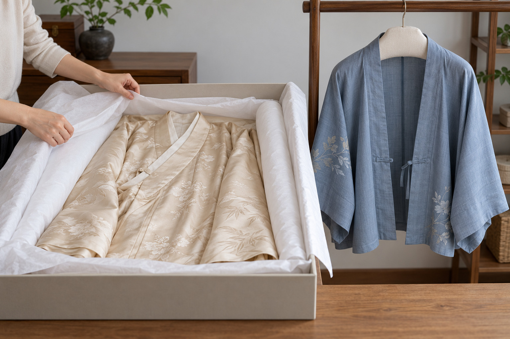

# 第24章　清洁、收纳与长期保存

一件衣服能穿多久，不只由缝得牢不牢决定。汗液、光照、摩擦、潮湿和反复折叠都会逐渐留下痕迹。护理首先要分清对象：今天新制的可穿衣物，依照生产者的洗护说明管理；古旧织物、收藏级服饰与出土衣物，需要保护人员评估，不能直接照搬家用洗衣经验。

## 成衣洗标比“汉服面料”四字具体

同一件衣服可能同时有面料、衬里、绣线、金属配件和黏合部件。即使主要成分相同，染料、整理和结构不同，也会带来不同护理要求。不能因为它叫“马面裙”，便推定它适合某个统一温度和洗涤程序。

先拍下洗标与成分表，保留商品说明。国际常用护理图示分别涉及水洗、漂白、干燥、熨烫与专业护理；水槽中的数字表示允许的最高洗涤温度，下方横线还涉及机械作用强度，并非只看温度便足够。[资料：GINETEX护理符号](https://www.ginetex.net/gb/labelling/care-symbols.asp)

标签缺失或说明互相矛盾时，向制作方核实。尤其注意“不能水洗”和“可以轻柔手洗”是不同指令。手洗也包含浸水与机械作用，不能把它当成对所有衣物都安全的折中办法。

## 把护理时间放到穿着前后

日常使用可建立一个简单记录：这件衣服何时穿过、接触过什么、何处容易脏、有没有处理过。进食、化妆、临时佩戴金属物件时，先留意衣物可能接触的位置。这样比事后对整件衣物进行强力清洁更容易控制变化。

脱下后先查看领缘、腋下、袖口、裙腰与下摆，比较有无新污迹、断线或附件松动。尚未完全干燥的衣物不急着入柜，按洗标允许的方式处理并充分干燥。染织品、刺绣和附件的变化常有各自节奏，整件“看着还新”并不表示每处都没有问题。

遇到不明污迹，先记录，不混用多种清洁剂反复试验。大面积水洗之前是否需要试验、怎样试验，应遵循该衣物的制作与洗护说明。网上一种去渍办法能够处理某件现代衣物，不足以证明它适合不同颜色、纤维和工艺的服饰。

## 日常衣物与馆藏织物的边界

加拿大文物保护研究所的纺织品保护资料指出，织物会受光照、环境和使用损耗影响，柔软的织物本身也需要合适支撑。这些原则帮助我们理解为什么展厅中的衣物不宜长期穿在真人身上，但不意味着家庭必须仿造博物馆全部设备。[资料：CCI《纺织品与服装的预防性保护》](https://www.canada.ca/en/conservation-institute/services/preventive-conservation/guidelines-collections/textiles-costumes.html)

古旧衣物最常见的误解，是“既然能穿，就能洗”。外表完整的纱线也可能已经脆弱；染色、早期修补与附着物又会影响处理。CCI专门针对无色织物的清洗说明仍要求先判断适用性，并明确将博物馆织物与现代使用织物区别处理。本书不将其中的保护操作改写成家庭洗古衣教程。[资料：CCI《无色织物的清洗》](https://www.canada.ca/en/conservation-institute/services/conservation-preservation-publications/canadian-conservation-institute-notes/washing-non-coloured-textiles.html)

如果一件衣物已经有收藏价值、年代信息或明显脆化，暂停试穿和自行清洗，保存现状与来源记录，比追求“洗得像新的一样”更有意义。

## 悬挂还是平放，看受力与重量

轻便、结构稳定且适合悬挂的现代衣物，可按其版型选支撑合适的衣架。不要仅用细带承受整件重衣，也别让窄硬衣架长期压出尖角。较重的裙子、钉缀物较多的衣物和脆弱衣物，则需要考虑更均匀的支撑。

平放也不等于随意塞进抽屉。先确认空间足够，再整理袖子、衣摆和带子，避免厚重饰件压在薄纱上。收藏保存中的平放方法强调对整片织物的支撑；可将这一受力思路用于理解储放选择，而具体材料和做法仍须按对象调整。[资料：CCI《纺织品基础护理》](https://www.canada.ca/en/conservation-institute/services/care-objects/textiles-costumes/basic-care-textiles.html)

日常衣物必须折叠时，避免总让同一位置承受又尖又紧的折线；已有定型褶则按商品说明整理，不为“保护”而随意拆开或重新压烫。衣物之间留出取放空间，往往比添加许多收纳用品更实用。

<!-- visual-study:photo-modern-storage -->

**上身观察｜现代成衣收纳：支撑肩部与折处。** 左边用平放与折处支撑分散受力，右边用加垫衣架支撑肩部。先按衣物状况选择方法，不把所有袍裙一律吊挂。

**图像性质与边界：** AI 生成的现代成衣护理展示，非文物修复操作记录。左为平放/柔软支撑思路，右为加垫衣架思路；盒纸材质、酸碱性、衣物纤维和耐久性无法靠生成图鉴定。具体护理仍服从洗标与材料情况。

**依据与支持特征：** [加拿大文物保护研究所《Caring for textiles and costumes》：Storage](https://www.canada.ca/en/conservation-institute/services/preventive-conservation/guidelines-collections/textiles-costumes.html)：尽量减少折叠、为折处提供柔软支撑、使用加垫衣架；脆弱、重饰或斜裁衣物更宜平放。

<!-- /visual-study:photo-modern-storage -->

## 长期保存需要检查，而非一封了之

选一个避开长期直晒、不靠近渗水源、便于定期查看的位置。透明袋方便看见内容，但不能替代避光；密封也不自动等于防潮。长期存放前，检查衣物与储放空间是否干净、干燥，并将不同附件分开支撑。

每隔一段时间检查一次折线、衣架承重点、金属附件附近和容器底部，日期写在记录中。发现霉迹、虫害或明显脆化时，先将对象与其他衣物分开，避免在居室中反复抖动；收藏衣物的处理应咨询保护人员。不要用香味掩盖异味，再把衣物放回原处。

保存还包括信息。保留设计者、制作时间、成分、洗标和修补记录，下一次清洁或转交时都能减少误判。没有这些资料，日后看到一块发黄织物时，很难分辨是原有色彩、使用痕迹还是处理造成的变化。

## 为一件现代衣物建立护理卡

护理卡可以只写一页：购入或制作日期、主要纤维、洗标照片、附件种类、已知易褪色部位，以及每次实际处理。第一次清洁后，比较关键尺寸、颜色和褶线，有变化就如实记录。若送交专业清洁，也把你知道的材料、旧污迹与过去处理告诉对方，不只留下“这是汉服”的概括。

修补同样值得记录。更换一枚扣子、重新缝牢一条带子，可能使今天的穿用更稳定；对现代衣物，实用修补本就是正常生命周期的一部分。对有历史价值的旧衣，处理目标和材料选择却不同，不能因为现代新衣修补顺利，就把同一办法直接用于旧物。

**观察练习：**选一件常穿衣物与一件较少穿的衣物，分别记录它们的重量感、附件、洗标和主要受力点，据此决定储放方式。随后检查储放空间是否真能满足这些条件。

## 本章资料

- [GINETEX：护理符号与说明](https://www.ginetex.net/gb/labelling/care-symbols.asp)
- [CCI：纺织品与服装的预防性保护](https://www.canada.ca/en/conservation-institute/services/preventive-conservation/guidelines-collections/textiles-costumes.html)
- [CCI：无色织物的清洗](https://www.canada.ca/en/conservation-institute/services/conservation-preservation-publications/canadian-conservation-institute-notes/washing-non-coloured-textiles.html)
- [CCI：纺织品基础护理](https://www.canada.ca/en/conservation-institute/services/care-objects/textiles-costumes/basic-care-textiles.html)
