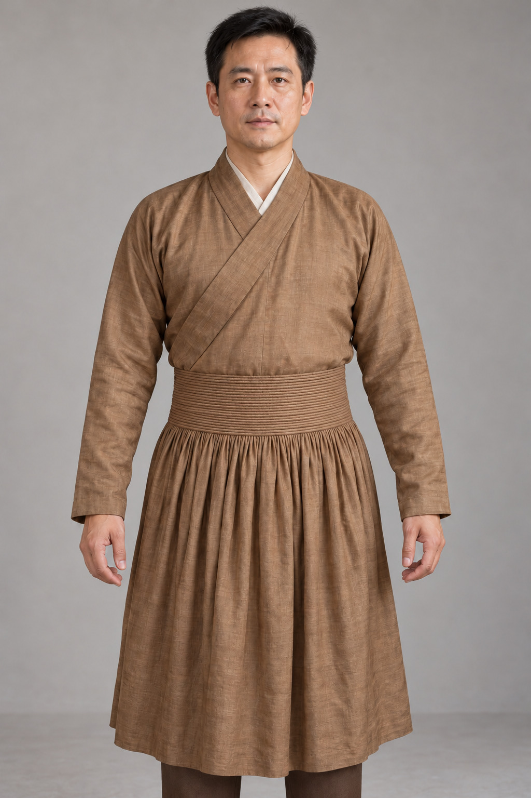

# 第25章　相邻传统与跨文化比较

交叠的衣襟、长裙、宽袖和束带，出现在不止一种衣着传统中。相似可能与传播有关，也可能与共同的材料条件或身体需求有关。要从“看着像”进一步走到历史解释，必须把具体对象、时间和传播证据带入比较。

## 比较什么，先把尺度说清

“汉服”“和服”“韩服”都是范围较大的名称，内部包含时代、性别、身份和场合差异。不能用一个唐代女俑，代表全部汉服；再用一套20世纪礼仪服饰，代表另一个传统，然后宣布两者的固定区别。

更稳妥的比较，是先限定到能核对的对象：例如某件宋代直领对襟上衣，与一件有年代记录的朝鲜半岛上衣；或某件明代袍服，与某件江户时代小袖。年代不必完全相同，但必须把不同处标出来，否则形式差异很容易被误读成一成不变的民族特征。

比较可按五个维度展开：身体怎样进入衣物；前片怎样闭合；腰部怎样固定；袖子怎样与衣身相连；织物怎样形成装饰。先观察这些具体关系，再讨论名称和审美。仅凭领襟方向识别整套服饰，证据太少。

## 韩服：熟悉组合中的自身变化

韩国国立民俗博物馆的介绍将女子韩服的基本组合说明为上衣jeogori与裙chima，并介绍用于系结的goreum。它为我们提供了一组可以逐件辨认的词汇，而不是一个只有轮廓的“高腰裙”形象。[资料：韩国国立民俗博物馆《Women's hanbok》](https://www.nfm.go.kr/k-box/ui/hanbok/female?lang=en)

英国V&A的专题又说明，韩服是涵盖长期变化的总称，袖长、宽度、廓形和折褶都曾改变；其馆藏中也有现代设计作品。因此，今天常见的短上衣与丰阔裙组合，不能直接倒推到所有历史时期。[资料：V&A《Hanbok – traditional Korean dress》](https://www.vam.ac.uk/articles/hanbok-traditional-korean-dress)

与汉服材料比较时，可问上衣长度、领缘、系结位置和裙腰支持方式如何相互配合。若只有正面照片，就暂时不评价背部裁剪；若比较对象是现代改良作品，应把设计年代一起写上。这样既能观察联系，也能尊重各自的长期发展。

## 和服：整体轮廓背后也有商业与生活变化

大都会艺术博物馆“Kimono Style”展览围绕18世纪末至20世纪初的和服变化展开，涉及小袖、布店向百货商店的转变以及现代设计。它提示我们，传统服饰同样受到消费与传播方式的塑造。[资料：大都会艺术博物馆2022年展览说明](https://www.metmuseum.org/de/press/exhibitions/2022/kimono-style)

比较时，可以观察衣身的直线构成、袖与躯干的连接、穿着时怎样处理腰部余量，而不只看是否佩戴宽带。对一件实际衣物，还要结合平铺图与穿着图：平面轮廓相近的衣物，穿在身体上可能因固定方式而产生不同体量。固定位置看似相近的衣物，也未必使用同一种裁剪。

把和服只理解为古代中国衣物的静止保存，或把两者说成全无历史联系，都会使比较变窄。具体的传播与再创造，要由某一时期的文献、实物和制度材料来说明，不能以一句起源口号包办。

## 中国境内的相邻传统同样重要

汉服研究涉及中国历史，却不能把中国所有时代、地区和族群衣物一律收进同一种形制。辽金元的衣着交流、清代宫廷与民间的不同系统，都需要保留各自身份。故宫藏清乾隆蓝色簟锦纹夹袍，具有圆领、右衽、马蹄袖和四开裾；它适合作为具体清宫服饰研究，不能仅凭右衽就改称某件明代袍服的延续款。[资料：故宫藏品页](https://www.dpm.org.cn/collection/embroider/230601.html)

同样，刺绣、织锦、盘扣和云纹也不是只服务一种衣着的符号。工艺与纹样可以跨地区流动，使用者又会改变位置、尺度和意义。若要说明某种纹样的传播，最好追踪有日期的织物，而不是把今天购买的两件印花衣服当成历史链条的两端。

<!-- visual-study:model-yuan-bianxian -->

**上身观察｜辫线袍类型试制：横向腰线与下裳细褶。** 同样是交领右衽，也不能只凭领襟就把这件蒙古衣着传统相关的元代类型归入明代袍服。比较需保留具体年代、出土背景和研究中的族群语境；本图不代替韩服或和服样例。

**图像性质与边界：** AI 生成的类型层面试制展示，非史料，非梳妆楼原物的逐件复制。 仅承诺右衽、窄袖、横向密集腰线与纵向细褶的关系；不以图中可数行数对应原物53条或重建九纽位置。 发型、颜色、内衬及裤为简化补足。没有画日月、金乌或月兔，也不推断质孙制度身份。 真实辫线的材料、编结与手针钉缀应查实物/研究图，不由生成的表面条纹来证明。

**依据与支持特征：** [郑瑶、刘大玮《元代土黄色斜纹绸辫线袍》，中国社会科学网/社科院专刊，2026-10-20](https://www.cssn.cn/skgz/bwyc/202610/t20261020_6074107.shtml)：梳妆楼M1实物的交领右衽、窄袖、上下分裁、腰缀辫线与下裳密褶。已查看刊载的整体实物及显微细节图。原物53条腰线与腋侧9纽是文献中的具体数据，不声称生成图逐项复制。 [中国丝绸博物馆《辫线袍》](https://www.chinasilkmuseum.com/zggd/info_21.aspx?itemid=1848)：只辅助其类型定义：交领右衽、窄袖、宽下摆、紧束腰部与钉缀辫线。该件仅存左肩，不拿它证明完整腰身。

<!-- /visual-study:model-yuan-bianxian -->

## 影响、挪用与当代设计要分别讨论

历史传播讨论的是证据；当代设计还涉及创作者如何解释来源、怎样使用具体作品。借鉴某种衣物构造、使用传统共享纹样、复制一件当代设计，并不是同一件事。判断时要把对象与行为说清，避免以宽泛的文化名称替代事实。

大都会2015年“中国：镜花水月”将中国艺术与西方时装想象并置。它可以作为研究跨文化视觉转译的案例，却不能把展出的时装当成古代中国人的真实日常衣着。[资料：大都会展览简介](https://www.metmuseum.org/exhibitions/listings/2015/china-through-the-looking-glass/description)

这也适用于影视与游戏：一件作品可能准确引用某个纹样，却重新设计整套结构。承认设计的创造，不需要同时赋予它未经证实的历史身份。

## 让比较产生新问题

一次有效比较不必得出谁更优越。它可以使我们发现：原来衣带不仅是装饰，还改变了衣物受力；原来同样的丝料，因组织和整理不同呈现了不同体量；原来现代活动中的传统服饰，也在适应新的身体经验和公共空间。

## 语言相似也需要核对对象

汉字文化圈中存在同字或相近词汇，但同一个字进入不同语言、不同制度后，所指未必完全一致。译名也会简化差异。例如把多种长衣都译成“袍”，方便初步阅读，却不能证明它们具有相同领襟和裁剪。比较笔记宜同时保留原名、机构译名与自己的结构描述。

一条可靠的影响链，还需说明通过什么媒介发生：实物赠赐、制度借鉴、贸易材料、工匠流动或图像传播，可能带来不同层次的变化。只发现两个图案相似，最多构成继续调查的起点。若缺少中间证据，可以写“存在形式相似，传播关系待考”，不必在完全独立和直接复制之间强行二选一。

**观察练习：**找两件有机构藏品页的衣物，建立一张只含年代、地区、用途、领襟、袖身连接和固定方式的表。未知项目写“资料未示”。完成以后，再描述三项相似与三项不同，并说明哪些只是观察，哪些已有历史解释支持。

## 本章资料

- [韩国国立民俗博物馆：Women's hanbok](https://www.nfm.go.kr/k-box/ui/hanbok/female?lang=en)
- [V&A：Hanbok – traditional Korean dress](https://www.vam.ac.uk/articles/hanbok-traditional-korean-dress)
- [大都会艺术博物馆：Kimono Style展览说明](https://www.metmuseum.org/de/press/exhibitions/2022/kimono-style)
- [故宫博物院：蓝色簟锦纹暗花绸夹袍](https://www.dpm.org.cn/collection/embroider/230601.html)
- [大都会艺术博物馆：中国：镜花水月](https://www.metmuseum.org/exhibitions/listings/2015/china-through-the-looking-glass/description)
