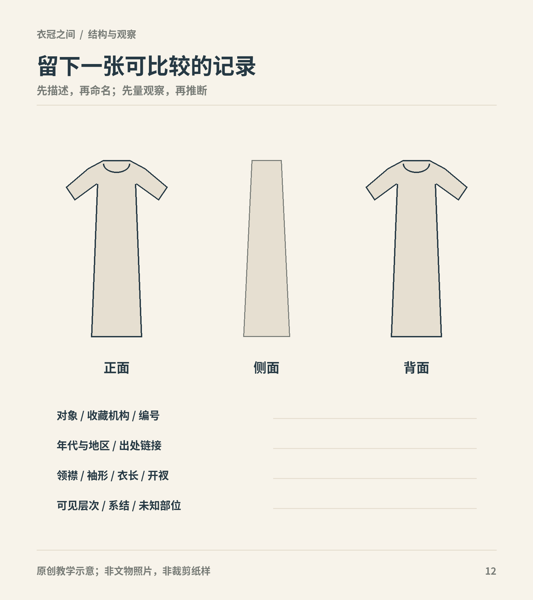

# 第26章　建立自己的衣冠观察记录

读到这里，不必先记住所有服名。更有用的收获，是面对一件陌生衣物时，知道怎样逐步看清它，又知道哪里仍然不能下结论。衣冠知识并非完成一张分类表就结束；新的发掘、修复与研究，还会改变我们对旧对象的理解。

图｜正侧背观察与来源、年代、结构、层次、未知项可合并记录，便于不同对象之间比较。 轮廓仅提供记录位置，不指向特定历史服装；不要用模板补画实际不可见的部位。 原创教学示意。

## 从一件对象开始

第一次做记录，选资料较完整的一件，不求最华丽。机构藏品页如果有明确名称、时代、材质与多视图，通常比只有一张转发照片更适合练习。记录原名与编号，也记下网页题名、机构和查阅日期。网页改版后，编号与题名仍有助于重新寻找对象。

故宫的蓝色簟锦纹暗花绸夹袍就有文物号、正背面及局部图，适合练习多视角核对；它的名称还同时包含颜色、纹样、织物和衣物类型，正好可以拆开阅读。[资料：故宫藏品页](https://www.dpm.org.cn/collection/embroider/230601.html)

把对象身份固定下来之后，再开始描述，不急着寻找“同款”。网上相似图可能来自不同藏品，也可能是同一件衣物在不同展陈、光线和修复状态下的照片。名称相近不保证对象相同，颜色相近也不能替代编号。

## 用三栏分开不同性质的信息

| 记录栏 | 应写什么 | 例子 |
| --- | --- | --- |
| 直接观察 | 当前照片或实物中可见的细节 | 前面左右衣片相接，边缘有窄条 |
| 来源提供 | 机构或报告明确给出的信息 | 馆方定年、面料鉴定、出土地点 |
| 解释与疑问 | 自己的推断，以及需要核实的问题 | 窄条是否为后来补配？固定点在哪里？ |

三栏不要求同样长。对于被遮住的部位，“看不见”就是完整而有价值的记录。不要为了填满表格，给不明的内层加上名称。若采用别人的解释，写明提出者与出处，别把它悄悄移入直接观察栏。

## 让观察有固定顺序

可先看整体，再沿头部、领襟、肩袖、腰部、下摆和足部依次移动。对平放衣物，则从外轮廓转到接缝、缘边、固定件和局部织物。每次只处理一层信息：第一次辨结构，第二次看装饰，第三次核对文字。

例如国丝的明初三件套资料，同时包含内外层、长短袖、不同织物和系带。若一开始只被绣花吸引，很容易忽略外层腋下的开衩；若只追求判定裙名，又可能漏掉上衣之间的覆盖关系。[资料：国丝绢短袖衫、绮长袖衫与绢裙](https://www.chinasilkmuseum.com/zggd/info_21.aspx?itemid=1870)

可以画线稿，但注明线条的性质。清楚可见的边界用实线，被遮挡而推测的连接用虚线，完全未知的部分留空。这里的绘图是一种记录方法，不能因为画得完整，就升级成已经验证的裁剪图。

## 一次只提出一个可回答的问题

“古人怎样穿衣”太大，“这件上衣的两条带子固定在哪里”则较具体。把问题缩小后，才知道应寻找哪类资料：固定装置需要内外侧和局部图，穿着组合需要成组衣物或同期图像，颜色判断还要考虑保存与摄影条件。

找到新资料以后，先检查它能否回答原问题。后世摹本能补充图像传统，却不一定替代原时代材料；现代复原能展示一种可行方案，却不能单独证明历史上只有这一种方案。答案暂时不足时，保留问题，继续寻找，比强行得出结论更有收获。

## 把复原当成需要说明的过程

国丝北朝绞缬绢衣的修复介绍同时提供文物信息、局部观察和复原线图。这类资料值得细读，因为它能让我们区分原件现状、保护工作与结构解释。[资料：国丝《北朝绞缬绢衣的保护修复》](https://www.chinasilkmuseum.com/gskt/info_319.aspx?itemid=27772)

观看复原展示时，可列四个问题：依据是什么；缺失部分如何处理；材料替代了什么；哪些穿用关系经过验证。提出这些问题并不是否定复原，而是理解它的知识贡献。一个清楚标明推定的方案，往往比完全不交代依据的“百分百还原”更容易讨论。

## 建立自己的小型资料夹

不必一次收集几千张图。先选十件分属不同年代、性别与证据类型的对象，每件保存一页记录即可。文件名可用“时代—机构—编号”，图注保留对象名称；网页另存或截图只供个人研究时，也不要删掉来源信息。准备公开传播图片之前，再核对机构授权与使用条件。

资料夹可以分成实物、图像、制度文本和现代实践四类。分类是为了提醒自己证据来源不同，并不禁止它们互相参照。将当代商品说明放入现代实践，有助于观察今天如何命名和使用历史元素，但不能让它替代考古报告。

每月回看一次旧记录，写下新增来源和改动原因。这样就能看到自己的判断如何变化，也减少同一个错误反复进入笔记。修订不是学习失败，恰好说明记录正在接受证据检验。

## 三条可以继续走的路线

喜欢历史，可以选定一个地区与时间范围，比较同阶段男女、官民和不同场合；喜欢结构，可以先研究一组衣物的领襟、接缝和固定方式，再学习制作；喜欢材料，则从纤维、组织、染色和织绣工艺出发，观察它们怎样影响衣物形态。

三条路线最终会相遇。一件衣服既属于某个社会，也由具体材料和工艺制成，还必须与身体相处。能把这三层关系连接起来，便比单独认出一个服名更接近衣冠的真实生活。

**最后一次观察：**重新打开最初吸引你的汉服照片，分别写一段外观描述、一段有来源的历史说明和一段尚待核实的问题。保留它们的区别，也保留自己的兴趣。衣服的细节越清楚，历史就越不容易被一张漂亮的图像代替。

## 本章资料

- [故宫博物院：蓝色簟锦纹暗花绸夹袍，多视图与文物号](https://www.dpm.org.cn/collection/embroider/230601.html)
- [中国丝绸博物馆：绢短袖衫、绮长袖衫与绢裙](https://www.chinasilkmuseum.com/zggd/info_21.aspx?itemid=1870)
- [中国丝绸博物馆：北朝绞缬绢衣的保护修复](https://www.chinasilkmuseum.com/gskt/info_319.aspx?itemid=27772)

本章三栏记录、提问顺序与资料夹组织为作者提出的学习方法；上列机构资料作为可练习的具体案例。
